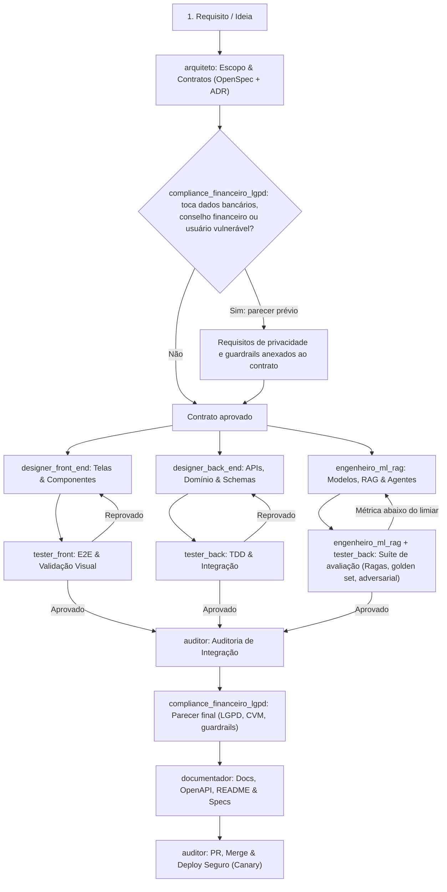

# 🤖 Sistema de Agentes Autônomos — Squad PANDORA

Este documento define a governança, os papéis, as regras operacionais e o fluxo de trabalho do time de agentes de IA que **desenvolve** o PANDORA. Ele é baseado no sistema *Agents & Skills* (squad de 7 agentes) e acrescenta dois agentes de domínio exigidos por um produto financeiro com IA.

> Não confundir com os **agentes do produto** (Orquestrador, Estrategista de Dívidas, Guardião…), que rodam dentro do PANDORA para o usuário final. Eles estão descritos em [`docs/04-agentes-ia.md`](docs/04-agentes-ia.md).

---

## 👥 Papéis e Atribuição de Skills

| Agente | Arquivo de Definição | Foco Principal | Skills Chave |
| :--- | :--- | :--- | :--- |
| **`arquiteto`** | `.agents/agents/arquiteto.md` | Escopo, governança, ADRs, contratos, validação de etapas. | `openspec-propose`, `openspec-explore`, `architecture-decision-records`, `contract-first`, `gateguard`, `delivery-gate`, `product-lens` |
| **`designer_front_end`** | `.agents/agents/designer_front_end.md` | PWA Next.js, dashboards financeiros legíveis, voz/upload acessíveis. | `impeccable`, `design-taste-frontend`, `dashboard-builder`, `nextjs-turbopack`, `motion-ui`, `frontend-a11y`, `react-patterns` |
| **`designer_back_end`** | `.agents/agents/designer_back_end.md` | FastAPI hexagonal, modelagem de dados, integrações bancárias, segurança. | `fastapi-patterns`, `python-patterns`, `hexagonal-architecture`, `api-design`, `postgres-patterns`, `redis-patterns`, `database-migrations`, `security-review` |
| **`engenheiro_ml_rag`** 🆕 | `.agents/agents/engenheiro_ml_rag.md` | Modelos de ML, RAG, grafo multiagente (LangGraph), gateway de LLM, avaliação. | `mle-workflow`, `pytorch-patterns`, `iterative-retrieval`, `eval-harness`, `agent-eval`, `cost-aware-llm-pipeline`, `council-multi-model` |
| **`compliance_financeiro_lgpd`** 🆕 | `.agents/agents/compliance_financeiro_lgpd.md` | LGPD, limites BCB/CVM, segurança de agentes, proteção de usuários vulneráveis. | `security-review`, `security-scan`, `safety-guard`, `llm-trading-agent-security`, `delivery-gate` |
| **`tester_front`** | `.agents/agents/tester_front.md` | E2E, componentes, inspeção visual e a11y. | `webapp-testing`, `e2e-testing`, `browser-qa`, `frontend-a11y`, `safe-debug` |
| **`tester_back`** | `.agents/agents/tester_back.md` | TDD (pytest), contratos de API, regressão de IA, carga. | `test-driven-development`, `tdd-workflow`, `python-testing`, `ai-regression-testing`, `benchmark`, `security-scan` |
| **`auditor`** | `.agents/agents/auditor.md` | Integração front-back, PRs, merges e deploy seguro. | `verification-loop`, `openspec-verify-change`, `git-workflow`, `github-ops`, `deployment-patterns`, `docker-patterns`, `canary-watch` |
| **`documentador`** | `.agents/agents/documentador.md` | Docs vivas, Mermaid, OpenAPI, READMEs, contexto para IDEs/agentes. | `write-openspec-docs`, `draft-openspec-docs`, `codebase-onboarding`, `living-docs-governance`, `article-writing` |

Só as skills referenciadas pelos agentes estão versionadas em `.agents/skills/`. Os workflows OpenSpec (`/opsx-*`) estão em `.agents/workflows/`.

---

## 🔄 Fluxo de Trabalho Integrado (Pipeline de Execução)

---

## 🛡️ Regras Invioláveis do Squad

1. **Nenhum código sem contrato**: front, back e ML só começam depois que o `arquiteto` definir interfaces, contratos de API e o modelo de dados.
2. **Portão de Testes Bloqueante**: nada avança com teste quebrado, regressão ou métrica de IA abaixo do limiar registrado.
3. **Desacoplamento Obrigatório**: regra de negócio isolada de banco, framework e **provedor de LLM** (arquitetura hexagonal + gateway de LLM).
4. **Padrão Impeccable no Front-End**: nada de "AI template look". Todo componente tem estados de carregamento, vazio e foco acessível.
5. **Documentação Viva**: todo PR mergeado vem com a atualização dos documentos pelo `documentador`.
6. **Privacidade por Padrão** 🆕: nenhum dado pessoal sai do perímetro sem mascaramento. Nenhum segredo ou dado real de usuário no repositório; só dados sintéticos ou sandbox.
7. **Sem Conselho Regulado** 🆕: o PANDORA não recomenda produtos de investimento específicos e não executa transações. Toda afirmação sobre direitos ou normas cita a fonte.
8. **Evidência antes de opinião** 🆕: toda decisão técnica relevante vira ADR em [`docs/adr/`](docs/adr/) com alternativas e justificativa, como exige o Challenge.
