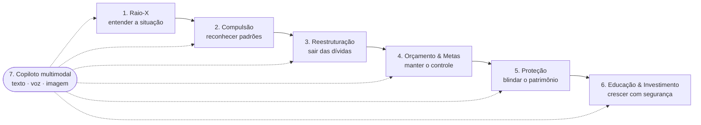
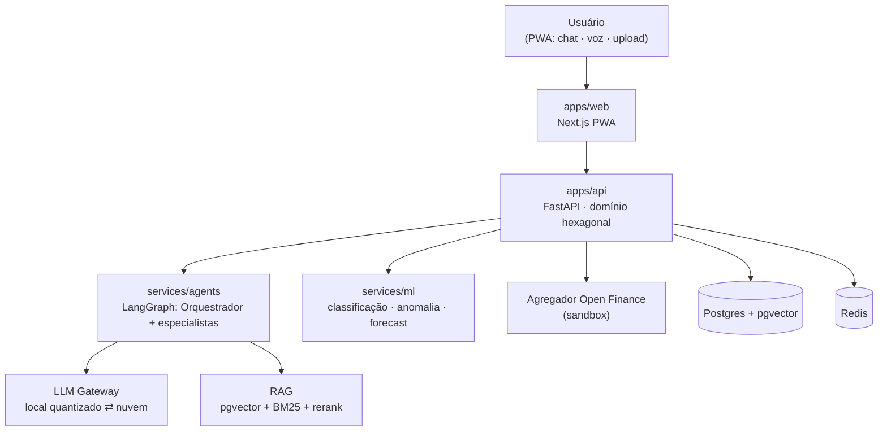

# PANDORA

**Copiloto de IA para sair das dívidas, controlar gastos compulsivos e reconstruir a vida financeira.**

> Challenge 2 · CBL · Big Idea **Qualidade de Vida**: *"Empoderando pessoas com IA para compreender melhor, decidir melhor e viver melhor."*
> Tema do grupo: **Finanças**.

## Essential Question

> **Como agentes de IA, apoiados em evidências confiáveis, podem ajudar pessoas endividadas ou com comportamento financeiro compulsivo a recuperar o controle das finanças e, com isso, a qualidade de vida?**

Dívida e compulsão financeira não são só um problema de planilha: elas afetam sono, saúde mental, relações e trabalho. O PANDORA parte do problema (ver [docs/01](docs/01-problema-e-essential-question.md)) e só depois propõe a solução: um sistema multiagente que lê a vida financeira real do usuário, explica o que está acontecendo, monta um plano de saída e protege o que ele já conquistou.

## A jornada

| # | Módulo | O que entrega |
|---|---|---|
| 1 | **Raio-X Financeiro** | Conexão bancária (Open Finance via agregador em sandbox) ou upload de extrato, classificação de transações, mapa de dívidas, score de saúde financeira |
| 2 | **Detector de Compulsão** | Identifica apostas (bets), impulso e padrões de risco, com linguagem acolhedora e encaminhamento para apoio |
| 3 | **Plano de Reestruturação** | Priorização de dívidas, simulação de renegociação, guia da Lei do Superendividamento (14.181/2021) |
| 4 | **Orçamento & Metas** | Orçamento adaptativo, previsão de fluxo de caixa, metas com nudges |
| 5 | **Proteção de Ativos** | Antifraude/golpes, travas e autoexclusão, reserva de emergência, impenhorabilidade |
| 6 | **Educação & Investimento** | Perfil de investidor, trilha educacional com RAG sobre fontes oficiais, simuladores, **sem recomendação de produto** |
| 7 | **Copiloto PANDORA** | Chat multimodal (texto, voz, foto de boleto/print) com respostas citando as fontes |

Detalhes, prioridades (MoSCoW) e histórias de usuário estão em [docs/02-features.md](docs/02-features.md).

## Arquitetura em uma imagem

Visão completa em [docs/03-arquitetura.md](docs/03-arquitetura.md).

## Stack

| Camada | Tecnologia |
|---|---|
| Front-end | Next.js (PWA), TypeScript, Web Speech / STT |
| Back-end | Python, FastAPI, Pydantic, arquitetura hexagonal |
| IA | LangGraph (multiagente), LLM Gateway provider-agnostic, modelo local quantizado + LLM em nuvem ([ADR-0003](docs/adr/0003-selecao-llm.md), **em aberto**) |
| ML | scikit-learn / gradient boosting, Isolation Forest, Prophet/ETS |
| Dados | Postgres + pgvector, Redis, object storage |
| Infra | Docker, deploy em container na nuvem, dados sandbox/sintéticos |

## Documentação

| Documento | Conteúdo | Semana |
|---|---|---|
| [01 · Problema e Essential Question](docs/01-problema-e-essential-question.md) | Problema, stakeholders, personas, evidências | 1 |
| [02 · Features](docs/02-features.md) | Módulos, MoSCoW, histórias de usuário | 1 |
| [03 · Arquitetura](docs/03-arquitetura.md) | Camadas, multiagente, RAG, gateway, segurança | 2–6 |
| [04 · Agentes de IA do produto](docs/04-agentes-ia.md) | Papéis, ferramentas, guardrails | 4–5 |
| [05 · Dados e integrações](docs/05-dados-e-integracoes.md) | Open Finance, ingestão, modelo de dados, LGPD | 1–2 |
| [06 · Riscos e métricas](docs/06-riscos-e-metricas.md) | Matriz de riscos, métricas, plano de avaliação | 1, 7 |
| [07 · Roadmap](docs/07-roadmap.md) | 7 semanas → entregáveis → agente responsável | todas |
| [Evidências (Notícias, Datasets e Artigos)](docs/evidencias/README.md) | Acervo estruturado que corrobora a importância do problema e alimenta ML/RAG | contínuo |
| [ADRs](docs/adr/) | Decisões técnicas justificadas | contínuo |
| [Registro grill-me](docs/grill-me-decisoes.md) | Perguntas e decisões da sessão de planejamento | 1 |

## Como o time trabalha

O desenvolvimento é conduzido pelo squad de agentes descrito em [AGENTS.md](AGENTS.md): os 7 agentes do sistema *Agents & Skills* (arquiteto, designers front/back, testers, auditor, documentador) mais dois agentes de domínio, `engenheiro_ml_rag` e `compliance_financeiro_lgpd`. As definições ficam em [`.agents/agents/`](.agents/agents/) e as skills em [`.agents/skills/`](.agents/skills/).

## Aviso

O PANDORA é um projeto acadêmico. Ele **não** é instituição financeira, **não** faz recomendação de investimentos (atividade regulada pela CVM) e **não** substitui atendimento jurídico, psicológico ou de saúde. Durante o desenvolvimento, usamos apenas dados sintéticos ou de sandbox.
