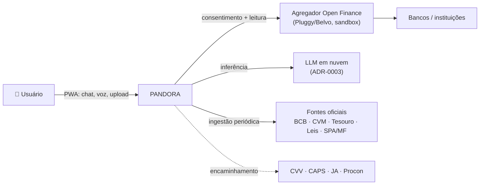
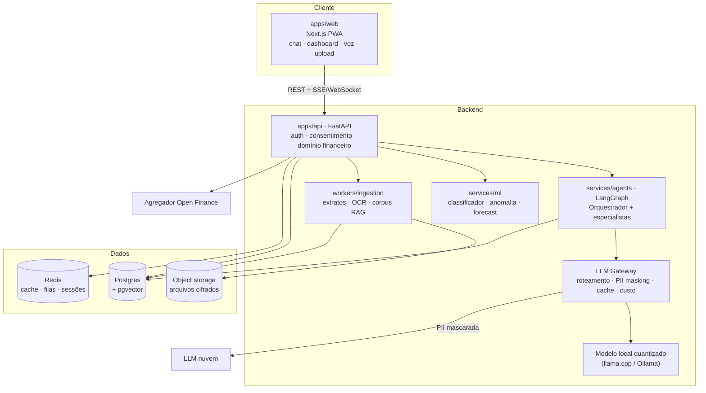
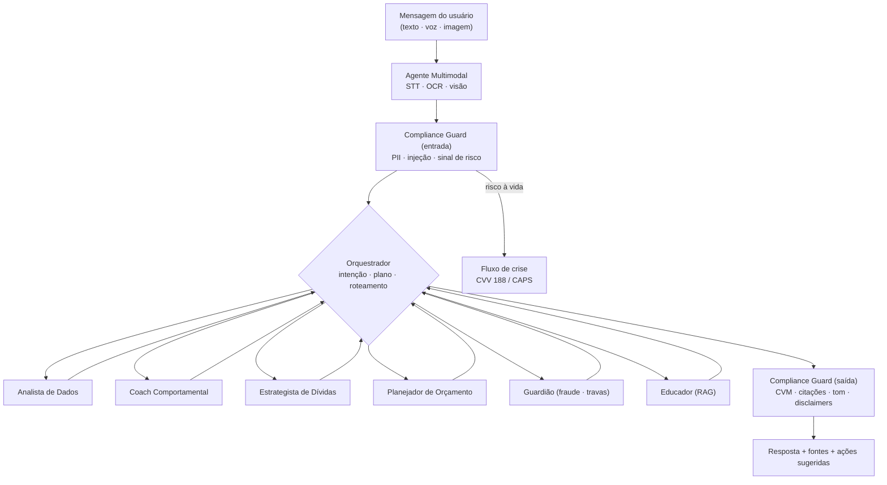
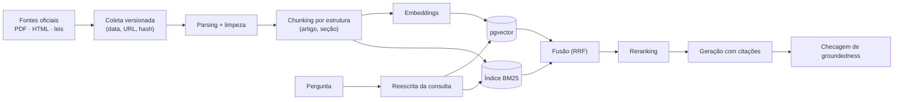
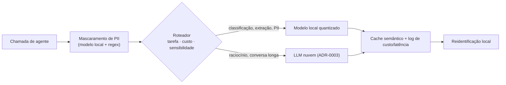

# 03 · Arquitetura

## 1. Princípios

1. **Hexagonal (ports & adapters):** regras financeiras e de domínio não conhecem banco, framework, agregador ou provedor de LLM.
2. **Determinístico onde dá, probabilístico onde precisa:** cálculos financeiros (juros, CET, priorização) são código testável; LLM só interpreta, explica e conversa.
3. **Evidência rastreável:** toda afirmação normativa vem do RAG com citação.
4. **Privacidade por padrão:** PII mascarada antes de sair do perímetro; o modelo local cuida do que é sensível.
5. **Provider-agnostic:** a escolha de LLM ([ADR-0003](adr/0003-selecao-llm.md)) pode mudar sem reescrever os agentes.

## 2. Contexto (C4 · Nível 1)



## 3. Containers (C4 · Nível 2)



### Estrutura do monorepo (proposta)

```
apps/
  web/                 # Next.js PWA
  api/                 # FastAPI
    domain/            # entidades e regras (Dívida, Transação, Plano, Meta)
    ports/             # BankDataPort, LLMPort, VectorStorePort, NotificationPort
    adapters/          # pluggy/, belvo/, ofx/, pgvector/, llm_gateway/
    application/       # casos de uso
services/
  agents/              # grafo LangGraph, ferramentas, prompts, guardrails
  ml/                  # treino, avaliação, artefatos versionados
workers/
  ingestion/           # parsers, OCR, pipeline do corpus RAG
evals/                 # golden sets, Ragas, testes adversariais
infra/                 # docker-compose, IaC, CI
docs/
```

## 4. Sistema multiagente (produto)

Padrão **supervisor + especialistas** com um **guardião transversal**. Detalhes de cada agente estão em [04-agentes-ia.md](04-agentes-ia.md).



- **Estado explícito** (LangGraph): perfil do usuário, fase da jornada, plano ativo, histórico resumido.
- **Ferramentas tipadas** (Pydantic): `get_transactions`, `get_debts`, `simulate_renegotiation`, `search_knowledge`, `check_bet_operator`, `analyze_scam_image`, `set_spending_lock`…
- **Nenhuma ferramenta movimenta dinheiro.** Ações com efeito (trava, notificação ao contato) exigem confirmação do usuário.
- As ferramentas podem ser expostas também via **MCP** para reuso e testes.

## 5. Pipeline RAG



- **Corpus:** BCB, CVM, Tesouro, Lei 14.181/2021, Lei 14.790/2023, CPC, LGPD, SPA/MF, Procon, padrões de golpe (FEBRABAN).
- **Metadados por chunk:** fonte, URL, data de coleta, vigência, tipo (lei/norma/guia).
- **Política de recusa:** se o contexto não sustenta a resposta, o agente diz que não sabe e indica o canal oficial.
- **Semana 3:** a mesma suíte de perguntas roda em *LLM puro* × *RAG* para medir o ganho ([06](06-riscos-e-metricas.md)).

## 6. LLM Gateway (híbrido local + nuvem)



- Interface única (`LLMPort`), implementada com LiteLLM ou uma camada própria.
- Telemetria por chamada: tokens, custo, latência, modelo, tarefa. Esses dados alimentam a decisão do ADR-0003.
- **A escolha final de provedor/modelo está em aberto** e será decidida por uma matriz de custo × facilidade de deploy × qualidade nas features reais.

## 7. ML clássico

| Modelo | Entrada | Saída | Baseline → evolução |
|---|---|---|---|
| Classificador de transações | descrição, valor, MCC, horário | categoria + confiança | regras/regex → gradient boosting/embeddings → LLM fallback |
| Detector de apostas | CNPJ/descrição, destino Pix | flag + evidência | lista SPA/MF → fuzzy match → classificador |
| Anomalia / impulso / fraude | série de transações | score + explicação | z-score → Isolation Forest |
| Previsão de caixa | histórico de saldo | saldo previsto 30/60/90d | média móvel → Prophet/ETS |

## 8. Segurança e LGPD

- Consentimento granular e revogável por fonte, com registro de finalidade.
- Tokens do agregador em cofre de segredos. Arquivos e campos sensíveis cifrados em repouso. TLS em trânsito.
- PII mascarada antes de qualquer chamada externa. Logs sem PII.
- Retenção mínima, exclusão sob demanda e trilha de auditoria de acessos.
- Testes de prompt injection via conteúdo de extratos, boletos e imagens.
- Detalhes em [05-dados-e-integracoes.md](05-dados-e-integracoes.md) e no agente [`compliance_financeiro_lgpd`](../.agents/agents/compliance_financeiro_lgpd.md).

## 9. Deploy

- **Local:** `docker-compose` (web, api, agents, ml, postgres+pgvector, redis, modelo local).
- **Nuvem:** containers em um provedor gerenciado (AWS/Render/Fly). O modelo local roda em uma instância dedicada ou é substituído por um endpoint gerenciado de modelo aberto, conforme o ADR-0003.
- **CI:** lint, testes, suíte de avaliação de IA com limiares bloqueantes, scan de segredos.
