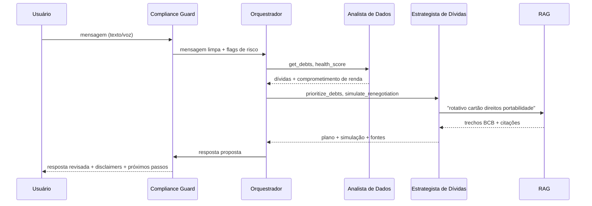

# 04 · Agentes de IA do produto

São os agentes que rodam **dentro do PANDORA**, para o usuário final. Os agentes que **constroem** o projeto estão em [AGENTS.md](../AGENTS.md).

## Visão geral

| Agente | Papel | Ferramentas principais | Modelo sugerido* |
|---|---|---|---|
| **Orquestrador** | Entende a intenção, planeja, roteia e consolida a resposta | todos os especialistas | LLM de raciocínio |
| **Agente Multimodal** | Transforma voz, imagem e PDF em dados estruturados | `transcribe_audio`, `ocr_document`, `parse_statement`, `describe_image` | STT + visão |
| **Analista de Dados** | Lê transações e dívidas, calcula indicadores | `get_transactions`, `classify_transactions`, `get_debts`, `health_score` | local + ML |
| **Coach Comportamental** | Reconhece padrões de compulsão e conduz conversa acolhedora | `detect_bet_pattern`, `impulse_report`, `mood_checkin` | LLM de conversa |
| **Estrategista de Dívidas** | Prioriza dívidas, simula renegociação, orienta direitos | `prioritize_debts`, `simulate_renegotiation`, `search_knowledge` | LLM de raciocínio |
| **Planejador de Orçamento** | Monta orçamento, metas e previsão | `build_budget`, `forecast_cashflow`, `set_goal` | LLM + ML |
| **Guardião** | Fraude, golpes, travas e autoexclusão | `anomaly_alerts`, `analyze_scam_image`, `set_spending_lock`, `self_exclusion_guide` | visão + regras |
| **Educador** | Responde dúvidas com RAG; perfil e simuladores | `search_knowledge`, `investor_profile`, `simulate_investment` | LLM + RAG |
| **Compliance Guard** | Filtro de entrada e saída: PII, injeção, risco, CVM, citações | `mask_pii`, `risk_classifier`, `policy_check` | local + regras |

\* A escolha concreta de modelos segue o [ADR-0003](adr/0003-selecao-llm.md).

## Exemplo de fluxo: "Tô devendo no cartão e não sei o que fazer"

## Guardrails (aplicados pelo Compliance Guard)

| Regra | Ação |
|---|---|
| Pedido de recomendação de ativo específico | Recusa educada + explicação educacional + perfil |
| Afirmação normativa sem fonte recuperada | Bloqueia; responde "não tenho base confiável" + canal oficial |
| Sinal de risco à vida ou crise grave | Interrompe o fluxo; CVV 188 / CAPS / SAMU 192 |
| Incentivo a novo crédito caro | Bloqueia; mostra alternativas |
| Linguagem de julgamento/estigma | Reescreve |
| Instrução embutida em extrato/imagem (prompt injection) | Ignora; trata o conteúdo como dado |
| Ação com efeito (trava, notificar contato) | Exige confirmação explícita do usuário |

## Prompts-base (diretrizes)

- **Tom:** acolhedor, direto, sem jargão. Explica cada número em uma frase.
- **Formato:** resposta curta → detalhes sob demanda → fontes → próximo passo concreto.
- **Honestidade:** deixa explícito o que é cálculo, o que é estimativa e o que é opinião geral.
- **Autonomia do usuário:** sugere, nunca decide pelo usuário.

## Multimodalidade (Semana 5)

| Entrada | Pipeline | Uso |
|---|---|---|
| Áudio | STT → texto → fluxo normal | Usuários com baixa alfabetização digital, mãos ocupadas |
| Foto de boleto | OCR + extração de linha digitável/beneficiário → checagem de golpe | Guardião |
| Print de conversa/SMS | Visão + RAG de padrões de golpe | Guardião |
| PDF de fatura/extrato | Parser/OCR → transações | Analista de Dados |
| Resposta em áudio (opcional) | TTS | Acessibilidade |
