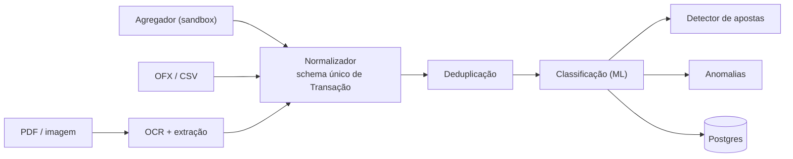
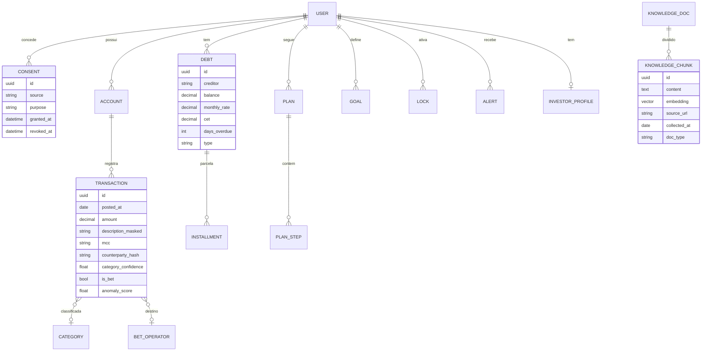

# 05 · Dados e integrações

## 1. Fontes de dados do usuário

| Fonte | Como | Status no projeto |
|---|---|---|
| Open Finance (via agregador) | Pluggy ou Belvo em **sandbox/trial**: conectores de teste com contas e transações fictícias | Must ([ADR-0002](adr/0002-dados-bancarios-sandbox.md)) |
| Upload OFX/CSV | Parser determinístico | Must |
| Upload PDF de extrato/fatura | Parser + OCR + extração assistida por LLM | Must |
| Foto de boleto / print | Agente Multimodal (OCR + visão) | Must |
| Entrada manual assistida | Formulário/conversa para dívidas fora do banco (agiota, loja, família) | Should |
| Dados sintéticos | Gerador baseado nas personas | Must (dev + avaliação) |

> **Por que não Open Finance direto?** Para acessar o Open Finance Brasil como receptor de dados é preciso ser uma instituição participante autorizada pelo Banco Central. Agregadores já autorizados (ou parceiros de instituições autorizadas) oferecem API e sandbox, o que viabiliza o projeto acadêmico sem licença própria.

## 2. Fluxo de ingestão

## 3. Modelo de dados (núcleo)

## 4. Dados externos de referência

| Dado | Fonte | Uso |
|---|---|---|
| Operadoras de apostas autorizadas | SPA/Ministério da Fazenda (lista pública) | Detector de apostas |
| Taxas médias de juros por modalidade | Banco Central (SGS / estatísticas de juros) | Comparar a taxa do usuário com o mercado |
| Selic, IPCA, CDI | Banco Central (SGS) | Simuladores |
| Normas e leis | Planalto, BCB, CVM | Corpus RAG |
| Padrões de golpe | FEBRABAN, BCB, Procons | Corpus RAG do Guardião |

## 5. LGPD: decisões de tratamento

| Princípio | Como aplicamos |
|---|---|
| Finalidade | Cada consentimento declara o propósito (diagnóstico, alerta, plano) |
| Necessidade | Coletamos só o necessário. Descrições de transação são mascaradas |
| Transparência | Tela "o que o PANDORA sabe sobre você" com exportação |
| Segurança | Cifragem em repouso, cofre de segredos, menor privilégio |
| Dados sensíveis | Dados sobre saúde (check-in de humor, sinais de compulsão) recebem consentimento específico |
| Eliminação | Exclusão completa sob demanda, inclusive de embeddings derivados |
| Transferência internacional | Chamadas a LLM fora do Brasil só com PII mascarada (fator do ADR-0003) |

## 6. Dados sintéticos

- Gerador baseado nas 4 personas ([01](01-problema-e-essential-question.md#4-personas)), com sazonalidade de salário, contas fixas, apostas, golpes e dívidas.
- Rótulos conhecidos (categoria, `is_bet`, `is_fraud`) permitem medir precisão e recall.
- Seeds versionadas em `evals/` para reprodutibilidade.
