# 07 · Roadmap (7 semanas)

O roadmap segue o deck do Challenge. Cada semana tem um entregável principal e agentes do squad responsáveis ([AGENTS.md](../AGENTS.md)).

```mermaid
gantt
    title PANDORA · Challenge 2
    dateFormat  X
    axisFormat  S%s
    section Fundamentos
    Problema, stakeholders, riscos, métricas :s1, 0, 1
    Base de conhecimento + 1º RAG           :s2, 1, 2
    LLM x RAG                               :s3, 2, 3
    section Inteligência
    Sistema multiagente                     :s4, 3, 4
    Multimodalidade                         :s5, 4, 5
    section Produto
    Integração completa                     :s6, 5, 6
    Testes, refinamento, relatório          :s7, 6, 7
```

| Semana | Foco (deck) | Entregável PANDORA | Agentes do squad |
|---|---|---|---|
| **1** | Problema, stakeholders, riscos e métricas | [01](01-problema-e-essential-question.md), [06](06-riscos-e-metricas.md), ADRs 0001/0002/0004, gerador de dados sintéticos, golden set v0, monorepo + CI | arquiteto, compliance_financeiro_lgpd, documentador |
| **2** | Base de conhecimento e recuperação | Corpus oficial coletado e versionado, pipeline RAG híbrido, `search_knowledge`, ingestão OFX/CSV + agregador sandbox | engenheiro_ml_rag, designer_back_end, tester_back |
| **3** | Comparação LLM x RAG | Experimento LLM puro × RAG com Ragas e juiz; gateway LLM com telemetria; **ADR-0003 decidido** | engenheiro_ml_rag, tester_back |
| **4** | Sistema multiagentes | Orquestrador + especialistas em LangGraph, Compliance Guard, classificador e detector de apostas, comparação agente único × multiagente | engenheiro_ml_rag, designer_back_end, compliance_financeiro_lgpd |
| **5** | Multimodalidade | Agente Multimodal: voz (STT/TTS), OCR de boleto/fatura, análise de print de golpe | engenheiro_ml_rag, designer_front_end, tester_front |
| **6** | Integração completa | PWA com Raio-X, plano, chat, travas; deploy em nuvem com dados sandbox; demo do MVP | designer_front_end, auditor, tester_front |
| **7** | Testes e refinamento | Testes adversariais, piloto com personas, relatório final, apresentação | tester_back, tester_front, documentador, auditor |

## Divisão sugerida para grupo de 3–5 pessoas

| Frente | Responsabilidade | Agentes de apoio |
|---|---|---|
| **Dados & Back-end** | Ingestão, agregador, domínio financeiro, API | designer_back_end, tester_back |
| **IA & ML** | RAG, agentes, modelos, avaliação, gateway | engenheiro_ml_rag |
| **Produto & Front-end** | PWA, UX acolhedora, voz, dashboards | designer_front_end, tester_front |
| **Pesquisa & Compliance** *(pode ser acumulada)* | Evidências, personas, LGPD, métricas de qualidade de vida, relatório | compliance_financeiro_lgpd, documentador |

## Critérios de pronto por semana

- Entregável demonstrável (não só código).
- Métricas da semana registradas em `docs/` ou `evals/`.
- ADRs atualizados para toda decisão nova.
- Docs sincronizados pelo `documentador`.
