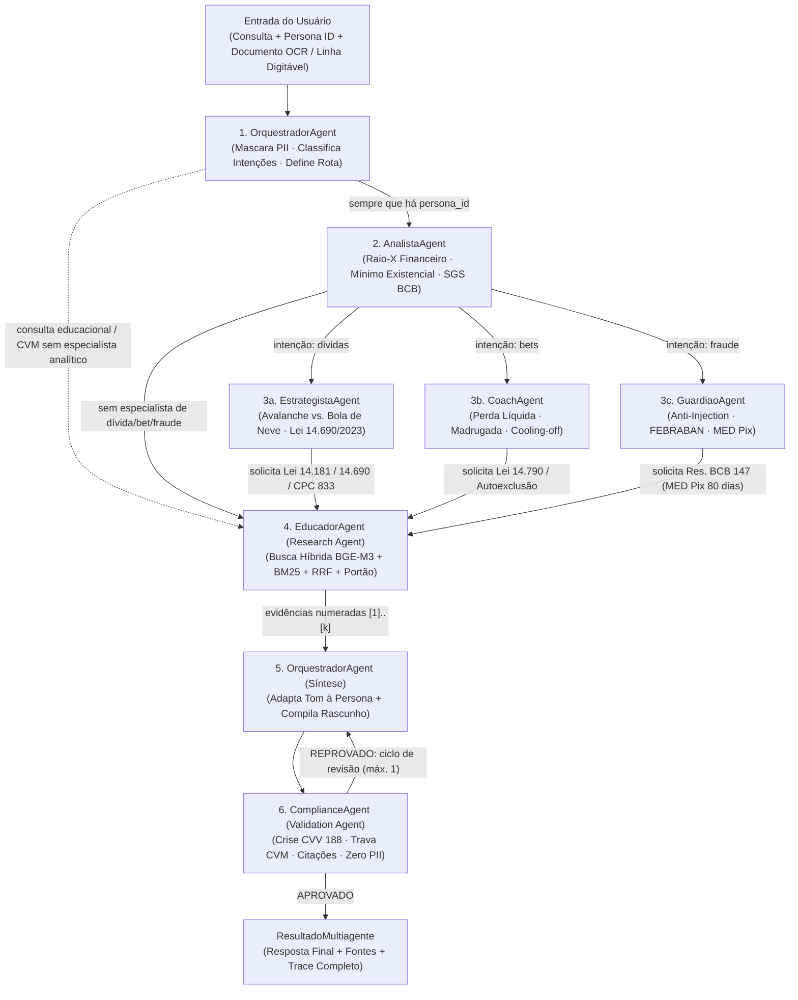

# 01 · Arquitetura do Sistema Multiagente

O sistema multiagente do **PANDORA** adota um **grafo de estado tipado (`GrafoPandora`)** em Python + Pydantic v2 integrado ao serviço `pandora_rag` (ver decisão formal em [`ADR-0001`](../adr/0001-arquitetura-multiagente-pandora.md)). Em vez de um agente monolítico com múltiplos *prompts*, cada competência crítica do domínio financeiro, comportamental, antifraude, normativo e regulatório é isolada em um agente especializado com contrato explícito.

---

## 1. Diagrama da Arquitetura dos Agentes

---

## 2. Arquitetura em Camadas e Invariantes (RNF01–RNF05)

A separação em camadas impede que um modelo de linguagem improvise matemática financeira, vaze dados pessoais ou seja sequestrado por texto malicioso em documentos:

| Camada | Componentes / Arquivos | Garantia Arquitetural |
|---|---|---|
| **1. Fronteira de Privacidade & Segurança** | `pandora_rag.generate.pii.mascarar` + `sanitizar_documento_nao_confiavel()` | **RNF01 (LGPD) & RNF05 (Anti-Injection):** CPF, CNPJ, e-mail, cartão e telefone são mascarados na entrada; textos OCR de boletos/prints passam por filtro de *prompt injection* e ficam encapsulados em `<documento_externo_nao_confiavel>`. |
| **2. Núcleo Determinístico** | [`agents/tools.py`](../../services/rag/src/pandora_rag/agents/tools.py) | **RNF03 (Exatidão = 0,00% erro):** Raio-X orçamentário, blindagem de 100% do Mínimo Existencial, simulação Avalanche vs. Bola de Neve, perda líquida em *bets* e dígito verificador Módulo 10 FEBRABAN rodam exclusivamente em funções Python puras e testadas unitariamente. |
| **3. Recuperação Normativa (RAG)** | `EducadorAgent` + `construir_retriever_padrao()` (`pgvector` → `corpus_local_bge_m3` → `corpus_embutido_oficial`) | **RNF04 (Anti-Alucinação):** Toda fundamentação legal sai do corpus oficial versionado com citações `[n]`, URL oficial e portão de abstenção (`score_rerank < 0.02`). |
| **4. Governança Ético-Regulatória** | `ComplianceAgent` (`specialists.py`) | **RNF02 (CVM) & Protocolo de Crise:** Bloqueia recomendações específicas de ativos (Recusa Educativa CVM), impõe o protocolo `CVV 188 / CAPS AD / JA` em sofrimento agudo e audita a presença de citações `[n]` e ausência de PII antes de liberar a resposta. |
| **5. Auditoria e Contratos** | [`agents/models.py`](../../services/rag/src/pandora_rag/agents/models.py) (`EstadoMultiagente`, `MensagemAgente`, `ResultadoMultiagente`) | Cada colaboração entre agentes produz um evento sequencial tipado (`trace`), exportável via CLI em Markdown e JSON. |

---

## 3. Resolução de Corpus e Modos de Execução

O `GrafoPandora` opera de maneira resiliente em três níveis de recuperação configurados em [`graph.py`](../../services/rag/src/pandora_rag/agents/graph.py):

1. **`pgvector` (Produção/Docker):** conecta no PostgreSQL vetorial quando o banco está ativo e populado.
2. **`corpus_local_bge_m3` (Padrão local na demo):** carrega os chunks estruturais das 33 fontes oficiais (`services/rag/data/text` — com resolução automática via `git rev-parse --git-common-dir` em *worktrees*) combinados aos embeddings pré-computados `BAAI/bge-m3` e índice `BM25` + `RRF`.
3. **`corpus_embutido_oficial` (`--offline` / CI):** utiliza um subconjunto em memória das normas centrais do projeto com `EmbedderHash` + `BM25` para execução instantânea e determinística sem dependências externas.

Da mesma forma, a síntese do `OrquestradorAgent` suporta o modo **`deterministico`** (padrão seguro e reproduzível) e o modo **`hibrido_llm`** (`--llm <chave>` via `Gateway`, respeitando orçamento e fallback automático).
