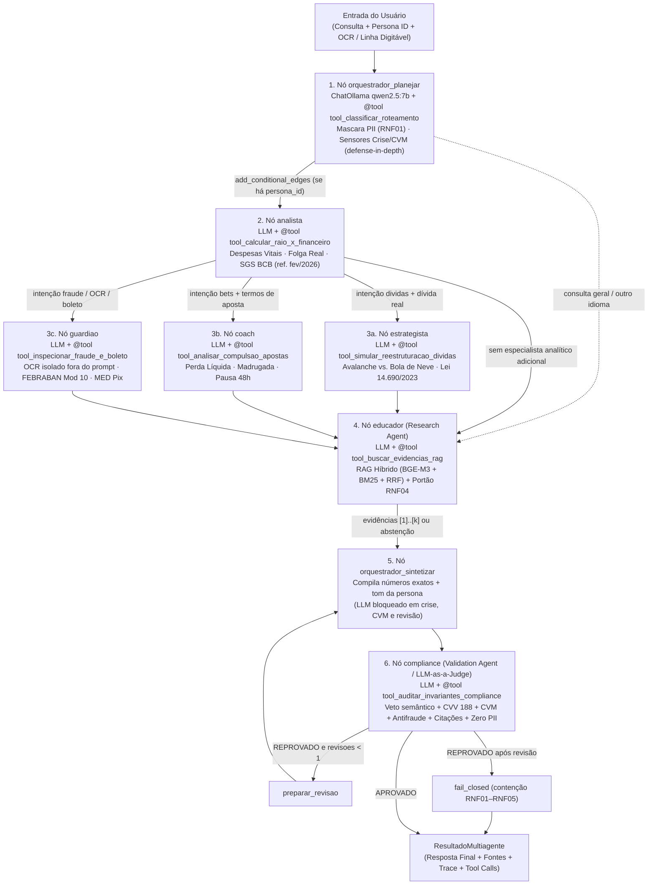

# 01 · Arquitetura do Sistema Multiagente (`LangGraph` + Tool Calling)

O sistema multiagente do **PANDORA** ocupa a **Camada 4 (Orquestração Cognitiva)** da arquitetura geral em 6 camadas ([`docs/arquitetura-geral.md`](../arquitetura-geral.md) e [`ADR-0003`](../adr/0003-arquitetura-geral-sistema-pandora.md)). Internamente, adota um **`StateGraph(EstadoMultiagente)` compilado com `LangGraph`** e **Tool Calling nativo (`@tool` + `bind_tools`)** sobre o serviço `pandora_rag` ([`ADR-0001`](../adr/0001-arquitetura-multiagente-pandora.md) e [`ADR-0002`](../adr/0002-orquestracao-langgraph-tool-calling.md)).

Cada competência crítica do domínio financeiro, comportamental, antifraude, normativo e regulatório é isolada em um dos **7 agentes especializados**, combinando raciocínio semântico em modelo local (**`qwen2.5:7b` via `ChatOllama`**, padrão; com suporte a Anthropic via `ChatAnthropic`), ferramentas matemáticas determinísticas (`RNF03`) e travas *fail-closed* (`RNF01–RNF05`).

---

## 1. Diagrama da Arquitetura dos Agentes (`StateGraph` + `@tool`)

---

## 2. Arquitetura em Camadas e Invariantes (`RNF01–RNF05`)

| Camada | Componentes / Arquivos | Garantia Arquitetural |
|---|---|---|
| **1. Fronteira de Privacidade & Segurança** | `pandora_rag.generate.pii.mascarar` + `sanitizar_documento_nao_confiavel()` | **RNF01 (LGPD) & RNF05 (Anti-Injection):** PII (`CPF`, `CNPJ`, e-mail, cartão, telefone) é mascarada na entrada, saída e antes de prompts externos. O texto de `documento_ocr` **nunca entra no prompt enviado ao LLM**; é sanitizado e auditado isoladamente dentro da tool do `GuardiaoAgent`. |
| **2. Orquestração Cognitiva (`LangGraph`)** | [`agents/graph.py`](../../services/rag/src/pandora_rag/agents/graph.py), [`agents/llm_provider.py`](../../services/rag/src/pandora_rag/agents/llm_provider.py) | **`StateGraph(EstadoMultiagente)`:** 10 nós registrados (`orquestrador_planejar`, `analista`, `estrategista`, `coach`, `guardiao`, `educador`, `orquestrador_sintetizar`, `compliance`, `preparar_revisao`, `fail_closed`) conectados por `add_conditional_edges`. Cada agente recebe `System Prompt` próprio e vincula sua `@tool` com `bind_tools`. |
| **3. Núcleo Determinístico e `@tool`s** | [`agents/tools.py`](../../services/rag/src/pandora_rag/agents/tools.py), [`agents/langgraph_tools.py`](../../services/rag/src/pandora_rag/agents/langgraph_tools.py) | **RNF03 (0,00% de erro matemático):** Raio-X financeiro, simulação Avalanche vs. Bola de Neve, perda líquida em *bets* e dígito verificador Módulo 10 FEBRABAN rodam exclusivamente em funções Python testadas unitariamente expostas como `@tool`s LangChain. |
| **4. Recuperação Normativa (RAG)** | `EducadorAgent` + `executar_busca_evidencias_rag()` (`pgvector` → `corpus_local_bge_m3` → `corpus_local_bm25_hash` → `corpus_embutido_oficial`) | **RNF04 (Anti-Alucinação):** Busca híbrida `bge-m3` + `BM25` + `RRF`, filtrando preâmbulos vazios e cláusulas puramente revogatórias/promulgatórias (limite máximo de 4 citações relevantes `[1]..[k]`) e portão de abstenção validado por domínio léxico e score. |
| **5. Governança Ético-Regulatória** | `ComplianceAgent` + `tool_auditar_invariantes_compliance` | **RNF02 (CVM) & Protocolo de Crise:** Combina auditoria semântica (*LLM-as-a-Judge*) com invariantes duros (ideação suicida direta/indireta `CVV 188`, trava CVM 19/20, julgamento moral, checagem exata antifraude, zero PII, citações consistentes). Em crise ou trava CVM, a geração livre de texto do LLM é desligada por segurança. |
| **6. Auditoria e Contratos** | [`agents/models.py`](../../services/rag/src/pandora_rag/agents/models.py) (`EstadoMultiagente`, `MensagemAgente`, `ResultadoMultiagente`) | Cada colaboração, *tool call* e decisão de revisão fica registrada em `trace: list[MensagemAgente]` e consolidada em JSON/Markdown. |

---

## 3. Resolução de Corpus e Modos de Execução

O `GrafoPandora` opera com degradação transparente de infraestrutura:

1. **Recuperação (`Retriever`):**
   - `pgvector` (PostgreSQL vetorial ativo com índice `HNSW`);
   - `corpus_local_bge_m3` (33 fontes extraídas + embeddings `BAAI/bge-m3` em cache local + `BM25`);
   - `corpus_local_bm25_hash` (33 fontes extraídas + `BM25` + hash vetorial, sem GPU);
   - `corpus_embutido_oficial` (`--offline` / CI sem corpus baixado).
2. **Modelo de Linguagem (`--llm` / `--offline`):**
   - `langgraph_llm` (**padrão** quando o daemon Ollama local está ativo com `qwen2.5:7b` — `llm="qwen25-7b"`);
   - `deterministico` (quando passado `--offline`, `llm=None` ou quando o daemon Ollama local não está rodando — registrando explicitamente `modo="deterministico"` e `modelo_llm="offline"` sem rótulos enganosos).
