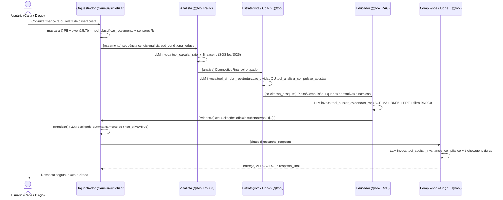
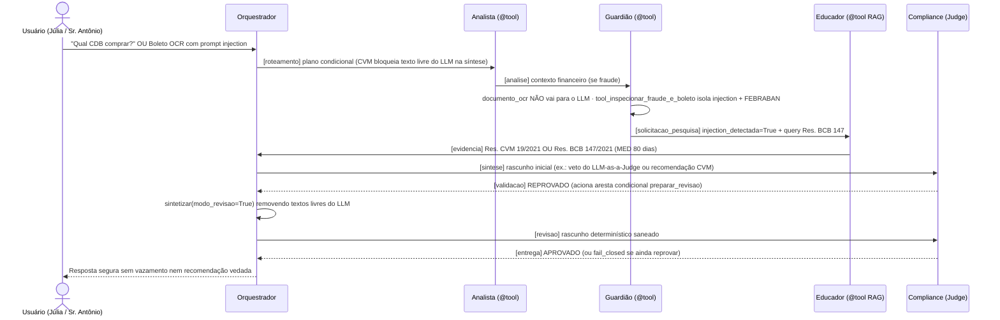

# 03 · Fluxo de Interação e Colaboração Entre Agentes (`StateGraph`)

A colaboração entre os 7 agentes do PANDORA acontece por meio de um **`StateGraph(EstadoMultiagente)` compilado no `LangGraph`** ([`graph.py`](../../services/rag/src/pandora_rag/agents/graph.py)), em que cada nó aciona seu LLM com **`bind_tools`** sobre sua `@tool` ([`langgraph_tools.py`](../../services/rag/src/pandora_rag/agents/langgraph_tools.py)) e registra cada handoff em **`MensagemAgente`** no `estado.trace`.

---

## 1. Estrutura da Mensagem e Observabilidade (`MensagemAgente` + `Tool Calls`)

Cada transição no `StateGraph` grava um registro sequencial em `estado.trace` ([`models.py#L30-L38`](../../services/rag/src/pandora_rag/agents/models.py#L30-L38)), incluindo os metadados de execução do LLM (`llm_modelo`), as `@tool`s efetivamente invocadas pelo modelo (`tool_calls`) e seus argumentos:

```json
{
  "ordem": 3,
  "origem": "estrategista",
  "destino": "educador",
  "tipo": "solicitacao_pesquisa",
  "resumo": "Plano Avalanche vs. Bola de Neve gerado blindando R$ 2.100,00; solicitando fundamentação na Lei 14.181/2021, Lei 14.690/2023 e CPC art. 833.",
  "dados_chave": {
    "ordem_avalanche": ["Concessionaria Energia (Luz)", "Cartao de Credito (Banco A)", "Emprestimo Pessoal (Financeira B)"],
    "alerta_lei_14690": true,
    "llm_modelo": "qwen2.5:7b",
    "tool_calls": [
      {
        "tool": "tool_simular_reestruturacao_dividas",
        "args": {
          "queries_normativas": ["Lei 14.181 minimo existencial", "Lei 14.690 teto juros rotativo"],
          "recomendacao_abertura": "Priorize o pagamento da conta de luz..."
        }
      }
    ]
  }
}
```

Os 8 tipos formais de interação (`TipoMensagem`) são: `roteamento`, `analise`, `solicitacao_pesquisa`, `evidencia`, `sintese`, `validacao`, `revisao` e `entrega`.

---

## 2. Diagramas de Sequência da Colaboração

### Cenário A · Superendividamento (`carla_34`) e Compulsão em *Bets* / Crise (`diego_24`)



### Cenário B · Veto do *Compliance Judge* / Loop de Revisão (`julia_31`) e Defesa Anti-Injection (`antonio_67`)



---

## 3. Como os Agentes Colaboram Sem Risco de Alucinação Numérica ou Bypass

1. **Delegação Cognitiva + Execução Matemática Determinística (`RNF03`):** O modelo `qwen2.5:7b` decide **quais ferramentas acionar**, interpreta o contexto em linguagem humana e **formula consultas jurídicas** para o `EducadorAgent`, mas **nunca executa contas no texto** — juros, mínimo existencial, perda líquida e Módulo 10 FEBRABAN retornam diretamente das `@tool`s Python.
2. **Isolamento de OCR e Bloqueio em Crise/CVM:** O conteúdo não confiável de `documento_ocr` nunca entra no prompt do `GuardiaoAgent`; e em qualquer cenário com crise emocional ou indução CVM, a síntese e pareceres livres do LLM são desligados por construção.
3. **Ciclo de Revisão Real no `StateGraph`:** O veredito semântico do *Compliance Judge* (`aprovado_semantico=False`, `contem_recomendacao_implicita_cvm=True` ou `contem_julgamento_moral=True`) é respeitado pelo grafo (`compliance -> preparar_revisao -> orquestrador_sintetizar -> compliance`), limpando qualquer texto inadequado antes da entrega final.
