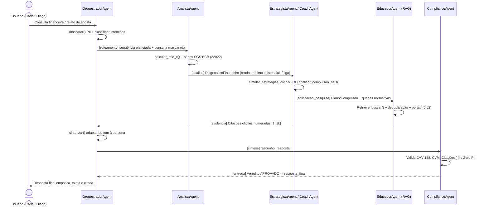
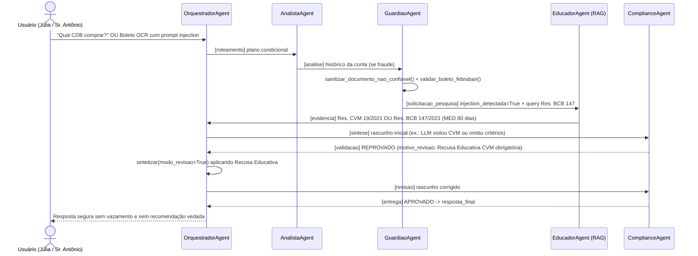

# 03 · Fluxo de Interação e Colaboração Entre Agentes

A colaboração entre os agentes do PANDORA acontece por meio de um **estado tipado compartilhado (`EstadoMultiagente`)** e de um **protocolo explícito de mensagens (`MensagemAgente`)**, garantindo que cada decisão tomada por um agente seja visível, auditável e verificável pelos agentes seguintes.

---

## 1. Estrutura da Mensagem Entre Agentes (`MensagemAgente`)

Cada transição no grafo registra um objeto [`MensagemAgente`](../../services/rag/src/pandora_rag/agents/models.py#L30-L38) em `estado.trace`:

```json
{
  "ordem": 3,
  "origem": "estrategista",
  "destino": "educador",
  "tipo": "solicitacao_pesquisa",
  "resumo": "Plano Avalanche vs. Bola de Neve gerado blindando R$ 2.100,00; solicitando fundamentação na Lei 14.181/2021, Lei 14.690/2023 e CPC art. 833.",
  "dados_chave": {
    "ordem_avalanche": ["Concessionaria Energia (Luz)", "Cartao de Credito (Banco A)", "Emprestimo Pessoal (Financeira B)"],
    "economia_juros": 0.0,
    "alerta_lei_14690": true,
    "queries_solicitadas": ["Lei 14.181 ...", "Lei 14.690 ...", "CPC art 833 ..."]
  }
}
```

Os 8 tipos formais de interação (`TipoMensagem`) são: `roteamento`, `analise`, `solicitacao_pesquisa`, `evidencia`, `sintese`, `validacao`, `revisao` e `entrega`.

---

## 2. Diagramas de Sequência da Colaboração

### Cenário A · Superendividamento (`carla_34`) e Compulsão em *Bets* (`diego_24`)



### Cenário B · Loop de Revisão CVM (`julia_31`) e Defesa Anti-Injection (`antonio_67`)



---

## 3. Como os Agentes Colaboram na Prática (Sem Sobreposição)

1. **Solicitação Orientada a Demanda (`queries_normativas`):** O `EducadorAgent` não faz buscas cegas com o desabafo emocional do usuário; ele consome as queries jurídicas específicas formuladas por `EstrategistaAgent` (Lei 14.181, Lei 14.690, CPC 833), `CoachAgent` (Lei 14.790) e `GuardiaoAgent` (Res. BCB 147/2021), garantindo cobertura normativa cruzada quando uma mesma pessoa tem múltiplos problemas (como `antonio_67`, que combina consignado + boleto falso + golpe Pix).
2. **Prevenção de Alucinação Numérica (`RNF03`):** O `OrquestradorAgent` nunca recalcula valores na camada de linguagem — ele lê diretamente os campos tipados de `DiagnosticoFinanceiro`, `PlanoReestruturacao`, `AnaliseCompulsao` e `InspecaoFraude`.
3. **Ciclo de Validação Ativo (`ComplianceAgent`):** Quando um modelo de linguagem tenta recomendar um CDB específico (comprovado no teste automatizado `test_loop_de_revisao_compliance_corrige_rascunho_que_viola_cvm` com `GatewayVioladorCVM`), o `ComplianceAgent` intercepta o rascunho, reprova o turno com motivo explícito, força a síntese em modo de revisão com os 3 critérios objetivos CVM e só então libera `resposta_final`.
