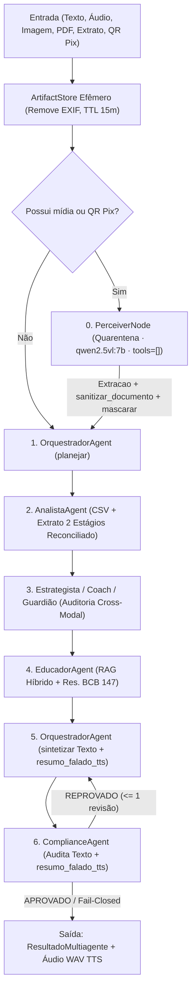

# 06 · Arquitetura Multimodal dos Agentes PANDORA

> **ADR de Referência:** [ADR-0004: Arquitetura Multimodal em Quarentena (*Perceiver–Executor*)](../../adr/0004-agentes-multimodais-perceiver-quarentena.md)
> **Requisitos Cobertos:** `RF01`, `RF07`, `RF09`, `RNF01–RNF07`, Issues `#73` e `#74`

---

## 1. Visão Geral e Stack Local Otimizada

A extensão multimodal do `GrafoPandora` segue o padrão **Perceiver–Executor** em quarentena, calibrado para co-residência em 24 GB de Memória Unificada (sem *cold-swap*):

1. **VLM de Percepção Visual (`qwen2.5vl:7b`):** especializado em OCR documental, tabelas financeiras, boletos e prints (`modelos.yaml` chave `qwen25-vl-7b`; `gemma3:12b` mantido como alternativa opcional).
2. **LLM de Tool Calling (`qwen2.5:7b`):** mantém os 7 agentes com `bind_tools` nativo (~10,7 GB totais co-residentes com `qwen2.5vl:7b`).
3. **Pass-by-Reference (`ArtifactStore`):** binários ficam em store efêmero (`0o700`, sem EXIF, TTL 15 min) e `EstadoMultiagente` trafega apenas `ReferenciaMidia`.
4. **Decodificação Determinística Antes da Probabilística:** `zxing-cpp` + `ITF-25` (44↔47 dígitos, Módulo 10/11) + `EMV BRCode` (`CRC-16/CCITT-FALSE`) e reconciliação de extratos em centavos rodam em Python puro (`RNF03`).
5. **Voz em Cascata Auditável (`RF09`):** `PyAV` + `faster-whisper (small, int8, PT-BR)` → `GrafoPandora` → `ComplianceAgent` (audita texto e `resumo_falado_tts`) → `Luciana (say)` / WAV PCM.

---

## 2. Reuso, Correção e Descarte sobre `workers/ingestion` (`PR #116`)

| Componente (`workers/ingestion`) | Decisão | Justificativa Técnica |
|---|---|---|
| `esquema.py`, `normalizar.py`, `deduplicar.py`, `ofx.py`, `csv_.py` | **Reaproveitar 100%** | Centavos inteiros, fuso `America/Sao_Paulo`, `Decimal` e deduplicação SHA-256 compatíveis com a API hexagonal. |
| `mascara.py` | **Corrigir *over-masking*** | Expandir `_EMPRESA` para preservar substantivos de despesas vitais e apostas (`ALUGUEL`, `LUZ`, `AGUA`, `BET`, `TIGRINHO`, `CONSIGNADO`, etc.) sem vazar nomes reais de pessoas físicas (`***`). |
| `pdf.py` e `importador.py` | **Estender + Descartar se incompleto** | Adicionar hook `extrator_ocr` sobre `PrecisaDeOcr` e reconciliação em centavos (`reconciliado`, `divergencia_centavos`). Se `pdf.py` falhar ou `reconciliado is False`, `ingestao_adapter.py` **descarta** a leitura incompleta e aciona o Estágio 2 (`qwen2.5vl:7b` `ExtratoDocumentalVLM`), escolhendo o menor `abs(divergencia_centavos)`. |

---

## 3. Fluxo Multimodal Integrado ao `StateGraph`

