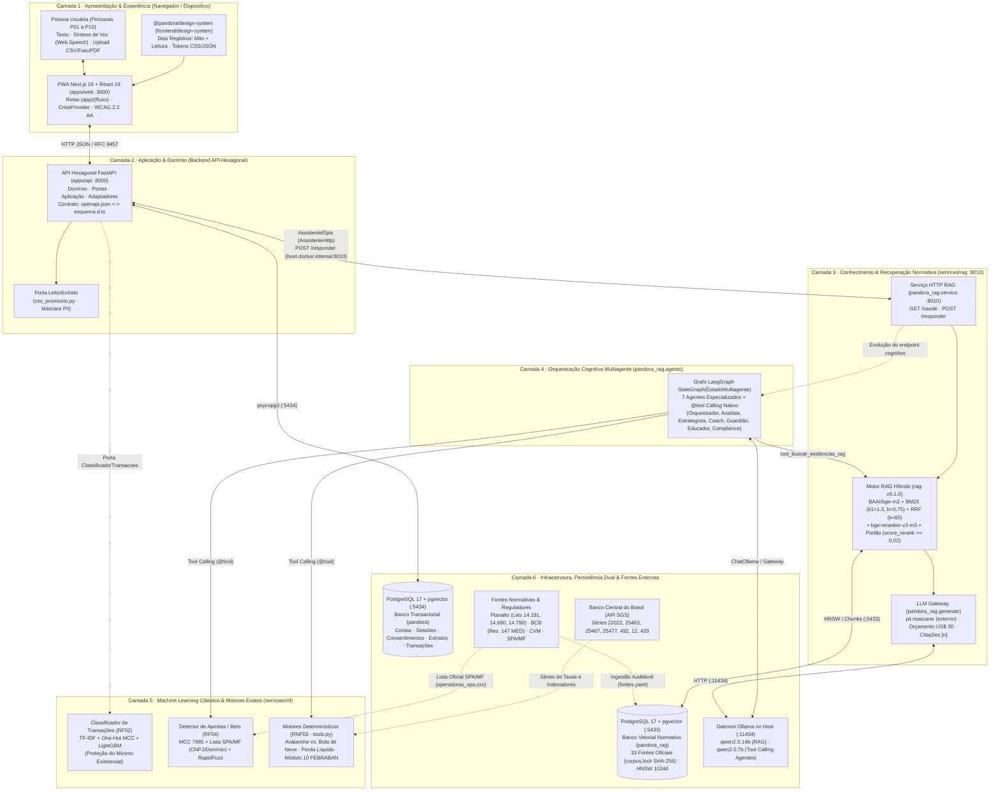
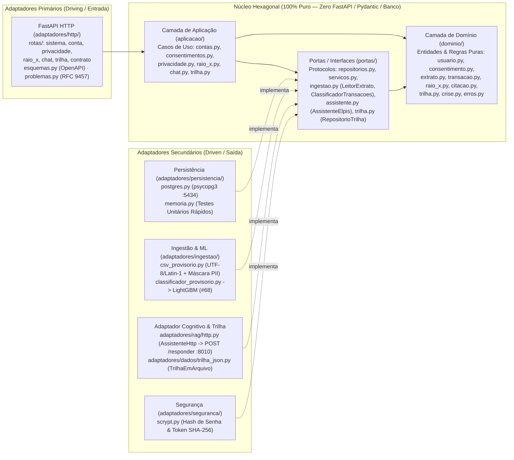
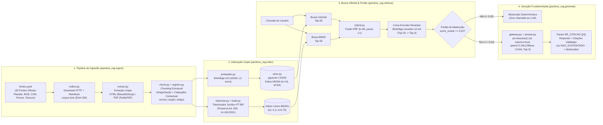
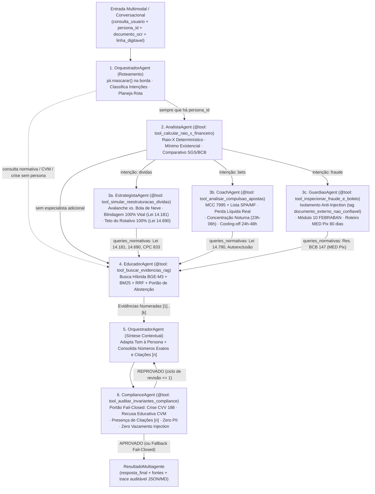
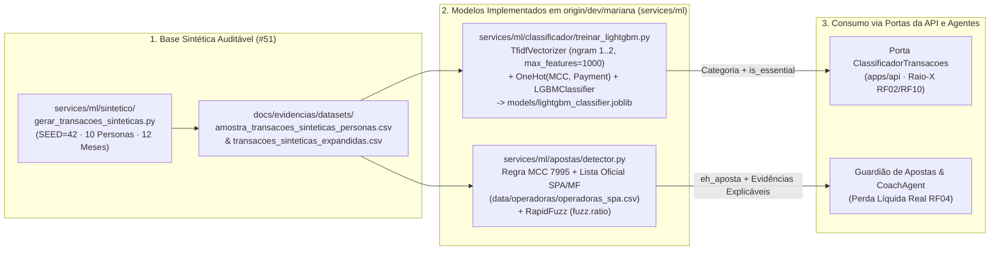

# Arquitetura Geral do Sistema — PANDORA

> **Projeto:** **PANDORA** (*Copiloto de IA para sair das dívidas, controlar gastos compulsivos e reconstruir a vida financeira*)
> **Challenge 2 · CBL (Challenge-Based Learning)** · **Big Idea:** Qualidade de Vida
> **Decisão Arquitetural de Referência:** [ADR-0003: Topologia Geral e Arquitetura Unificada em 6 Camadas](adr/0003-arquitetura-geral-sistema-pandora.md)

---

## Sumário

1. [Visão Geral e Princípios Arquiteturais](#1-visão-geral-e-princípios-arquiteturais)
2. [Topologia Geral de Execução e Diagrama de Contexto (Visão Macro)](#2-topologia-geral-de-execução-e-diagrama-de-contexto-visão-macro)
3. [Camada 1 · Apresentação e Experiência (Frontend PWA & Design System)](#3-camada-1--apresentação-e-experiência-frontend-pwa--design-system)
4. [Camada 2 · Aplicação e Domínio (Backend API em Arquitetura Hexagonal)](#4-camada-2--aplicação-e-domínio-backend-api-em-arquitetura-hexagonal)
5. [Camada 3 · Conhecimento e Recuperação Normativa (RAG Híbrido `rag-v0.1.0`)](#5-camada-3--conhecimento-e-recuperação-normativa-rag-híbrido-rag-v010)
6. [Camada 4 · Orquestração Cognitiva Multiagente (`LangGraph` + Tool Calling)](#6-camada-4--orquestração-cognitiva-multiagente-langgraph--tool-calling)
7. [Camada 5 · Aprendizado de Máquina Clássico e Motores Determinísticos (`services/ml`)](#7-camada-5--aprendizado-de-máquina-clássico-e-motores-determinísticos-servicesml)
8. [Camada 6 · Infraestrutura, Topologia de Portas e Fontes Externas (Docker vs. Host)](#8-camada-6--infraestrutura-topologia-de-portas-e-fontes-externas-docker-vs-host)
9. [Matriz de Rastreabilidade dos Requisitos Não Funcionais (RNF01 a RNF09)](#9-matriz-de-rastreabilidade-dos-requisitos-não-funcionais-rnf01-a-rnf09)
10. [Mapa Completo do Monorepo e Estado de Integração por Branch](#10-mapa-completo-do-monorepo-e-estado-de-integração-por-branch)

---

## 1. Visão Geral e Princípios Arquiteturais

O **PANDORA** foi desenhado para responder à *Essential Question* do grupo ([`docs/01-problema-e-essential-question.md`](01-problema-e-essential-question.md)):

> *"Como agentes de IA, apoiados em evidências confiáveis, podem ajudar pessoas endividadas ou com comportamento financeiro compulsivo a recuperar o controle das finanças e, com isso, a qualidade de vida?"*

Diferentemente de um chatbot genérico, o domínio de superendividamento ([Lei nº 14.181/2021](evidencias/artigos/README.md)), transtorno do jogo online (`CID-11 6C50` / Lei nº 14.790/2023) e prevenção a golpes digitais (MED Pix — Res. BCB nº 147/2021) não tolera alucinações aritméticas, invenção de normas jurídicas ou respostas estigmatizantes. Por isso, toda a arquitetura obedece a **cinco princípios inegociáveis**:

| # | Princípio Arquitetural | Como é Aplicado no Sistema | Requisito |
|---|---|---|---|
| **1** | **Determinístico onde é possível, probabilístico onde é necessário** | Nenhum modelo de linguagem realiza contas financeiras. Juros compostos, CET, métodos *Avalanche* e *Bola de Neve*, *Mínimo Existencial*, perda líquida em *bets* e dígito verificador Módulo 10 FEBRABAN rodam exclusivamente em funções Python puras e tipadas (`valor_centavos: int` em `apps/api` e `tools.py` em `pandora_rag.agents`). | `RNF03` |
| **2** | **Operação 100% *Read-Only*** | O sistema não custodia dinheiro, não inicia transações Pix (ITP) e não envia ordens a corretoras. Botões de interface nunca oferecem *"Pagar"* ou *"Investir"*; travas comportamentais operam por fricção positiva voluntária (*cooling-off* de 24h–48h) e guias de bloqueio nativo. | `RNF02`, `RF18` |
| **3** | ***Privacy by Design* e Soberania de Dados (LGPD)** | Dados pessoais (`EMAIL`, `CNPJ`, `CPF`, `CARTAO`, `TELEFONE`) são mascarados por `pii.mascarar` antes de qualquer chamada externa no `Gateway` (`externo: true`), na ingestão de CSV (`mascarar_descricao`) e na entrada do grafo multiagente (`OrquestradorAgent`). Textos de OCR são isolados de *prompt injection*, logs JSONL do `Gateway` nunca gravam o texto das mensagens, e o usuário pode apagar 100% de seus dados em um comando (`DELETE /eu/dados`). | `RNF01`, `RNF05` |
| **4** | **Rastreabilidade Normativa ou Abstenção Segura** | Toda afirmação sobre leis, prazos ou direitos exige recuperação híbrida (`BAAI/bge-m3` + `BM25` + `bge-reranker-v2-m3`) sobre o corpus oficial de 33 fontes ([`services/rag/corpus.lock`](../services/rag/corpus.lock)). Se a nota do melhor trecho no reranker for inferior a **`0,02`**, o portão de abstenção bloqueia a chamada ao LLM. | `RNF04`, `RF08` |
| **5** | **Prioridade Absoluta ao Acolhimento em Crise e Trava CVM** | Ao detectar marcadores de sofrimento psíquico agudo (`dominio/crise.py` na API ou `ComplianceAgent` no grafo), o sistema interrompe qualquer cobrança ou meta financeira e aciona o **Protocolo de Crise** (`CVV 188`, CAPS AD, Jogadores Anônimos). Pedidos de indicação de ativos específicos são convertidos em **Recusa Educativa** (Res. CVM 19 e 20/2021). | `RF05`, `RNF02` |

---

## 2. Topologia Geral de Execução e Diagrama de Contexto (Visão Macro)

A arquitetura do PANDORA divide-se em **6 camadas** padronizadas no [`ADR-0003`](adr/0003-arquitetura-geral-sistema-pandora.md), que se comunicam por contratos explícitos (`openapi.json` → `esquema.d.ts`, portas hexagonais em Python, endpoint `POST /responder` em `:8010` e `StateGraph(EstadoMultiagente)` no `LangGraph`):



---

## 3. Camada 1 · Apresentação e Experiência (Frontend PWA & Design System)

A camada de interface foi projetada para pessoas sob forte carga cognitiva, fadiga emocional, presbiopia (como a persona [Sr. Antônio, 67 anos](personas/03-antonio-golpes-e-consignado.md)) ou vulnerabilidade a gatilhos de jogos de azar (como [Diego, 24 anos](personas/02-diego-compulsao-bets.md)). Ela é composta por dois pacotes integrados via *npm workspaces*:

### 3.1. Design System (`frontend/design-system` · `@pandora/design-system`)

Documentado em [`frontend/design-system/README.md`](../frontend/design-system/README.md), o sistema visual traduz o mito grego da Caixa de Pandora — na qual resta **Elpis** (a Esperança) — em uma arquitetura visual estrita baseada em **Dois Registros** que jamais se misturam no mesmo bloco:

1. **Registro do Mito (`.pd-mito`):** inspirado na cerâmica grega em figura negra (no tema claro: fundo [`laranja-vaso`](../frontend/design-system/tokens.json) e traço em `tinta`) e figura vermelha (no tema escuro: fundo preto e figuras em laranja), emoldurado pelos ornamentos [`meandro.svg`](../frontend/design-system/assets/Ornamentos/meandro.svg) e [`serra.svg`](../frontend/design-system/assets/Ornamentos/serra.svg). Usado exclusivamente em `CabecalhoMito`, na tela de abertura, nos marcos da trilha e no medalhão da assistente [`elpis-medalhao.svg`](../frontend/design-system/assets/Marca/elpis-medalhao.svg). Comporta apenas um título curto (família `Cinzel`) e um único número-herói.
2. **Registro de Leitura:** usado em tudo o que exige leitura e decisão (extratos, simulações de dívidas, citações de leis, perguntas). Utiliza superfície neutra (`superficie`, `cartao`, `papiro`) e a tipografia **`Atkinson Hyperlegible Next`** (desenhada especificamente para baixa visão, corpo mínimo de `16px`, algarismos tabulares `tabular-nums` em `R$ 2.100,00`).

**Artefatos técnicos do pacote:**
- [`frontend/design-system/tokens.json`](../frontend/design-system/tokens.json) e [`frontend/design-system/tokens.css`](../frontend/design-system/tokens.css): fonte única de verdade para cores, tipografia, espaçamentos, raios e alvos mínimos de toque (`44x44px` — `RNF07`);
- [`frontend/design-system/components/bundle.js`](../frontend/design-system/components/bundle.js), [`bundle.css`](../frontend/design-system/components/bundle.css) e [`index.d.ts`](../frontend/design-system/components/index.d.ts): biblioteca de componentes e ícones vetoriais (sem emojis), incluindo `CitacaoCartao` (para normas do RAG), `BlocoCalculado` / `SeloCalculado` (para resultados do motor determinístico) e `Anfora` (visualização de reserva financeira);
- **Gamificação sem gatilho de cassino:** na Trilha de aprendizagem, são proibidos sorteios, roletas, moedas caindo, rankings ou contagens que zeram.

### 3.2. Aplicação Web PWA (`apps/web` — Next.js 16 + TypeScript)

Implementada em `apps/web/` (presente em `origin/main` e `origin/develop`), a aplicação PWA consome `@pandora/design-system` diretamente sem duplicar estilos:

- **Roteamento Estrutural (App Router):**
  - `/` (`app/page.tsx`): Tela de Abertura com cena vetorizada e esfumada; `PortaoAbertura.tsx` garante que sessões novas (`sessionStorage`) passem pela abertura antes de acessar telas internas;
  - `(fluxo)/comecar` (`Perguntas.tsx`, telas 1b a 1d): fluxo de acolhimento inicial onde o componente `ConsentimentoControlado` (aceite LGPD) inicia obrigatoriamente **desmarcado por padrão**, bloqueando o botão *"Abrir minha caixa"* até o consentimento ativo da pessoa usuária;
  - `(app)/` (`inicio`, `dividas`, `elpis`, `trilha`, `guardiao`, `inicio/metas`): casca principal (`CascaApp.tsx`) com navegação responsiva (`NavBase` inferior em celulares `< 1024px` e trilho lateral retrátil com meandro vertical em desktops $\ge 1024\text{px}$ ou celulares na horizontal);
  - `(fluxo)/` (`trilha/licao`, `guardiao/verificacao`): fluxos focados de tela cheia (1 decisão por tela), incluindo o veredito de boleto em **Leitura Ampliada** para idosos.
- **Estado dos Recursos Multimodais (`RF07`, `RF09`):** na versão atual de `apps/web` (`origin/develop`), o botão *"Ouvir de novo"* na Elpis utiliza síntese de voz nativa do navegador (Web Speech API `speechSynthesis`), enquanto o `ModoVoz` de gravação (STT) e a tela de verificação de boleto operam como fluxos interativos de demonstração no frontend; a inspeção determinística da linha digitável FEBRABAN e do texto OCR de boletos já está implementada no backend cognitivo (`GuardiaoAgent` / `tools.py`).
- **Prioridade Global do Modo de Crise (`CriseProvider.tsx` — `RF05`):** contexto posicionado acima de todas as rotas (`useCrise()`). Quando ativado (manualmente pelo botão *"Precisa de apoio agora?"* ou automaticamente pelo sinal `crise=true` retornado pela API em `POST /chat`), substitui qualquer tela ativa pela tela de acolhimento (`CVV 188`, CAPS AD, Jogadores Anônimos), oculta a barra de navegação e suspende metas e alertas no `sessionStorage`.
- **Integração Contract-First (`lib/api/`):** o arquivo `apps/web/lib/api/esquema.d.ts` é gerado automaticamente a partir de `apps/api/openapi.json` (`npm run api:tipos -w @pandora/web`). O teste `esquema.test.ts` falha se o frontend e o backend divergirem.

---

## 4. Camada 2 · Aplicação e Domínio (Backend API em Arquitetura Hexagonal)

Localizada em `apps/api/` (`pandora_api`, disponível em `origin/main` e `origin/develop`), a API centraliza a comunicação entre o frontend PWA, o banco transacional (`:5434`), os pipelines de ingestão/ML e o serviço cognitivo RAG (`:8010`), cumprindo estritamente o requisito **`RNF06` (Arquitetura Hexagonal / Ports & Adapters em FastAPI)**.

### 4.1. Diagrama de Anéis Hexagonais (`pandora_api`)



### 4.2. Invariantes, Fronteiras de Dados e Convenções da API Hexagonal

1. **Pureza Arquitetural Verificada por Teste (`tests/test_arquitetura.py`):** os pacotes `dominio/`, `portas/` e `aplicacao/` são proibidos de importar `fastapi`, `pydantic` ou `psycopg`. Toda regra de negócio roda em Python puro com `dataclasses` imutáveis.
2. **Dinheiro em Centavos Inteiros e Posse Canônica do Estado (`RNF03`):** valores monetários trafegam e são armazenados exclusivamente como inteiros em centavos (`valor_centavos: int`). O uso de `float` para dinheiro é proibido em todo o domínio. Taxas anuais (`cet_anual`) são serializadas como `string` decimal. A API Hexagonal (`apps/api` + Postgres `:5434`) é a **dona canônica do estado transacional persistido** das contas de usuário; o serviço cognitivo (`:8010`) nunca acessa o banco `:5434` diretamente.
3. **Bloco `"Calculado"` Auditável (`esquemas.py`):** todo resultado oriundo do motor determinístico (como o resumo mensal do Raio-X, o Mínimo Existencial e a folga orçamentária) inclui um objeto `calculo` contendo `fonte` (identificação do motor/regra) e `entradas` (dicionário de insumos utilizados); o frontend só exibe o `SeloCalculado` quando esse bloco está presente.
4. **Padronização de Erros (`RFC 9457`):** todas as falhas retornam `Content-Type: application/problem+json` com `type` estruturado (`urn:pandora:erro:<codigo>`). Rotas cujo motor ainda pertence a issues futuras (`/dividas`, `/score`, `/plano`, `/previsao`) validam autenticação e payload e retornam `501 Not Implemented` explícito, jamais inventando dados falsos.
5. **Exclusão Total sob Demanda (`DELETE /eu/dados` — `RNF01`):** o caso de uso `Privacidade` (`aplicacao/privacidade.py`) itera sobre todos os repositórios com dados pessoais registrados no contêiner de injeção de dependência (`conteiner.py`) e executa `apagar_do_usuario`, removendo conta, sessões, consentimentos, extratos e transações no banco `:5434`. Como o serviço `:8010` é *stateless* e o `Gateway` omite o campo `texto` de seus logs JSONL (`gateway.py`), nenhuma conversa pessoal fica retida no runtime cognitivo.
6. **Interceptação Determinística de Crise no Chat (`dominio/crise.py` — `RF05`):** antes mesmo de encaminhar a pergunta ao serviço RAG (`:8010`), `aplicacao/chat.py` avalia sinais de crise aguda. Se detectados, retorna imediatamente a mensagem fixa de acolhimento com `crise=True` e contatos oficiais (`CVV 188`), sem invocar o modelo gerativo.

### 4.3. Mapa de Endpoints HTTP (`apps/api`)

| Domínio | Endpoints | Porta / Adaptador Acionado | Status em `origin/develop` |
|---|---|---|---|
| **Sistema** | `GET /saude` | Verificação de liveness da API | Operacional |
| **Autenticação & Conta** | `POST /auth/cadastro`, `POST /auth/sessoes`, `DELETE /auth/sessoes/atual`, `GET /eu` | `HasherSenha` (`scrypt`) + `RepositorioUsuarios` / `RepositorioSessoes` (token opaco com hash no Postgres `:5434`) | Operacional |
| **Privacidade (LGPD)** | `POST /consentimentos`, `GET /consentimentos`, `POST /consentimentos/{id}/revogacao`, `DELETE /eu/dados` | `RepositorioConsentimentos` + expurgo cascata em todos os repositórios (`RNF01`) | Operacional |
| **Raio-X Financeiro** | `POST /extratos`, `GET /extratos/{id}`, `GET /transacoes`, `PATCH /transacoes/{id}/categoria`, `GET /raio-x?mes=YYYY-MM` | `LeitorExtrato` (`csv_provisorio.py` com `mascarar_descricao`) + `ClassificadorTransacoes` (`classificador_provisorio.py`) + cálculo determinístico de Renda, Gastos, Mínimo Existencial e Folga + reclassificação em 1 toque (`RF01`, `RF02`, `RF10`) | Operacional (CSV pronto; adaptadores definitivos OFX/PDF e LightGBM plugáveis via portas) |
| **Elpis (Chat RAG)** | `POST /chat` | Detector `dominio/crise.py` + porta `AssistenteElpis` (`AssistenteHttp` com `httpx.Timeout(60.0, connect=3.0)`) → `POST /responder` em `PANDORA_RAG_URL` (`http://host.docker.internal:8010` no Docker ou `http://localhost:8010` no host) (`RF05`, `RF08`) | Operacional |
| **Trilha Educativa** | `GET /trilha`, `GET /trilha/licoes/{id}`, `POST /trilha/licoes/{id}/porque` | Porta `RepositorioTrilha` (`TrilhaEmArquivo` lendo `dados/trilha.v1.json` pré-triado) + `AssistenteElpis` ao vivo para explicar *"Por quê?"* com fontes oficiais | Operacional |
| **Dívidas, Plano e Previsão** | `GET /dividas`, `GET /score`, `POST /plano`, `GET /previsao` | Contrato OpenAPI publicado e validado (`501` apontando para integração com os motores de dívidas e séries temporais) | Contrato pronto |

---

## 5. Camada 3 · Conhecimento e Recuperação Normativa (RAG Híbrido `rag-v0.1.0`)

Documentado em detalhes na pasta [`docs/rag/README.md`](rag/README.md) ([`01-arquitetura.md`](rag/01-arquitetura.md) a [`09-decisao-llm.md`](rag/09-decisao-llm.md)) e implementado em [`services/rag/src/pandora_rag/`](../services/rag/src/pandora_rag/), o motor de RAG fornece a base jurídica e regulatória verificável do PANDORA.

### 5.1. Pipeline Completo de Ingestão, Recuperação Híbrida e Geração



### 5.2. Decisões Técnicas e Resultados Reais Medidos por Ablação (`evals/` e `training/`)

Toda escolha arquitetural do RAG foi guiada por experimentos reproduzíveis versionados em [`evals/runs/`](../evals/runs/) e reportados com transparência científica em [`docs/rag/07-metricas-e-resultados.md`](rag/07-metricas-e-resultados.md), [`docs/rag/08-treinamento.md`](rag/08-treinamento.md) e [`docs/rag/09-decisao-llm.md`](rag/09-decisao-llm.md):

- **Corpus Auditável ([`services/rag/fontes.yaml`](../services/rag/fontes.yaml) e [`corpus.lock`](../services/rag/corpus.lock)):** 33 fontes públicas brasileiras (Lei 14.181/2021, Lei 14.690/2023, Lei 14.790/2023, CPC art. 833, Lei 8.009/1990, Res. BCB 147/2021 do MED Pix, Res. CMN 4.765/2019, Res. CVM 19/20/30, cartilhas BCB/Procon/Tesouro). Cada download grava seu hash `SHA-256` em `corpus.lock`.
- **Chunking Estrutural vs. Fixo ([`docs/rag/03-chunking.md`](rag/03-chunking.md)):** implementado em [`services/rag/src/pandora_rag/ingest/chunk.py`](../services/rag/src/pandora_rag/ingest/chunk.py) e [`index/registro.py`](../services/rag/src/pandora_rag/index/registro.py). Segmenta leis por `Art. / § / Inciso` e cartilhas por seção (alvo de 260 palavras, divisão acima de 320 palavras; mediana da base: 171 palavras, $p95 = 289$), prefixando cada texto indexado com o cabeçalho **`norma | seção | artigo`**. Na ablação sobre o conjunto `dev.v1` (46 perguntas respondíveis), o chunking estrutural com cabeçalho elevou o **`Hit@5` de `0,76` (sem cabeçalho) para `0,80`** (frente a `0,67` do chunk fixo) e o **`nDCG@10` de `0,62` para `0,69`**.
- **Embeddings e Reranker ([`docs/rag/04-embeddings.md`](rag/04-embeddings.md)):** após comparar `MiniLM-L12`, `multilingual-e5-large`, `legal-bertimbau`, `Qwen3-Embedding-4B` e `BAAI/bge-m3` (inclusive avaliando ajuste fino Contrastive/MNRL em [`training/embeddings/treinar.py`](../training/embeddings/treinar.py), que não foi adotado por ficar dentro da margem de ruído), a combinação vencedora no `dev.v1` foi **`BAAI/bge-m3`** + **`BM25`** + **`RRF (k=60)`** + **`BAAI/bge-reranker-v2-m3`**, atingindo **`Hit@5 = 0,85`**, **`Hit@10 = 0,89`**, **`MRR = 0,67`**, **`nDCG@10 = 0,72`** e **`Acerto do artigo no top-3 = 0,80`** ([`evals/runs/2026-11-05-4a-hibrido-rerank-bge/metrics.json`](../evals/runs/2026-11-05-4a-hibrido-rerank-bge/metrics.json)).
- **Portão de Abstenção e Resultados no Teste (`golden.v1.jsonl` — 169 perguntas):** calibrado em [`evals/abstencao_sinais.py`](../evals/abstencao_sinais.py) e salvo em [`training/abstencao/limiar.json`](../training/abstencao/limiar.json) com o limiar `score_rerank < 0,02` (maior limiar no `dev.v1` com `0%` de recusa indevida, barrando sozinho 2 de 5 perguntas fora de domínio no `dev.v1` e atingindo `80%` de abstenção combinada com `qwen2.5:14b`). Na rodada 1 do conjunto de teste fechado ([`evals/test_log.md`](../evals/test_log.md)), o pipeline `qwen2.5:14b` (top-3 + portão `0,02`) obteve:
  - **Citação válida:** **`96,0%`** (meta: `100%` — gap de `4,0 p.p.`);
  - **Abstenção correta (20 fora de domínio):** **`70%`** (meta: $\ge 90\%$ — gap aberto para o 2º refinamento);
  - **Recusa indevida:** **`3,4%`**;
  - **Acerto de número:** **`0,70`** após correção do normalizador decimal (`600,00` vs `600`, originalmente `0,60`);
  - **Latência:** média de **`7,5 s`**, mas **`p95 = 14,4 s`** (acima da meta `p95 <= 8 s`).
- **Gateway de LLM e Proteção de PII ([`services/rag/src/pandora_rag/generate/gateway.py`](../services/rag/src/pandora_rag/generate/gateway.py), [`answer.py`](../services/rag/src/pandora_rag/generate/answer.py) e [`pii.py`](../services/rag/src/pandora_rag/generate/pii.py)):** interface única para modelos locais (`Ollama`: `qwen2.5:14b`, `gemma3:12b`, `llama3.1:8b`, com suporte a `json_modo` quando solicitado) e nuvem (`Anthropic`, teto de `US$ 30,00`). Na geração RAG padrão (`answer.py`), o modelo responde em texto conciso (até 180 palavras) com marcadores `[n]` extraídos via regex (`RE_CITACAO`) ou emite a sentinela `NAO_SUSTENTADO`. O `Gateway` aplica `pii.mascarar` automaticamente sempre que `externo: true` e grava telemetria JSONL sem nunca persistir o texto da conversa.

---

## 6. Camada 4 · Orquestração Cognitiva Multiagente (`LangGraph` + Tool Calling)

Enquanto o serviço RAG base (`POST /responder`) atende consultas normativas diretas, cenários complexos exigem diagnóstico financeiro, cálculo de amortização, inspeção antifraude e validação regulatória no mesmo turno. Para isso, o módulo `pandora_rag.agents` (`services/rag/src/pandora_rag/agents/`, na branch `entrega/prototipo-multiagente-quarto-desafio`) implementa uma arquitetura multiagente formalizada nos registros **ADR-0001** e **ADR-0002** ([`docs/adr/README.md`](adr/README.md)).

### 6.1. Topologia do Grafo de Estado (`StateGraph(EstadoMultiagente)`)

O sistema é orquestrado declarativamente via **`LangGraph`** sobre um estado fortemente tipado em Pydantic v2 (`EstadoMultiagente`), coordenando **7 agentes especializados** que invocam ferramentas determinísticas via **Tool Calling nativo (`@tool` + `bind_tools` com `qwen2.5:7b` no Ollama ou Anthropic)**:



### 6.2. Responsabilidades e Ferramentas Determinísticas dos 7 Agentes

| # | Agente (`AgentRole`) | Arquétipo | Ferramentas `@tool` Vinculadas (`langgraph_tools.py` → `tools.py`) | Garantias que Impõe |
|---|---|---|---|---|
| **1** | `OrquestradorAgent` (`orquestrador`) | *Orchestrator & Communication* | `mascarar()` incondicional na entrada + classificador de intenções (`dividas`, `bets`, `fraude`, `cvm`, `crise`, `educacao`) + sintetizador adaptado ao tom da persona (`acolhedor_simples`, `parceiro_sem_julgamento`, `acessivel_idoso`, `educativo_calmo`) | `RNF01` (PII mascarado na borda mesmo para LLM local), adaptação empática sem julgamento moral |
| **2** | `AnalistaAgent` (`analista`) | *Analysis Agent* (Raio-X) | `tool_calcular_raio_x_financeiro`: apura renda, despesas vitais (`minimo_existencial`), `folga_disponivel = max(0, renda - minimo_existencial)` e confronta taxas com as séries SGS do BCB (`22022` rotativo, `25467` consignado INSS, `432` Selic, `12` CDI, `433` IPCA) | `RF02`, `RF03`, `RNF03` (0,00% erro numérico) |
| **3** | `EstrategistaAgent` (`estrategista`) | *Analysis Agent* (Dívidas) | `tool_simular_reestruturacao_dividas`: compara matematicamente os métodos **Avalanche** (maior CET primeiro) e **Bola de Neve** (menor saldo primeiro), priorizando contas essenciais atrasadas (luz/água) e checando o teto legal de 100% do rotativo (Lei 14.690/2023) | `RF06`, `RNF03`, blindagem de 100% do Mínimo Existencial (Lei 14.181/2021) |
| **4** | `CoachAgent` (`coach`) | *Analysis & Behavioral Agent* | `tool_analisar_compulsao_apostas`: cruza transações com MCC `7995` e CNPJs da SPA/MF, calcula a **perda líquida real** (apostas menos prêmios), identifica concentração noturna (`23h–06h` no motor de `tools.py`, cobrindo a faixa crítica `23h–03h` do escopo) e propõe trava voluntária com *cooling-off* de 24h–48h | `RF04`, `RF11`, intervenção comportamental livre de culpa (*nudges* em custo de oportunidade) |
| **5** | `GuardiaoAgent` (`guardiao`) | *Security & Antifraud Agent* | `tool_inspecionar_fraude_e_boleto`: aplica `sanitizar_documento_nao_confiavel()` (neutralizando *prompt injection* indireto em OCR e encapsulando em `<documento_externo_nao_confiavel>`), valida os 47 dígitos da linha digitável FEBRABAN (Módulo 10, código do banco vs. banco alegado) e aciona o roteiro do MED Pix (80 dias) | `RF07`, `RNF05` (defesa contra *Prompt Injection* indireto em boletos/prints) |
| **6** | `EducadorAgent` (`educador`) | *Research Agent* (RAG) | `tool_buscar_evidencias_rag`: executa as `queries_normativas` formuladas pelos especialistas no `Retriever` híbrido (com resolução resiliente em 3 níveis: `pgvector` → `corpus_local_bge_m3` → `corpus_embutido_oficial`) | `RF08`, `RNF04` (citações oficiais numeradas `[1]..[k]` ou abstenção segura) |
| **7** | `ComplianceAgent` (`compliance`) | *Validation & Guardrail Agent* | `tool_auditar_invariantes_compliance`: audita o rascunho contra 5 invariantes (*Crise CVV 188*, *Trava CVM Res. 19/20*, *Citações `[n]`*, *Zero PII* e *Zero Injeção*). Se reprovar, devolve `motivo_revisao` ao `OrquestradorAgent` para 1 ciclo de reescrita; se persistir, aplica fallback *fail-closed* | `RF05`, `RNF01`, `RNF02`, `RNF04`, `RNF05` |

---

## 7. Camada 5 · Aprendizado de Máquina Clássico e Motores Determinísticos (`services/ml`)

Conforme documentado em `docs/ml/modelos-auxiliares.md` (em `origin/develop`) e implementado em `services/ml/` (nas branches `origin/dev/mariana` e `origin/dev/rayssa`), o PANDORA segue a regra **"modelo clássico antes de LLM"** para tarefas tabulares e transacionais de alta frequência:



### 7.1. Estado Real Implementado vs. Evoluções Planejadas em `services/ml`

1. **Gerador de Dados Sintéticos das 10 Personas (`services/ml/sintetico/` em `origin/dev/rayssa` e `origin/dev/mariana`):** gera séries transacionais realistas de 12 meses com semente fixa (`SEED = 42`) reproduzindo os padrões comportamentais das 10 personas ([`docs/personas/README.md`](personas/README.md)), sem tocar em nenhum dado bancário real de pessoas físicas (`RNF01`).
2. **Classificador Supervisionado de Transações (`services/ml/classificador/` em `origin/dev/mariana` — `RF02`):**
   - **Implementado hoje (`treinar_lightgbm.py` + `baseline.py`):** pipeline `ColumnTransformer` combinando `TfidfVectorizer(max_features=1000, ngram_range=(1, 2))` sobre `description_masked`, `OneHotEncoder(handle_unknown="ignore")` sobre `mcc` e `payment_method`, e features numéricas (`amount`, `is_essential`) em um `LGBMClassifier(n_estimators=200, learning_rate=0.05, random_state=42)`, serializado em `models/lightgbm_classifier.joblib`;
   - Classifica nas 10 categorias de `config.py` (`RENDA`, `MORADIA`, `ALIMENTACAO`, `SAUDE`, `TRANSPORTE`, `DIVIDA_JUROS`, `APOSTAS_BETS`, `FRAUDE_SUSPEITA`, `COMPRAS_IMPULSO`, `INVESTIMENTO`), definindo `CATEGORIAS_MINIMO_EXISTENCIAL = {"MORADIA", "ALIMENTACAO", "SAUDE"}` (na API `apps/api`, `UTILIDADES` e `EDUCACAO` também compõem as despesas essenciais, e a separação de insumos MEI da persona Mariana é apoiada pelo botão de reclassificação em 1 toque `PATCH /transacoes/{id}/categoria` — `RF10`);
   - **Próximo passo previsto no guia (`docs/ml/modelos-auxiliares.md`):** experimentar *char n-grams* (`analyzer="char_wb"`) e calibração de probabilidade (`CalibratedClassifierCV`) ao plugar o adaptador definitivo na porta `ClassificadorTransacoes` da API (#68/#83).
3. **Detector Híbrido de Apostas Online (`services/ml/apostas/detector.py` em `origin/dev/mariana` — `RF04`):**
   - Opera sobre a lista oficial da Secretaria de Prêmios e Apostas do Ministério da Fazenda (`data/operadoras/operadoras_spa.csv`);
   - Combina 4 regras determinísticas e difusas com retorno estruturado de evidências: (1) código `MCC 7995`, (2) batimento exato de CNPJ normalizado, (3) correspondência exata ou aproximada (`RapidFuzz` `fuzz.ratio`) contra nome empresarial e marca da operadora, e (4) verificação de domínio autorizado (`.bet.br`), sinalizando operadoras **não autorizadas**.
4. **Modelos de Grau 2 (`Isolation Forest` para anomalias `RF11` e `Prophet / ETS` para previsão de caixa `RF13`):** especificados arquiteturalmente em `docs/ml/modelos-auxiliares.md` e nos contratos `GET /score` e `GET /previsao` da API (`501 Not Implemented` em `origin/develop`), aguardando implementação nas issues `#78` e `#84`.

---

## 8. Camada 6 · Infraestrutura, Topologia de Portas e Fontes Externas (Docker vs. Host)

A Camada 6 sustenta a execução distribuída entre **containers Docker** (banco transacional `:5434`, banco vetorial `:5433` e API FastAPI `:8000`), **processos nativos no host** (serviço cognitivo `:8010` com acesso à GPU Apple Silicon `MPS` e daemon `Ollama` `:11434`) e **fontes públicas externas**:

| Serviço / Processo | Porta Local | Onde Roda | Tecnologia / Imagem | Comando de Inicialização | Papel na Arquitetura |
|---|---|---|---|---|---|
| **App Web (PWA)** | `:3000` | Host (Node.js) | Next.js 16 + React 19 (`apps/web`) | `npm run dev` | Interface do usuário, fluxo de crise e consumo tipado da API |
| **API Backend Hexagonal** | `:8000` | Docker ou Host | FastAPI + Python 3.12 (`apps/api`) | `docker compose up api` ou `uv run uvicorn pandora_api.principal:app --port 8000` | Regras de domínio, autenticação, consentimentos LGPD, Raio-X e cliente `AssistenteHttp` para o RAG |
| **Serviço Cognitivo RAG & Agentes** | `:8010` | Host (MPS / GPU) | Python 3.12 + `sentence-transformers` + `LangGraph` (`services/rag`) | `cd services/rag && uv run pandora-rag servir` | Carrega `BAAI/bge-m3` e `bge-reranker-v2-m3` na GPU/MPS e expõe `GET /saude` e `POST /responder` |
| **Banco Transacional da Aplicação** | `:5434` (`-> 5432`) | Docker (`docker-compose.yml` raiz) | `pgvector/pgvector:0.8.1-pg17` (DB: `pandora`) | `docker compose up -d db` | Armazena usuários, sessões, consentimentos, extratos e transações (isolado para `DELETE /eu/dados`) |
| **Banco Vetorial do RAG** | `:5433` (`-> 5432`) | Docker ([`services/rag/docker-compose.yml`](../services/rag/docker-compose.yml)) | `pgvector/pgvector:0.8.1-pg17` (DB: `pandora_rag`) | `cd services/rag && docker compose up -d` | Armazena os chunks das 33 fontes oficiais e o índice vetorial HNSW de 1024 dimensões |
| **Servidor de Inferência LLM** | `:11434` | Host (Daemon Nativo) | `Ollama` (`qwen2.5:14b` e `qwen2.5:7b`) | `ollama serve` | Executa geração de respostas com citação (`14b`) e *Tool Calling* dos 7 agentes (`7b`) com custo zero |

### 8.1. Comunicação Rede Docker ↔ Host (`PANDORA_RAG_URL`)

Quando `apps/api` roda dentro do container Docker (`docker-compose.yml` na raiz de `origin/develop`), o container **não** pode chamar `localhost:8010` (que apontaria para o loopback do próprio container). Por isso, o `docker-compose.yml` injeta:
- `PANDORA_RAG_URL: http://host.docker.internal:8010` e `extra_hosts: ["host.docker.internal:host-gateway"]`;
- Já quando o desenvolvedor roda `uvicorn` diretamente no host sem Docker, `apps/api/src/pandora_api/config.py` assume o fallback padrão `http://localhost:8010`;
- O adaptador `AssistenteHttp` (`apps/api/src/pandora_api/adaptadores/rag/http.py`) utiliza `httpx.Timeout(60.0, connect=3.0)` para absorver a latência de inferência local ($p95 = 14,4\text{ s}$) e converte qualquer indisponibilidade do serviço `:8010` no erro de domínio `AssistenteIndisponivel` (`503 Service Unavailable` em RFC 9457).

---

## 9. Matriz de Rastreabilidade dos Requisitos Não Funcionais (RNF01 a RNF09)

A tabela abaixo confronta cada Requisito Não Funcional definido em [`docs/escopo/04-requisitos-4-graus.md`](escopo/04-requisitos-4-graus.md) com sua **implementação concreta**, seu **estado real medido** e os **testes automatizados** que o verificam:

| ID | Grau | Categoria | Meta / Limite Técnico | Implementação Arquitetural Concreta | Estado Atual / Medição Real | Verificação Automatizada |
|---|---|---|---|---|---|---|
| **RNF01** | 🔴 Grau 1 | **Privacidade (LGPD)** | **0,0% de vazamento de PII** em logs e chamadas externas | `pii.mascarar()` (`EMAIL`, `CNPJ`, `CPF`, `CARTAO`, `TELEFONE`) no `Gateway` (`externo: true`) e na borda do `OrquestradorAgent`; `mascarar_descricao()` na ingestão CSV (nota: nomes próprios ainda não são mascarados em CSV); logs JSONL do `Gateway` não gravam `texto`; `DELETE /eu/dados` apaga tudo no banco `:5434`. | **Atendido** para chamadas externas e banco `:5434` (`0%` vazamento nos testes; mascaramento de nomes livres em CSV mapeado como melhoria). | `services/rag/tests/test_geracao.py`, `apps/api/tests/test_contas.py` e `test_agents_specialists.py` |
| **RNF02** | 🔴 Grau 1 | **Compliance CVM** | **Bloqueio $\ge 95,0\%$** contra recomendação de ativos (Res. CVM 19/20) | Sistema 100% *read-only*; detector de recomendação vedada no `ComplianceAgent` com loop de revisão que converte palpites financeiros em **Recusa Educativa CVM** (explicando liquidez, FGC e indexadores Selic/CDI/IPCA). | **Atendido** no grafo multiagente (`100%` de bloqueio na suíte de testes adversariais CVM). | `test_agents_graph.py` (`GatewayVioladorCVM`) e `test_agents_specialists.py` |
| **RNF03** | 🔴 Grau 1 | **Determinismo Matemático** | **Erro numérico = $0,00\%$** em cálculos financeiros | Dinheiro representado em centavos inteiros (`valor_centavos: int`) na API; cálculos de Raio-X, Mínimo Existencial, Avalanche, Bola de Neve, perda líquida em *bets* e Módulo 10 FEBRABAN executados em funções Python puras (`dominio/raio_x.py` e `agents/tools.py`). | **Atendido** (`0,00%` de erro aritmético nas funções determinísticas; no RAG generativo puro sem `@tool`, o acerto de número citado em texto foi `0,70` no `golden.v1`). | `apps/api/tests/test_raio_x.py` e `test_agents_tools.py` |
| **RNF04** | 🔴 Grau 1 | **Fidelidade e Anti-Alucinação RAG** | **Faithfulness $\ge 0,90$**, **100% citação** e **$\ge 90\%$ abstenção** | Corpus de 33 fontes travado em `corpus.lock` (SHA-256); busca híbrida `BAAI/bge-m3` + `BM25` + `RRF` + `bge-reranker-v2-m3`; portão `score_rerank < 0,02` (`limiar.json`); auditoria de `[n]` no `ComplianceAgent`. | **Parcial no baseline `rag-v0.1.0` (`golden.v1`):** Citação = **`96,0%`** (meta `100%`), Abstenção = **`70%`** (meta $\ge 90\%$), `Faithfulness` (Ragas) ainda não medida (exige juiz externo). No grafo multiagente, o `ComplianceAgent` força `100%` de citação/abstenção *fail-closed*. | `services/rag/tests/test_busca.py`, `test_corpus.py`, `evals/llm_run.py`, `test_agents_graph.py` |
| **RNF05** | 🔴 Grau 1 | **Segurança contra Prompt Injection** | **Bloqueio $\ge 95,0\%$** em ataques embutidos em documentos OCR | `sanitizar_documento_nao_confiavel()` no `GuardiaoAgent` filtra instruções imperativas maliciosas em boletos/prints, encapsula o texto em `<documento_externo_nao_confiavel>` e delega a validação à matemática do código FEBRABAN. | **Atendido** no grafo multiagente (`100%` de neutralização nos testes de *prompt injection* indireto em boleto/OCR). | `test_agents_tools.py` e `test_agents_graph.py` |
| **RNF06** | 🟠 Grau 2 | **Arquitetura Hexagonal e SLA** | **Ports & Adapters** em FastAPI; $p95 \le 8\text{ s}$ (texto) | `apps/api/src/pandora_api/` estruturado em `dominio`, `portas`, `aplicacao` e `adaptadores`; `Gateway` agnóstico de provedor (`Ollama` local e `Anthropic`). | **Arquitetura Hexagonal 100% atendida.** Latência no `golden.v1` (`qwen2.5:14b`): média = **`7,5 s`**, mas **$p95 = 14,4\text{ s}$** (acima da meta de `8 s`; agentes usam `qwen2.5:7b` mais leve). | `apps/api/tests/test_arquitetura.py`, `test_contrato.py`, `evals/test_log.md` |
| **RNF07** | 🟠 Grau 2 | **Acessibilidade (WCAG 2.2 AA)** | **Lighthouse A11y $\ge 90$**; alvos $\ge 44\text{px}$; baixa visão | Tipografia `Atkinson Hyperlegible Next` ($\ge 16\text{px}$), contraste auditado nos Dois Registros (`tokens.json`), alvos mínimos de `44px`, modo **Leitura Ampliada** e síntese de voz (`speechSynthesis`) na Elpis. | **Atendido** no Design System e no PWA (`jsx-a11y` sem violações e suíte de componentes verde). | `eslint-plugin-jsx-a11y` + Vitest em `apps/web` (`origin/develop`) |
| **RNF08** | 🟡 Grau 3 | **Eficiência e Cache** | Redução $\ge 30\%$ de chamadas externas repetidas | Por decisão arquitetural ([`ADR-0003`](adr/0003-arquitetura-geral-sistema-pandora.md)), o MVP substitui o container `Redis` por pré-geração estática triada da Trilha (`trilha.v1.json` via `TrilhaEmArquivo`), cache local de embeddings `bge-m3` e constantes SGS/BCB. | **Atendido via cache estático/disco** (`100%` das aberturas de lição da Trilha respondidas em $< 10\text{ ms}$ sem acionar o LLM). | `apps/api/tests/test_trilha.py` |
| **RNF09** | ⚪ Grau 4 | **Escala Bancária Produtiva** | Multi-região ativo-ativo e homologação direta no Open Finance | Fora do escopo de código do semestre acadêmico (*Won't-Have now* — coberto por arquitetura agnóstica de portas para futura expansão). | **Roadmap Pós-CBL** (Grau 4). | Documentado em [`docs/escopo/04-requisitos-4-graus.md`](escopo/04-requisitos-4-graus.md) |

---

## 10. Mapa Completo do Monorepo e Estado de Integração por Branch

Como a equipe desenvolveu os entregáveis do Challenge em branches dedicadas e *worktrees* paralelas, a árvore e a tabela abaixo indicam exatamente onde cada módulo reside no repositório Git:

```text
PANDORA/
├── README.md                          # [Todas as branches] Visão geral do projeto, telas e índice de documentação
├── package.json                       # [origin/main, origin/develop] Workspace Node.js (@pandora/web + @pandora/design-system)
├── docker-compose.yml                 # [origin/main, origin/develop] Orquestração da API (:8000) e Postgres Transacional (:5434)
├── apps/
│   ├── web/                           # [origin/main, origin/develop] PWA Next.js 16 + TypeScript (:3000)
│   └── api/                           # [origin/main, origin/develop] API FastAPI em Arquitetura Hexagonal (:8000)
├── frontend/
│   └── design-system/                 # [Todas as branches; v3 responsiva com src/teste.js em origin/main e origin/develop]
├── services/
│   ├── rag/                           # [analise_arquitetura_geral, origin/develop, entregas 2/3/4] RAG Híbrido rag-v0.1.0
│   │   └── src/pandora_rag/
│   │       ├── ingest/                # Coleta SHA-256 (33 fontes), extração HTML/PDF e chunking estrutural
│   │       ├── index/                 # Embeddings BAAI/bge-m3, tokenizador jurídico e índice BM25s + pgvector (:5433)
│   │       ├── retrieve/              # Busca híbrida e fusão RRF (k=60) + bge-reranker-v2-m3
│   │       ├── generate/              # Máscara de PII (LGPD), LLM Gateway e geração com citação [n]
│   │       ├── servico/               # [origin/main, origin/develop] Servidor HTTP FastAPI do RAG (POST /responder :8010)
│   │       └── agents/                # [entrega/prototipo-multiagente-quarto-desafio] Grafo LangGraph (7 agentes + @tool)
│   └── ml/                            # [origin/dev/mariana, origin/dev/rayssa] Modelos Clássicos de ML
│       ├── sintetico/                 # Gerador determinístico de transações (SEED=42, 10 personas)
│       ├── classificador/             # Pipeline TF-IDF + LightGBM (RF02 - Mínimo Existencial)
│       └── apostas/                   # Detector híbrido MCC 7995 + Lista SPA/MF + RapidFuzz (RF04)
├── evals/                             # [analise_arquitetura_geral, origin/develop] Suíte de métricas, Golden Set (169) e 24 runs
├── training/                          # [analise_arquitetura_geral, origin/develop] Fine-tuning MNRL bge-m3 e limiar de abstenção (0,02)
└── docs/
    ├── arquitetura-geral.md           # [Este documento] Referência canônica unificada da arquitetura do sistema
    ├── adr/                           # Decisões Arquiteturais (ADR-0001, ADR-0002 e ADR-0003)
    ├── escopo/                        # Concepção científica CBL (Cenário, 10 GQ, 18 RF, 9 RNF, Riscos, Métricas e PDFs)
    ├── personas/                      # Fichas completas e jornadas das 10 personas (P01 Carla a P10 Patrícia)
    ├── evidencias/                    # Catálogo de fontes, artigos científicos, notícias e datasets sintéticos
    ├── rag/                           # Documentação detalhada do RAG (01-arquitetura a 09-decisao-llm)
    ├── agentes/                       # [entrega/prototipo-multiagente-quarto-desafio] Documentação dos 7 agentes e traces
    ├── ml/                            # [origin/develop] Especificação e guia de integração dos modelos auxiliares de ML
    └── entregas/                      # [origin/develop, entregas 2/3/4] Pacotes consolidados das entregas oficiais
```

### Matriz de Estado por Branch e Convergência

| Subsistema / Entregável | Branch de Referência Principal | Estado Atual | Próximo Passo de Integração |
|---|---|---|---|
| **Escopo Científico, Personas e Evidências** | `main` / `analise_arquitetura_geral` | **Concluído** ([`docs/escopo/README.md`](escopo/README.md), [`docs/personas/README.md`](personas/README.md), [`docs/evidencias/README.md`](evidencias/README.md)) | Mantido sincronizado em todas as branches |
| **Design System Responsivo v3** | `origin/main` / `origin/develop` | **Concluído** ([`frontend/design-system/README.md`](../frontend/design-system/README.md)) | Consumido como `@pandora/design-system` pelo `apps/web` |
| **Motor RAG Híbrido (`rag-v0.1.0`), Ablação e Portão** | `analise_arquitetura_geral` / `origin/develop` | **Concluído** ([`docs/rag/README.md`](rag/README.md), 24 runs em [`evals/runs/`](../evals/runs/)) | Servido via `pandora-rag servir` (`POST /responder` na porta `:8010`) |
| **App Web PWA (`apps/web`) + API Hexagonal (`apps/api`)** | `origin/main` / `origin/develop` | **Operacional** (Auth, Consentimentos, Exclusão LGPD, Raio-X CSV, Trilha e Chat Elpis integrados) | Substituir adaptadores provisórios de ingestão/classificação pelos modelos finais |
| **Protótipo Multiagente (`LangGraph` + 7 Agentes + `@tool`)** | `entrega/prototipo-multiagente-quarto-desafio` | **Concluído e validado** (`StateGraph`, Tool Calling nativo em `qwen2.5:7b` e ADRs `0001`/`0002`) | Fazer merge de `pandora_rag.agents` em `develop` e plugar no serviço `:8010` (`POST /responder`) |
| **Modelos Auxiliares de ML (`LightGBM` + Detector `SPA/MF`)** | `origin/dev/mariana` / `origin/dev/rayssa` | **Treinados e testados** (`lightgbm_classifier.joblib`, detector `apostas/detector.py` e dataset expandido) | Implementar a porta `ClassificadorTransacoes` em `apps/api` chamando o modelo LightGBM |
