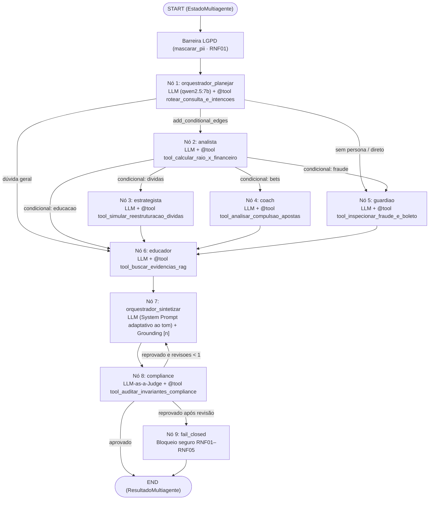

# Spec: Migração dos 7 Agentes para `LangGraph` (`StateGraph`) com Tool Calling Nativo (`qwen2.5:7b` / Ollama)

- **Classificação ATLAS:** `ATLAS · refactor · arquitetura+produto · standard → pesquisa, descoberta, plano, G1, SDD, revisão, verificação, G2 · lanes: arquitetura`
- **Data:** 2026-11-19
- **ADR Vinculado:** [`docs/adr/0002-orquestracao-langgraph-tool-calling.md`](../../adr/0002-orquestracao-langgraph-tool-calling.md)
- **Branch:** `entrega/prototipo-multiagente-quarto-desafio`

---

## 1. Objetivo

Substituir a lógica imperativa hardcoded de roteamento, seleção de ferramentas, geração de *queries* RAG, interpretação de diagnósticos e julgamento de compliance por **agentes LLM reais orquestrados com `LangGraph` (`StateGraph`) e Tool Calling nativo (`@tool` + `bind_tools`)**, utilizando por padrão o modelo local **`qwen2.5:7b` via Ollama** (`langchain-ollama`) — além de suportar os demais modelos de `modelos.yaml` (`llama3.1:8b`, `qwen2.5:14b`, `gemma3:12b` e Anthropic Claude `haiku`/`sonnet` via `langchain-anthropic`).

---

## 2. Arquitetura Alvo (`LangGraph` + Tool Calling nos 7 Agentes)

### Papel do LLM e das `@tool`s em Cada um dos 7 Agentes

| # | Agente (`Node` no `StateGraph`) | System Prompt Especializado | `@tool` Vinculada (`llm.bind_tools`) | O que o LLM Decide / Produz Dinamicamente |
|---|---|---|---|---|
| **1** | **`OrquestradorAgent`** (`orquestrador_planejar` e `orquestrador_sintetizar`) | Supervisor de triagem financeira e comunicador empático adaptativo (`acessivel_idoso`, `parceiro_sem_julgamento`, `objetivo_educativo`, `acolhedor_pratico`). | `tool_classificar_roteamento` | Analisa a consulta mascarada + resumo da persona, invoca a tool de roteamento informando intenções detectadas, especialistas necessários, sinais de crise/CVM e redige a síntese final ancorada nos números das tools e nas citações `[n]`. |
| **2** | **`AnalistaAgent`** (`analista`) | Analista de orçamento doméstico, Mínimo Existencial (Lei 14.181/2021) e séries SGS do Banco Central. | `tool_calcular_raio_x_financeiro` | Invoca a tool de raio-X sobre as transações da persona, interpreta o comprometimento de renda e os comparativos SGS (22022, 25467, 432) e gera um parecer analítico + *queries* normativas específicas. |
| **3** | **`EstrategistaAgent`** (`estrategista`) | Especialista em reestruturação de dívidas (Avalanche vs. Bola de Neve) e proteção contra superendividamento. | `tool_simular_reestruturacao_dividas` | Invoca o simulador determinístico de amortização 12m, interpreta a economia de juros e o déficit vital e formula dinamicamente as *queries* jurídicas para o Educador (Lei 14.181, Lei 14.690, CPC art. 833). |
| **4** | **`CoachAgent`** (`coach`) | Psicólogo econômico e especialista em redução de danos para apostas de quota fixa (Lei 14.790/2023). | `tool_analisar_compulsao_apostas` | Invoca a tool de auditoria de bets (`MCC 7995`), analisa gatilhos de madrugada e pós-salário, redige recomendação de fricção positiva sem julgamento moral e formula *queries* normativas para o Educador. |
| **5** | **`GuardiaoAgent`** (`guardiao`) | Especialista em segurança bancária, validação FEBRABAN (Módulo 10), defesa contra *prompt injection* e MED do Pix. | `tool_inspecionar_fraude_e_boleto` | Invoca a tool de sanitização OCR e auditoria FEBRABAN, interpreta os motivos de fraude no boleto/extrato, orienta o acionamento do MED em até 80 dias e formula *queries* normativas (Res. BCB 147/2021). |
| **6** | **`EducadorAgent`** (`educador`) | Pesquisador jurídico-regulatório (*Research Agent*) ancorado exclusivamente em fontes oficiais. | `tool_buscar_evidencias_rag` | Formula/refina as *queries* de busca a partir dos pedidos dos especialistas, invoca o `Retriever` híbrido (`bge-m3` + `BM25` + `RRF`) via `@tool` e consolida as citações `[n]` aplicando o portão de abstenção `RNF04`. |
| **7** | **`ComplianceAgent`** (`compliance`) | Auditor regulatório e ético (*Validation Agent / LLM-as-a-Judge*) para LGPD, CVM 19/20, Protocolo de Crise 188 e Grounding. | `tool_auditar_invariantes_compliance` | Invoca a tool de verificação de invariantes e avalia semanticamente se o rascunho contém recomendação implícita de ativos, julgamento moral ou omissão de alerta crítico, aprovando ou disparando revisão no grafo. |

---

## 3. Invariantes e Guardrails Preservados (`RNF01–RNF05`)

1. **RNF01 (LGPD / Zero PII):** A máscara `mascarar()` roda obrigatoriamente antes de qualquer chamada ao `ChatOllama` / `ChatAnthropic` e novamente na saída de cada nó.
2. **RNF02 (Trava CVM):** O detector determinístico + o julgamento semântico do `ComplianceAgent` bloqueiam qualquer recomendação de ativo específico e garantem a presença da Recusa Educativa CVM com os 3 critérios objetivos.
3. **RNF03 (0,00% de Erro Numérico):** Nenhum agente calcula juros, saldo, mínimo existencial, perda líquida ou módulo 10 "de cabeça" no prompt — todos os números vêm exclusivamente do retorno das `@tool`s determinísticas e o `ComplianceAgent` valida que os valores exatos foram preservados na síntese.
4. **RNF04 (Anti-Alucinação e Abstenção):** Citações `[n]` vêm exclusivamente dos chunks aprovados pela `tool_buscar_evidencias_rag`; perguntas fora de domínio (ex.: receita de bolo) ativam abstenção segura.
5. **RNF05 (Isolamento contra Prompt Injection):** `documento_ocr` é sanitizado por `sanitizar_documento_nao_confiavel()` antes que qualquer trecho seja exposto ao contexto do LLM.

---

## 4. Critérios de Aceite Verificáveis

- [ ] **CA1:** `services/rag/pyproject.toml` declara `langgraph`, `langchain-core`, `langchain-ollama` e `langchain-anthropic` e instala limpo via `uv sync --extra dev`.
- [ ] **CA2:** `GrafoPandora` constrói e compila um `StateGraph` real do `LangGraph` (`self.workflow.compile()`), com nós e `add_conditional_edges` para os 7 agentes e para o loop de revisão do `ComplianceAgent`.
- [ ] **CA3:** Todos os 7 agentes possuem `System Prompt` próprio e invocam `@tool`s nativas (`langchain_core.tools.tool`) via `llm.bind_tools(...)`, usando `qwen2.5:7b` (Ollama local) como modelo padrão (`llm="qwen25-7b"`), registrando no `trace` (`dados_chave`) o modelo LLM acionado, as `tool_calls` executadas e o parecer/raciocínio gerado.
- [ ] **CA4:** A execução real de `pandora-rag demo` e `pandora-rag agent` com `qwen2.5:7b` no Ollama local conclui as 4 jornadas (`carla_34`, `diego_24`, `julia_31`, `antonio_67`) e o teste fora de domínio com veredito `APROVADO` no Compliance e trace detalhando as chamadas LLM + `@tool`.
- [ ] **CA5:** Toda a suíte automatizada (`pytest tests/ -v`) e o linter (`ruff check`) passam 100% verdes, cobrindo tanto a execução via `LangGraph` + Tool Calling quanto os invariantes *fail-closed*.
