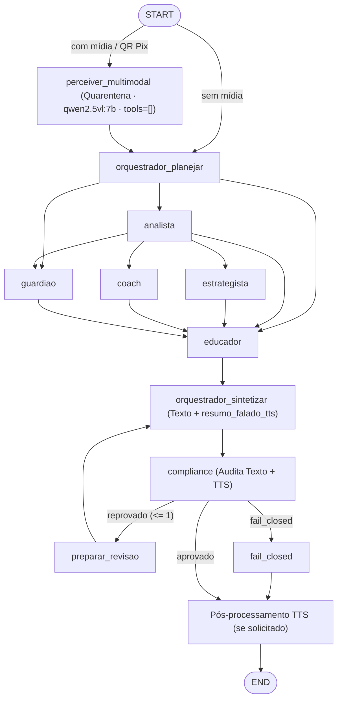

# Spec: Agentes Multimodais do PANDORA (`RF01`, `RF07`, `RF09`, `#73`, `#74`) e Pipeline Otimizado sobre `PR #116`

- **Classificação ATLAS:** `ATLAS · feature · arquitetura+produto+dados · large → pesquisa, descoberta, plano, G1, SDD, revisão, verificação, G2 · lanes: arquitetura`
- **Data:** 2026-11-26
- **ADR Vinculado:** [`docs/adr/0004-agentes-multimodais-perceiver-quarentena.md`](../../adr/0004-agentes-multimodais-perceiver-quarentena.md)
- **Branch:** `feat/agentes-multimodais`

---

## 1. Objetivo

Evoluir o `GrafoPandora` (`StateGraph(EstadoMultiagente)`) para suportar percepção multimodal completa (**Visão/Boletos/Pix QR**, **Extratos OFX/CSV/PDF em 2 Estágios com reconciliação em centavos** e **Voz PT-BR STT/TTS**), com stack local co-residente em 24 GB RAM (`qwen2.5vl:7b` + `qwen2.5:7b` + `faster-whisper small` + `Luciana TTS`), corrigindo gargalos do `PR #116` (*over-masking* de despesas vitais/bets e leituras PDF incompletas).

---

## 2. Arquitetura e Integração no `StateGraph`

---

## 3. Estratégia de Reuso, Correção e Descarte sobre o `PR #116` (`workers/ingestion`)

| Componente do PR #116 | Ação | Detalhe |
|---|---|---|
| `esquema.py`, `ofx.py`, `csv_.py`, `normalizar.py`, `deduplicar.py` | **Reaproveitar 100%** + 3 campos em `Leitura` | `reconciliado: bool \| None = None`, `divergencia_centavos: int = 0`, `usou_ocr: bool = False`. |
| `mascara.py` | **Corrigir *over-masking*** | Preservar termos essenciais/bets (`ALUGUEL`, `LUZ`, `AGUA`, `BET`, `TIGRINHO`, etc.) em `_EMPRESA`, mantendo 100% do mascaramento de nomes reais de PF (`***`). |
| `pdf.py`, `importador.py` | **Estender + Descartar via 2 Estágios** | Hook `extrator_ocr` sobre `PrecisaDeOcr` + `_reconciliar_saldos()`. Se `pdf.py` falhar ou `reconciliado is False`, `ingestao_adapter.py` descarta a leitura incompleta e aciona Estágio 2 (`qwen2.5vl:7b` `ExtratoDocumentalVLM`). |

---

## 4. Invariantes de Segurança e Qualidade (`RNF01–RNF07`)

1. **RNF01 (LGPD / Zero PII + Pass-by-Reference):** Mídia bruta fica apenas no `ArtifactStore` efêmero (`0o700`, remoção de EXIF, `expurgar_tudo()`). Estado carrega somente `ReferenciaMidia`. Percepção roda 100% local (`externo=False`).
2. **RNF02 (CVM):** Nenhum áudio TTS é sintetizado com recomendação específica de ativo; `ComplianceAgent` audita `rascunho_resposta` e `resumo_falado_tts`.
3. **RNF03 (Determinismo):** Validação `ITF-25` (44↔47 dígitos, Módulo 10 + Módulo 11), `EMV BRCode` (`CRC-16/CCITT-FALSE`) e reconciliação de extratos operam em centavos inteiros (`int`).
4. **RNF04 (Citações):** Todo alerta antifraude de boleto/Pix referencia a `Resolução BCB nº 147/2021` (MED Pix, 80 dias) com link oficial.
5. **RNF05 (Anti-Injection Visual):** `PerceiverNode` (`qwen2.5vl:7b`) não recebe `@tool`s e usa JSON Schema fechado (`ExtracaoVisualQuarantinada`). Mídia de pagamento força deterministicamente a passagem pelo `GuardiaoAgent`.
6. **RNF06 (Latência):** Medir `latencia_percepcao_s` e latência total garantindo `p95 <= 12,0 s` em imagem/PDF e áudio.

---

## 5. Critérios de Aceite Verificáveis

- [ ] **CA1:** Merge limpo de `origin/develop` sem quebrar nenhum dos 61 testes originais de `workers/ingestion` nem os 65 testes originais de `services/rag`.
- [ ] **CA2:** `mascara.py` preserva despesas vitais e apostas (`ALUGUEL`, `LUZ`, `BET`) mascarando nomes reais; `ArtifactStore` remove EXIF e impede `base64` no `EstadoMultiagente`.
- [ ] **CA3:** Decodificadores `ITF-25` (Módulo 10/11 + conversão 44↔47) e `EMV BRCode` (`CRC-16`) validam boletos e QR Codes Pix com 100% de exatidão matemática.
- [ ] **CA4:** Pipeline em 2 estágios descarta leitura `pdf.py` não reconciliada em favor do Estágio 2 `qwen2.5vl:7b` e suporta PDF escaneado via `extrator_ocr`.
- [ ] **CA5 (`#74`):** Suíte ao vivo de 20 documentos sintéticos (10 legítimos + 10 adulterados/injection/QR corrompido) atinge taxa de detecção de fraude documental `>= 0,90` com citação oficial da `Resolução BCB 147/2021`.
- [ ] **CA6 (`#73`):** Bloqueio de *Visual Prompt Injection* em 100% dos ataques tipográficos e latência multimodal `p95 <= 12,0 s`, com voz PT-BR (`PyAV` + `faster-whisper small` + `Luciana TTS`) auditada pelo `ComplianceAgent`.
