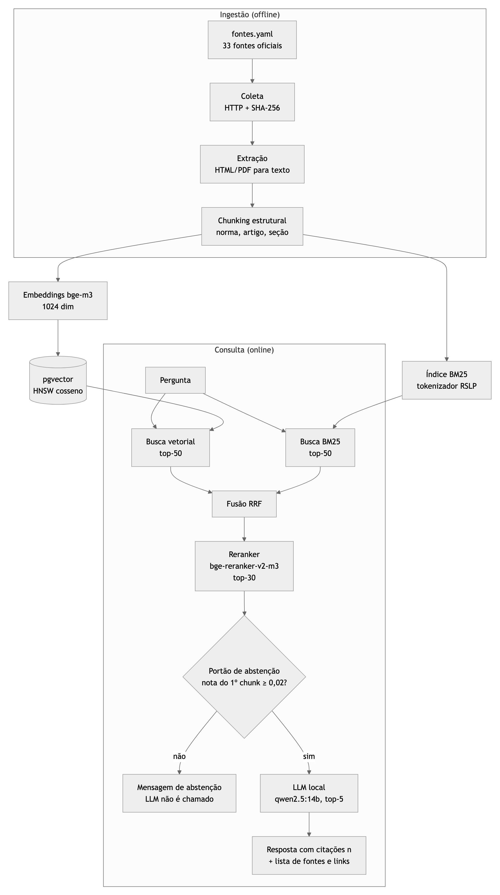
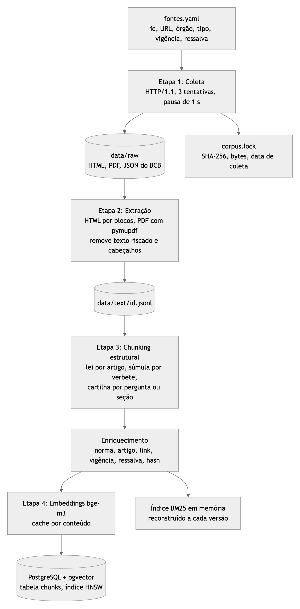

# 5. Diagrama de arquitetura e pipeline de ingestão

## Arquitetura

A ingestão roda offline e alimenta dois índices: vetorial (pgvector) e lexical (BM25). Na consulta, as duas buscas são fundidas por RRF, o reranker reordena os 30 melhores e um portão de abstenção decide se o LLM é chamado: se a nota do melhor chunk fica abaixo de 0,02, o sistema responde que não encontrou nas fontes, sem gerar texto. Quando responde, o LLM local (qwen2.5:14b, via Ollama) só pode usar os trechos numerados, e cada afirmação traz o marcador `[n]` que vira a lista de fontes com link.

Fonte editável: [diagramas/arquitetura.mmd](diagramas/arquitetura.mmd) (também em SVG).

## Pipeline de ingestão

| Etapa | Comando | O que faz |
|---|---|---|
| Coleta | `pandora-rag coletar` | Baixa cada fonte de `fontes.yaml` por HTTP/1.1 (o Planalto recusa HTTP/2), com 3 tentativas e pausa de 1 s. Grava SHA-256, tamanho e data em `corpus.lock`. |
| Extração | `pandora-rag extrair` | HTML por blocos de texto, PDF com pymupdf (sem cabeçalho e rodapé). Remove texto riscado (revogado). Grava `data/text/{id}.jsonl`. |
| Chunking | (parte do `indexar`) | Divisão estrutural com cabeçalho; ver [02](02-estrategia-de-chunking.md). |
| Enriquecimento | (parte do `indexar`) | Norma, artigo, link, vigência, ressalva e hash em cada chunk. |
| Indexação | `pandora-rag indexar` | Embeddings bge-m3 (com cache por conteúdo), carga no pgvector e índice HNSW. |

Fonte editável: [diagramas/pipeline-ingestao.mmd](diagramas/pipeline-ingestao.mmd). Para regerar as imagens: `sh diagramas/render.sh` (precisa de internet e do Chrome).
