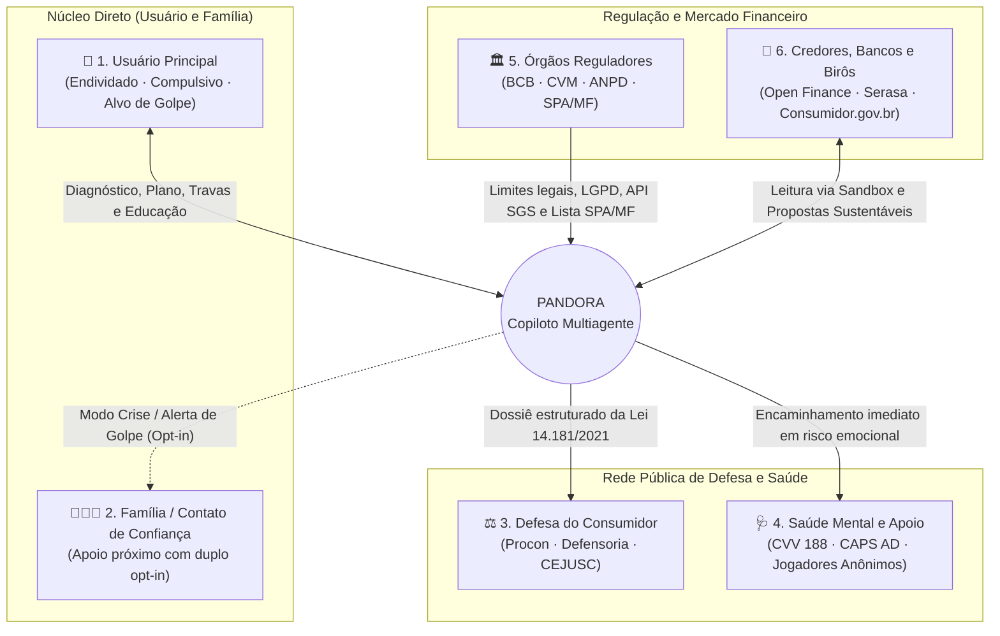

# 03 · Mapa de Stakeholders e Personas

[⬅️ Anterior: 02 · Essential & Guiding Questions](02-essential-e-guiding-questions.md) · [Voltar ao índice](README.md) · [Próximo: 04 · Requisitos (4 Graus) ➡️](04-requisitos-4-graus.md)

---

## 1. Mapa de Stakeholders (6 Atores do Ecossistema)

O ecossistema do **PANDORA** conecta **6 grupos de stakeholders** diretamente ligados à recuperação financeira, defesa legal e proteção de saúde mental do cidadão:

| # | Stakeholder | Interesse Principal | Dores / Restrições Atuais | Como o PANDORA Entrega Valor |
|---|---|---|---|---|
| **1** | **Pessoa Endividada, Compulsiva ou Alvo de Golpe** *(Usuário Primário)* | Sair do sufoco, estancar perdas com juros ou apostas e recuperar a paz mental sem julgamento. | Vergonha; dificuldade com planilhas; medo de bloqueio salarial; vulnerabilidade a golpes. | Interface PWA acessível (texto, áudio e foto), tom empático, privacidade estrita e plano que preserva o mínimo existencial. |
| **2** | **Família / Contato de Confiança** *(Usuário Secundário)* | Proteger o orçamento doméstico e apoiar o familiar em recaídas ou tentativas de golpe sem invadir sua privacidade. | Falta de visibilidade até que a dívida ou o golpe já tenha consumido as economias da casa. | **"Modo Crise"** e botão **"Compartilhar Alerta de Golpe"** baseados em **duplo consentimento (opt-in)**. |
| **3** | **Órgãos de Defesa do Consumidor** *(Procon, Defensoria, CEJUSC)* | Garantir a aplicação da Lei 14.181/2021 e agilizar audiências globais de repactuação. | O cidadão chega ao atendimento sem contratos, sem saber o CET das dívidas e sem o cálculo de despesas vitais. | Gera o **Dossiê de Repactuação**: Mapa de Dívidas, comparativo com taxas do BCB e cálculo do Mínimo Existencial familiar. |
| **4** | **Rede de Saúde Mental e Apoio** *(CVV 188, CAPS AD, Jogadores Anônimos)* | Receber encaminhamento rápido e seguro de pessoas em sofrimento psíquico agudo ou com transtorno do jogo (`CID-11 6C50`). | Apps financeiros ignoram sinais de desespero humano; por outro lado, IAs não podem fazer terapia clínica. | Guardrail interrompe o fluxo financeiro ao detectar risco emocional e conecta o usuário em 1 toque ao `CVV 188`, CAPS e JA. |
| **5** | **Órgãos Reguladores** *(BCB, CVM, ANPD, SPA/MF)* | Proteção de dados (LGPD), combate a apostas ilegais, uso correto do MED Pix e vedação à consultoria irregular (CVM). | Proliferação de *bets* clandestinas, vazamento de dados e influenciadores/robôs recomendando ativos ilegalmente. | Mascaramento de PII, checagem na lista oficial da SPA/MF, guia do MED Pix e bloqueio de recomendação de ativos (Res. CVM 19/20). |
| **6** | **Credores, Bancos e Birôs** *(Open Finance, Serasa)* | Recuperar crédito vencido de maneira sustentável, reduzindo a quebra de acordos (*re-default*). | Acordos fechados em feirões sem análise do orçamento real do devedor quebram já no segundo mês. | Simula propostas de renegociação (Avalanche/Bola de Neve) que cabem na margem real após o mínimo existencial. |

---

## 2. As 5 Personas Exclusivas do Sistema

> 👥 **Fichas Completas:** O detalhamento completo de cada persona está em **[`docs/personas/`](../personas/README.md)**, e os dados transacionais correspondentes estão em **[`amostra_transacoes_sinteticas_personas.csv`](../evidencias/datasets/amostra_transacoes_sinteticas_personas.csv)**.

| # | Persona e Renda | Contexto e Gatilho da Crise | Dificuldades / Barreiras | Como o PANDORA Ajuda |
|---|---|---|---|---|
| **01** | **[Carla Mendes, 34](../personas/01-carla-superendividamento.md)** Atendente CLT · Mãe solo (2 filhos) **R$ 2.850/mês (Fixa)** | **73,6%** da renda vai para o mínimo existencial (R$ 2.100). Acumula R$ 4.200 no rotativo (**448% a.a.**), empréstimo e luz atrasada. | Medo de conectar o banco e ter o salário retido; pavor de penhora salarial; paralisia com siglas ("CET", "IOF"). | **Upload de PDFs**, blindagem dos R$ 2.100 vitais, método *Avalanche*, citação do **CPC art. 833** e dossiê da **Lei 14.181/2021** (*Módulos 1 e 3*). |
| **02** | **[Diego Oliveira, 24](../personas/02-diego-compulsao-bets.md)** Entregador de app (Moto) **~R$ 1.120/semana (Variável)** | Aposta via Pix minutos após receber o repasse de quarta-feira e escala valores entre **23h e 03h** (*chasing losses*). Atrasou a parcela da moto. | Reatância a sermões morais; impulso de desligar limites na madrugada; ilusão de ganho com pequenos prêmios. | Cruzamento com lista **SPA/MF**, cálculo da **perda líquida real**, *nudge* pós-repasse ("5 tanques de gasolina"), trava com **janela de 24h–48h** e atalho JA/CVV (*Módulos 2 e 5*). |
| **03** | **[Sr. Antônio Ferreira, 67](../personas/03-antonio-golpes-e-consignado.md)** Aposentado INSS · Viúvo **R$ 2.412/mês (Fixa)** | 30% do benefício em consignado. Pagou **boleto falso de R$ 1.198** via WhatsApp e sofreu assédio de "falsa central" pedindo Pix de R$ 1.800. | Humilhação pós-golpe; dificuldade visual com telas pequenas (presbiopia); lentidão para digitar; pânico sob pressão. | Interface **Voz (STT/TTS) + Foto**, checagem FEBRABAN/CNPJ de boletos, roteiro falado do **MED do Pix (Res. BCB 147/2021)** e auditoria INSS (`SGS 25467`) (*Módulos 5 e 7*). |
| **04** | **[Mariana Costa, 28](../personas/04-mariana-impulso-e-cartoes.md)** Designer MEI / Freelancer **R$ 3.200 a R$ 5.800/mês (Volátil)** | Espalha 22 parcelamentos em 4 bancos digitais, faz compras noturnas por estresse, mistura MEI × PF e paga fatura com outro cartão. | Abandona planilhas manuais em 5 dias; insumos de trabalho MEI classificados errado como "Lazer"; falha de orçamentos fixos. | Consolidação **Open Finance multi-banco**, reclassificação em 1 toque, detecção de impulso (`Isolation Forest`) e previsão de caixa 30/60/90d (`Prophet`) (*Módulos 1, 2 e 4*). |
| **05** | **[Júlia Santos, 31](../personas/05-julia-reconstrucao-e-reserva.md)** Analista CLT · Pós-dívida **R$ 4.500/mês (Poupa R$ 500)** | Quitou dívidas há 3 meses, mas tem trauma de recair (42% reincidem em 10 anos) e sofre bombardeio de *finfluencers* prometendo ganhos irreais. | Frustração se receber uma recusa seca da IA; desmotivação em metas longas (6 meses de reserva); dúvida entre Selic, CDI e IPCA. | Escada de micro-metas ("Dias de Tranquilidade"), simulador com séries **SGS (`432`, `12`, `433`)** e **Recusa Educativa CVM** ensinando critérios de liquidez e FGC (*Módulos 4 e 6*). |
