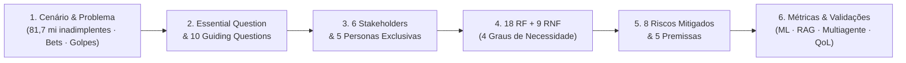

# 🧭 Escopo e Concepção do Projeto — PANDORA

> **Challenge 2 · CBL (Challenge-Based Learning)**
> **Big Idea:** Qualidade de Vida — *"Empoderando pessoas com IA para compreender melhor, decidir melhor e viver melhor."*
> **Tema do Grupo:** Finanças Pessoais, Superendividamento e Comportamento Financeiro Compulsivo
> **Projeto:** **PANDORA** (*Copiloto de IA para sair das dívidas, controlar gastos compulsivos e reconstruir a vida financeira*)

---

## 📄 Versão Consolidada em PDF (Pronta para Impressão / Entrega)

- 📕 **[`PANDORA-Documento-de-Escopo-CBL.pdf`](PANDORA-Documento-de-Escopo-CBL.pdf)** — Documento de 3 a 5 páginas formatado com tipografia limpa, tabelas paginadas e diagramas visuais.

---

## 🗂️ Navegação Modular do Escopo (Leitura Rápida no GitHub)

Assim como na pasta [`docs/personas/`](../personas/README.md), o escopo completo foi organizado em **6 documentos modulares** com tabelas enxutas e navegação sequencial (*Anterior / Próximo*), além do arquivo Markdown único ([`documento-completo-cbl.md`](documento-completo-cbl.md)):

| # | Documento do Escopo | Tópicos Cobertos | Leitura |
|---|---|---|---|
| **01** | **Cenário Escolhido e Problema** | Contexto brasileiro (2024–2026), lacunas das soluções atuais, os 5 eixos de evidências (Serasa, CNC, BCB, Datafolha) e impacto na qualidade de vida. | [📄 Ler 01 · Cenário e Problema](01-cenario-e-problema.md) |
| **02** | **Essential Question e 10 Guiding Questions** | A *Essential Question* da equipe e as **10 perguntas-guia** respondidas com decisões de arquitetura, psicologia econômica e leis. | [📄 Ler 02 · Essential & Guiding Questions](02-essential-e-guiding-questions.md) |
| **03** | **Mapa de Stakeholders e Personas** | Os **6 stakeholders do ecossistema** (diagrama e matriz de valor) e o resumo integrado das **5 personas exclusivas**. | [📄 Ler 03 · Stakeholders e Personas](03-stakeholders-e-personas.md) |
| **04** | **Requisitos Funcionais e Não Funcionais** | Índice de **4 Graus de Necessidade** (*Must, Should, Could, Won't*) distribuindo os **18 RF** e **9 RNF** com metas técnicas. | [📄 Ler 04 · Requisitos (4 Graus)](04-requisitos-4-graus.md) |
| **05** | **Riscos e Premissas do Projeto** | Matriz de **8 riscos críticos** (alucinação, gatilho emocional, CVM, LGPD, *prompt injection*) com mitigações e **5 premissas**. | [📄 Ler 05 · Riscos e Premissas](05-riscos-e-premissas.md) |
| **06** | **Métricas, Limites, Testes e Validações** | Limites matemáticos (*thresholds*), massas de teste (*Golden Set*) e protocolos experimentais para **ML, RAG, Multiagente e Qualidade de Vida**. | [📄 Ler 06 · Métricas e Validações](06-metricas-e-validacoes.md) |
| **📚** | **Documento Único Consolidado (Markdown)** | Versão contínua em um único arquivo `.md` reunindo todas as 10 seções e referências bibliográficas. | [📄 Ler Documento Completo (.md)](documento-completo-cbl.md) |

---

## 🔗 Visão Geral da Arquitetura do Escopo

