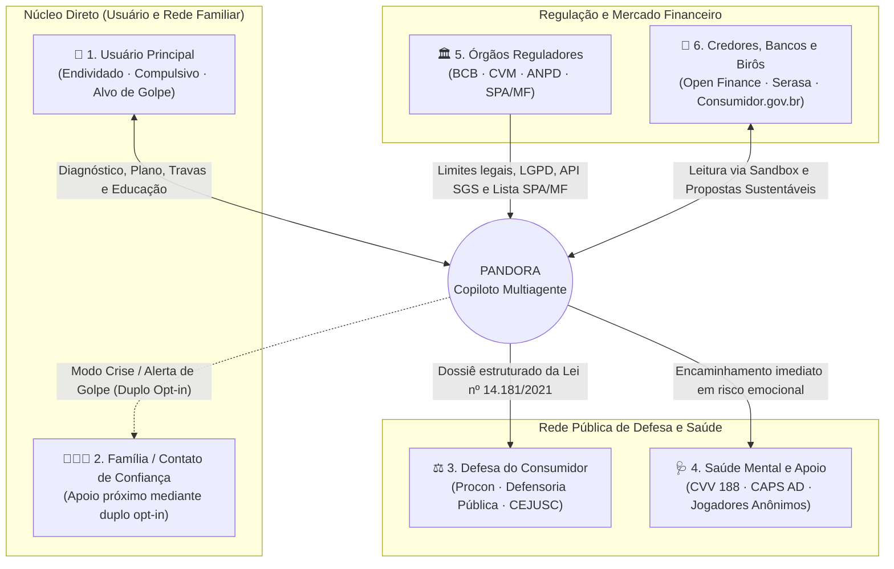

# PROJETO PANDORA: ARQUITETURA MULTIAGENTE E APRENDIZADO DE MÁQUINA PARA REESTRUTURAÇÃO DE DÍVIDAS, MITIGAÇÃO DE COMPULSÃO FINANCEIRA E PROTEÇÃO AO CONSUMIDOR

**Documento Científico de Concepção, Especificação de Escopo e Metodologia de Validação — Challenge 2 (CBL)**
**Grande Ideia (Big Idea):** Qualidade de Vida — *"Empoderando pessoas com IA para compreender melhor, decidir melhor e viver melhor"*
**Área Temática:** Finanças Pessoais, Superendividamento, Comportamento Financeiro Compulsivo e Segurança Digital
**Data de Publicação:** Outubro de 2026

---

## RESUMO

A digitalização acelerada do Sistema Financeiro Nacional promoveu inclusão bancária e liquidez instantânea, mas reduziu drasticamente as fricções cognitivas para a tomada de crédito de alto custo, para as apostas online de quota fixa (*bets*) e para a vitimização por golpes digitais. No Brasil contemporâneo, 81,7 milhões de adultos encontram-se inadimplentes, o rotativo do cartão de crédito atinge 435,9% ao ano e aproximadamente R$ 20,8 bilhões mensais são transferidos via Pix para plataformas de apostas, deteriorando a saúde mental e o mínimo existencial das famílias. Este documento apresenta a concepção científica, o mapeamento de *stakeholders* e personas, a engenharia de requisitos graduada em quatro níveis de necessidade e o protocolo de validação experimental do **PANDORA** (*Personal AI Navigator for Debt Organization, Recovery and Autonomy*). A arquitetura proposta adota o princípio *"determinístico onde é possível, probabilístico onde é necessário"*, combinando motores matemáticos exatos de amortização, modelos de aprendizado de máquina para classificação transacional e detecção de anomalias temporais, recuperação aumentada por geração (RAG Híbrido) sobre normas do Banco Central do Brasil (BCB), Comissão de Valores Mobiliários (CVM) e legislação consumerista (Leis nº 14.181/2021, nº 14.690/2023 e nº 14.790/2023), além de um copiloto multimodal acessível por voz e imagem sob *guardrails* estritos de proteção de dados (LGPD) e saúde mental (`CVV 188`).

**Palavras-chave:** Inteligência Artificial Multiagente; Superendividamento; Mínimo Existencial; Transtorno do Jogo (*Bets*); Recuperação Aumentada por Geração (RAG); Qualidade de Vida.

---

## SUMÁRIO

1. [Introdução e Cenário Escolhido](#1-introdução-e-cenário-escolhido)
2. [Formulação do Problema e Evidências Empíricas](#2-formulação-do-problema-e-evidências-empíricas)
   - 2.1 [Evidências Quantitativas e Macroeconômicas](#21-evidências-quantitativas-e-macroeconômicas)
   - 2.2 [Impacto Clínico, Psicométrico e Jurídico na Qualidade de Vida](#22-impacto-clínico-psicométrico-e-jurídico-na-qualidade-de-vida)
3. [Questão Essencial (*Essential Question*) e Questões Norteadoras (*Guiding Questions*)](#3-questão-essencial-essential-question-e-questões-norteadoras-guiding-questions)
   - 3.1 [Questão Essencial da Equipe](#31-questão-essencial-da-equipe)
   - 3.2 [Matriz das 10 Questões Norteadoras (*Guiding Questions*)](#32-matriz-das-10-questões-norteadoras-guiding-questions)
4. [Mapeamento de *Stakeholders* do Ecossistema](#4-mapeamento-de-stakeholders-do-ecossistema)
5. [Perfis Comportamentais e Personas do Sistema](#5-perfis-comportamentais-e-personas-do-sistema)
   - 5.1 [Personas Nucleares de Validação Experimental (01 a 05)](#51-personas-nucleares-de-validação-experimental-01-a-05)
   - 5.2 [Personas Complementares de Cobertura Socioeconômica Estendida (06 a 10)](#52-personas-complementares-de-cobertura-socioeconômica-estendida-06-a-10)
6. [Engenharia de Requisitos e Priorização em 4 Graus de Necessidade](#6-engenharia-de-requisitos-e-priorização-em-4-graus-de-necessidade)
   - 6.1 [Índice de Grau de Necessidade (Escala de 4 Graus)](#61-índice-de-grau-de-necessidade-escala-de-4-graus)
   - 6.2 [Especificação dos Requisitos Funcionais (RF01 a RF18)](#62-especificação-dos-requisitos-funcionais-rf01-a-rf18)
   - 6.3 [Especificação dos Requisitos Não Funcionais (RNF01 a RNF09)](#63-especificação-dos-requisitos-não-funcionais-rnf01-a-rnf09)
7. [Análise de Riscos Arquiteturais, Clínicos e Regulatórios](#7-análise-de-riscos-arquiteturais-clínicos-e-regulatórios)
8. [Premissas Metodológicas e Operacionais](#8-premissas-metodológicas-e-operacionais)
9. [Metodologia de Avaliação, Métricas de Sucesso, Limites e Validações](#9-metodologia-de-avaliação-métricas-de-sucesso-limites-e-validações)
   - 9.1 [Validação dos Modelos de Aprendizado de Máquina (`services/ml`)](#91-validação-dos-modelos-de-aprendizado-de-máquina-servicesml)
   - 9.2 [Validação do Pipeline RAG e Qualidade Generativa (`evals/` + Ragas)](#92-validação-do-pipeline-rag-e-qualidade-generativa-evals--ragas)
   - 9.3 [Validação do Sistema Multiagente, Multimodalidade e Guardrails](#93-validação-do-sistema-multiagente-multimodalidade-e-guardrails)
   - 9.4 [Validação de Impacto em Qualidade de Vida e Compreensão Decisória](#94-validação-de-impacto-em-qualidade-de-vida-e-compreensão-decisória)
10. [Referências Bibliográficas e Normativas](#10-referências-bibliográficas-e-normativas)

---

## 1. Introdução e Cenário Escolhido

O projeto **PANDORA** insere-se no cenário das **finanças pessoais, proteção ao consumidor e saúde financeira de famílias brasileiras em situação de vulnerabilidade socioeconômica, superendividamento ou compulsão financeira**. No período recente (2024–2026), a modernização tecnológica do Sistema Financeiro Nacional — impulsionada pela consolidação do Pix, pela expansão do Open Finance e pela oferta massiva de crédito digital — proporcionou conveniência transacional sem precedentes. Contudo, essa mesma infraestrutura reduziu severamente os mecanismos de reflexão e fricção antes da tomada de decisões financeiras de alto risco, expondo milhões de cidadãos ao crédito rotativo com taxas extorsivas, às apostas esportivas e jogos online de quota fixa (*bets*) e a esquemas sofisticados de engenharia social.

Nesse contexto, indivíduos submetidos a estresse financeiro crônico tomam decisões sob intensa sobrecarga cognitiva, fadiga decisória, estigma social e assimetria informacional perante instituições financeiras. As ferramentas atualmente disponíveis no mercado falham estruturalmente porque tratam o fenômeno de forma fragmentada e desconsideram os determinantes comportamentais e jurídicos do problema, conforme sintetizado na **Tabela 1**.

**Tabela 1 — Análise comparativa entre as alternativas atuais de mercado e a abordagem proposta pelo sistema PANDORA.**

| Alternativa Atual no Mercado | Principal Limitação / Falha Estrutural | Diferencial Científico e Arquitetural do PANDORA |
|---|---|---|
| **Aplicativos de Bancos e Carteiras Digitais** | Enxergam apenas a própria instituição e possuem conflito de interesses intrínseco (rentabilizam sobre o rotativo, parcelamentos de fatura e crédito consignado). | Visão consolidada multi-banco (Open Finance / upload documental) e atuação **100% isenta**, orientada à minimização do Custo Efetivo Total (CET) pago pelo cidadão. |
| **Planilhas e Gerenciadores Tradicionais de Gastos** | Exigem disciplina manual contínua, pressupõem estabilidade emocional e ignoram gatilhos de compulsão, ansiedade ou volatilidade de renda. | Classificação automática via *Machine Learning*, detecção de anomalias temporais (gastos e apostas na madrugada) e orçamento adaptativo por piso de renda. |
| **Feirões de Renegociação** *(Serasa Limpa Nome, Desenrola)* | Atuam pontualmente sobre o estoque da dívida passada sem proteger o fluxo de caixa mensal nem alterar o comportamento gerador da dívida (42% reincidem). | Blindagem prévia de 100% do **Mínimo Existencial** (Lei nº 14.181/2021), simulação determinística de capacidade real de pagamento e acompanhamento contínuo. |
| **Educação Financeira Genérica e *Finfluencers*** | Conteúdo abstrato desconectado da fatura real do usuário ou enviesado por promessas de retorno rápido sem risco (*day trade*, criptoativos, pirâmides). | Educação financeira *just-in-time* (Lusardi & Mitchell, 2014) ancorada nos próprios números do usuário e em fontes públicas via RAG (BCB, CVM, Tesouro), sob *guardrails* regulatórios. |
| **Rede Pública de Defesa e Saúde Mental** *(Procon, Defensoria, CAPS, JA)* | Acionada tardiamente e desconectada dos dados financeiros cotidianos; o cidadão comparece ao atendimento sem documentação estruturada. | Detecção precoce de marcadores de crise, geração automática do dossiê de repactuação legal e encaminhamento acolhedor imediato (`CVV 188`, CAPS AD, JA). |

*Fonte: Elaborado pelos autores com base na revisão da literatura e análise de mercado (2026).*

---

## 2. Formulação do Problema e Evidências Empíricas

O problema científico e social endereçado pelo projeto consiste na **espiral de deterioração da qualidade de vida desencadeada pela interação entre superendividamento estrutural familiar, taxas de juros extremas, comportamento financeiro compulsivo em apostas online (*bets*) e vitimização por golpes financeiros digitais**, quadro agravado pela opacidade dos contratos bancários e pelo desconhecimento dos instrumentos legais de defesa do consumidor.

### 2.1 Evidências Quantitativas e Macroeconômicas

Os levantamentos estatísticos oficiais e relatórios técnicos catalogados no repositório de evidências do projeto (`docs/evidencias/`) demonstram a severidade do problema em escala nacional, estruturados nos cinco eixos da **Tabela 2**.

**Tabela 2 — Síntese das evidências empíricas e macroeconômicas do problema financeiro no Brasil (2024–2026).**

| Eixo do Problema | Indicador Estatístico Oficial no Brasil | Fonte Institucional e Período | Consequência Direta na Qualidade de Vida Familiar |
|---|---|---|---|
| **1. Inadimplência Crônica e Reincidência** | **81,7 milhões** de brasileiros inadimplentes (recorde histórico); **332 milhões** de dívidas ativas; média de **R$ 6.598,13 por pessoa**. | Serasa Experian — *Mapa da Inadimplência: Edição de 10 Anos* (mar./2026) | Expansão de 38% em uma década; **42% dos devedores já estavam negativados há 10 anos**, comprovando que renegociar sem reeducar e constituir reserva gera reincidência. |
| **2. Endividamento Doméstico Estrutural** | **81,7%** das famílias brasileiras endividadas (pico histórico de **82,0%** em jul.–ago./2026); **29,6%** com contas em atraso; **12,5%** sem condições de pagar. | Confederação Nacional do Comércio (CNC) — *Pesquisa PEIC Nacional* (jul.–set./2026) | O **cartão de crédito** figura em **85,3%** dos lares endividados; o serviço da dívida passa a competir diretamente com despesas vitais de alimentação, moradia e energia elétrica. |
| **3. Assimetria Informacional e Juros Extremos** | Rotativo do cartão de crédito a **435,9% a.a.**; cheque especial a **~130% a.a.**; crédito pessoal livre a **61,7% a.a.** | Banco Central do Brasil (API SGS) / Agência Brasil / Senado Notícias (fev.–mai./2026) | O consumidor paga o "valor mínimo da fatura" acreditando manter a adimplência e desconhece o limite legal de 100% sobre o valor original da dívida (**Lei nº 14.690/2023**). |
| **4. Compulsão em Apostas Online (*Bets*)** | **R$ 20,8 bilhões/mês** transferidos via Pix a 56 operadoras de apostas; **24 milhões** de apostadores mensais no país. | Banco Central do Brasil — *Estudo Especial nº 119/2024* (set./2024) | Forte concentração entre jovens de 20 a 30 anos e drenagem de renda de subsistência (**R$ 3 bilhões** enviados por **5 milhões** de beneficiários do Bolsa Família em um único mês). |
| **5. Epidemia de Golpes Financeiros Digitais** | **24 milhões** de brasileiros vítimas de golpes via Pix ou boleto falso em 12 meses; prejuízo agregado de **quase R$ 29 bilhões** (**R$ 1.198/vítima**). | Instituto Datafolha / Fórum Brasileiro de Segurança Pública (FBSP) (ago./2025) | Pessoas idosas constituem o grupo mais vulnerável a boletos adulterados e falsas centrais telefônicas; uma única fraude compromete meses de renda previdenciária. |

*Fonte: Elaborado pelos autores a partir de dados públicos da Serasa Experian (2026), CNC (2026), BCB (2024, 2026) e Datafolha/FBSP (2025).*

### 2.2 Impacto Clínico, Psicométrico e Jurídico na Qualidade de Vida

A literatura científica internacional estabelece que o estresse financeiro severo (*financial distress*) atua como preditor direto de **insônia, transtornos de ansiedade generalizada, episódios depressivos, desagregação familiar e perda de produtividade laboral**, fenômenos mensurados por instrumentos psicométricos validados, tais como a *InCharge Financial Distress/Financial Well-Being Scale* (Prawitz et al., 2006) e a *CFPB Financial Well-Being Scale* (CFPB, 2017). No âmbito psiquiátrico, a Organização Mundial da Saúde classifica o transtorno do jogo (*Gambling Disorder*) na **CID-11 sob o código `6C50`**, caracterizado pela perda de controle sobre o ato de apostar, priorização do jogo em detrimento de obrigações vitais e escalada de apostas para recuperar perdas (*chasing losses*). No plano jurídico nacional, a **Lei nº 14.181/2021** (Lei do Superendividamento) positivou a proteção do **mínimo existencial** como corolário da dignidade da pessoa humana, proibindo que o pagamento de dívidas de consumo prive o cidadão e sua família das condições materiais básicas de sobrevivência.

---

## 3. Questão Essencial (*Essential Question*) e Questões Norteadoras (*Guiding Questions*)

### 3.1 Questão Essencial da Equipe

> **Questão Essencial (*Essential Question*):** *"Como agentes de Inteligência Artificial, apoiados em evidências empíricas e fontes normativas confiáveis, podem ajudar pessoas endividadas ou com comportamento financeiro compulsivo a recuperar o controle das finanças e, com isso, a qualidade de vida?"*

### 3.2 Matriz das 10 Questões Norteadoras (*Guiding Questions*)

Para desdobrar a Questão Essencial em requisitos verificáveis de engenharia de software, aprendizado de máquina, economia comportamental e conformidade jurídica, foram formuladas e respondidas **10 Questões Norteadoras (*Guiding Questions*)**, detalhadas na **Tabela 3**.

**Tabela 3 — Matriz das 10 Questões Norteadoras (*Guiding Questions*) e respectivas soluções arquitetadas no PANDORA.**

| Código | Eixo Científico | Questão Norteadora (*Guiding Question*) | Resposta Metodológica e Solução Arquitetada no PANDORA |
|---|---|---|---|
| **GQ01** | **Visibilidade e Diagnóstico** | *O que a pessoa endividada ou compulsiva **não consegue enxergar** sozinha na própria movimentação financeira?* | O indivíduo não visualiza: (a) a perda líquida real acumulada em microtransferências via Pix para *bets* (mascarada por pequenos prêmios esporádicos); (b) o custo exponencial (CET anualizado) de pagar apenas o mínimo do cartão; (c) o efeito cumulativo de dezenas de parcelamentos distribuídos em múltiplos cartões; e (d) qual fração da sua renda compõe o **mínimo existencial** intocável. |
| **GQ02** | **Economia Comportamental** | *Em que momento uma intervenção de IA (alerta, trava, diálogo) altera efetivamente o comportamento, e quando ela se torna ruído ou gatilho de culpa?* | Repreensões morais geram reatância psicológica, vergonha e abandono do aplicativo. A intervenção é eficaz quando ocorre **próxima ao gatilho temporal** (ex.: minutos após o crédito do repasse semanal ou na janela crítica das 23h às 03h), adota **linguagem livre de estigma** e aplica **fricção positiva voluntária** (*cooling-off period* de 24h a 48h para desativação de limites e *nudges* de custo de oportunidade — Thaler & Sunstein, 2008). |
| **GQ03** | **Direitos e Assimetria Legal** | *Que informação normativa oficial os cidadãos desconhecem e que poderia reduzir substancialmente o custo de suas dívidas?* | Os consumidores desconhecem: (1) o direito à **repactuação global de dívidas** em até 5 anos com preservação do mínimo existencial (**Lei nº 14.181/2021**); (2) o teto legal de **100% do valor original** para juros do rotativo (**Lei nº 14.690/2023**); (3) o limite de **8% a.m.** no cheque especial (**Res. CMN nº 4.765/2019**); e (4) a **impenhorabilidade** absoluta do salário, da aposentadoria e do bem de família (**CPC art. 833 / Lei nº 8.009/1990**). |
| **GQ04** | **Prevenção e Resposta a Fraudes** | *Como proteger cidadãos vulneráveis (especialmente idosos) no instante em que estão sob pressão psicológica de um golpe de Pix ou boleto falso?* | Disponibilizando um canal multimodal de mínima fricção (**Voz STT/TTS + Fotografia**) no qual o agente `Guardião` valida a estrutura FEBRABAN dos 47 dígitos da linha digitável, confronta o CNPJ/CPF do beneficiário real com a logomarca impressa, detecta padrões de engenharia social em capturas de tela e, caso a transferência Pix já tenha ocorrido, gera o roteiro imediato para acionamento do **MED (Res. BCB nº 147/2021)** em até 80 dias. |
| **GQ05** | **Volatilidade de Renda (MEI/App)** | *Como estruturar o orçamento e evitar o endividamento cruzado em cartões para trabalhadores de aplicativo e autônomos (MEI) cuja renda oscila semanalmente?* | Substituindo regras orçamentárias estáticas (como 50-30-20 sobre renda fixa) por um **Orçamento Baseado em Piso de Renda Conservador**, segregando despesas operacionais PJ/MEI de gastos pessoais e empregando modelos de séries temporais (**Prophet / ETS**) para projetar déficits de caixa em horizontes de 30, 60 e 90 dias antes do vencimento das faturas. |
| **GQ06** | **Determinismo vs. IA Generativa** | *Como impedir que um grande modelo de linguagem (LLM) alucine cálculos de juros compostos, prazos processuais ou invente dispositivos legais?* | Aplicando o princípio arquitetural **"Determinístico onde é possível, probabilístico onde é necessário"**: toda aritmética financeira (juros compostos, CET, Tabela Price, ordenação *Avalanche* e *Bola de Neve*) é executada exclusivamente por funções Python determinísticas tipadas; e toda resposta normativa exige recuperação prévia via **RAG Híbrido (`pgvector` + BM25)** com citação verificável ou abstenção explícita. |
| **GQ07** | **Fronteira Regulatória (CVM)** | *Como capacitar uma pessoa recém-saída do endividamento a constituir sua Reserva de Emergência sem infringir as normas de consultoria de valores mobiliários da CVM?* | Observando estritamente as **Resoluções CVM nº 19/2021, nº 20/2021 e nº 30/2021**: o sistema aplica questionário educacional de perfil de risco (*suitability*), simula rendimentos reais utilizando as séries oficiais do BCB (**Selic `432`, CDI `12`, IPCA `433`**) apenas sobre **classes gerais de ativos**, e o `Compliance Guard` intercepta qualquer pedido de indicação de ações, fundos ou títulos privados específicos, convertendo o bloqueio em uma **Recusa Educativa**. |
| **GQ08** | **Privacidade e Segurança (LGPD)** | *Como processar extratos bancários, boletos e relatos emocionais sensíveis assegurando conformidade integral com a LGPD e resiliência contra ataques?* | Mediante arquitetura *Privacy by Design* (**Lei nº 13.709/2018**): mascaramento local de dados pessoais identificáveis (CPF, nome, agência/conta) antes do *LLM Gateway*, coleta de consentimento granular específico, direito de exclusão integral sob demanda (incluindo vetores no banco de *embeddings*), encapsulamento de textos extraídos via OCR contra *Prompt Injection* indireto e operação 100% *read-only* (ausência de ferramentas de movimentação financeira). |
| **GQ09** | **Bioética e Saúde Mental em Crise** | *Qual é a fronteira ética de atuação de um agente de IA diante de um usuário em sofrimento psíquico severo decorrente de dívidas ou transtorno do jogo?* | O sistema jamais simula atendimento psicológico ou psiquiátrico clínico. Ao identificar marcadores linguísticos de desespero agudo, ideação autolesiva ou colapso emocional no `Compliance Guard`, o fluxo financeiro e de cobrança de metas é imediatamente suspenso, acionando-se o **Protocolo de Crise**, que apresenta contato direto em um toque com o **CVV (`188`)**, **CAPS AD** e **Jogadores Anônimos (JA)**. |
| **GQ10** | **Mensuração de Qualidade de Vida** | *Como demonstrar cientificamente que a intervenção do sistema promoveu ganho real de **qualidade de vida**, para além de métricas contábeis?* | Combinando indicadores financeiros objetivos (preservação de 100% do mínimo existencial, redução do CET médio ponderado e dias consecutivos em abstinência de apostas) com a variação pré e pós-intervenção em escalas psicométricas internacionalmente validadas: **InCharge IFDFW (Prawitz et al., 2006)** e **CFPB Financial Well-Being Scale (CFPB, 2017)**. |

*Fonte: Elaborado pelos autores (2026).*

---

## 4. Mapeamento de *Stakeholders* do Ecossistema

O ecossistema sociotécnico do **PANDORA** articula **6 grupos de *stakeholders*** diretamente envolvidos na recuperação financeira, na tutela de direitos do consumidor e na rede de apoio psicossocial do cidadão, representados na **Figura 1** e detalhados na **Tabela 4**.

*Figura 1 — Topologia de interação entre o núcleo multiagente PANDORA e os 6 grupos de stakeholders do ecossistema. Fonte: Elaborado pelos autores (2026).*

**Tabela 4 — Matriz analítica de interesses, restrições operacionais e proposta de valor para os 6 stakeholders.**

| # | Grupo de *Stakeholder* | Interesse Primário no Ecossistema | Dores e Restrições Atuais | Entrega de Valor pelo Sistema PANDORA |
|---|---|---|---|---|
| **1** | **Pessoa Endividada, Compulsiva ou Alvo de Golpe** *(Usuário Primário)* | Estancar perdas com juros abusivos ou apostas, proteger o sustento familiar e recuperar a tranquilidade mental sem sofrer julgamento moral. | Vergonha de expor a situação; baixa literacia financeira; receio de bloqueio salarial; vulnerabilidade cognitiva a fraudes. | Interface PWA acessível (texto, voz e imagem), comunicação empática, privacidade estrita e plano de ação que blinda o mínimo existencial. |
| **2** | **Família / Contato de Confiança** *(Usuário Secundário)* | Proteger o orçamento doméstico e apoiar o ente familiar em episódios de recaída ou tentativa de golpe, sem violar sua autonomia. | Ausência de visibilidade até que a dívida ou a fraude já tenha exaurido os recursos da família; desgaste nas relações familiares. | **"Modo Crise"** e recurso **"Compartilhar Alerta de Golpe"** operados sob **duplo consentimento explícito (*opt-in*)**, emitindo apenas avisos pontuais acordados. |
| **3** | **Órgãos de Defesa do Consumidor** *(Procon, Defensoria Pública, CEJUSC)* | Assegurar a efetividade da Lei do Superendividamento (Lei nº 14.181/2021) e dar celeridade às audiências globais de repactuação. | O consumidor comparece ao atendimento sem contratos consolidados, sem conhecer o CET de cada dívida e sem o levantamento de gastos vitais. | Geração automatizada do **Dossiê de Repactuação**: Mapa de Dívidas padronizado, comparativo com taxas médias do BCB e memória de cálculo do Mínimo Existencial. |
| **4** | **Rede de Saúde Mental e Apoio Psicossocial** *(CVV 188, CAPS AD, JA)* | Receber encaminhamento tempestivo e qualificado de indivíduos em sofrimento psíquico agudo ou com transtorno do jogo (`CID-11 6C50`). | Aplicativos financeiros ignoram sinais críticos de desespero humano; em contrapartida, sistemas de IA não devem improvisar psicoterapia. | *Guardrail* de segurança interrompe imediatamente a jornada financeira diante de marcadores de crise e conecta o usuário em um toque ao `CVV 188`, CAPS AD e JA. |
| **5** | **Órgãos Reguladores e Fiscalizadores** *(BCB, CVM, ANPD, SPA/MF)* | Garantir proteção de dados pessoais (LGPD), repressão a casas de apostas clandestinas, uso adequado do MED Pix e vedação à consultoria irregular. | Proliferação de domínios ilegais de apostas, vazamento de dados financeiros sensíveis e recomendação irregular de valores mobiliários por terceiros. | Mascaramento obrigatório de PII, verificação automática na lista de outorgas da SPA/MF, instrução estruturada do MED Pix e trava de conformidade CVM (Res. 19/20). |
| **6** | **Credores, Instituições Financeiras e Birôs** *(Open Finance, Serasa)* | Recuperar créditos inadimplidos de forma sustentável, reduzindo a taxa de quebra de acordos (*re-default*) no curto prazo. | Acordos firmados em feirões sem avaliação da capacidade real de pagamento do devedor são interrompidos já na segunda ou terceira parcela. | Simulação determinística de propostas (*Avalanche* / *Bola de Neve*) estritamente compatíveis com a margem líquida disponível após o mínimo existencial. |

*Fonte: Elaborado pelos autores (2026).*

---

## 5. Perfis Comportamentais e Personas do Sistema

A modelagem comportamental do projeto fundamenta-se nas estatísticas oficiais da Serasa Experian, CNC/Peic, Banco Central do Brasil e Datafolha/FBSP. O acervo completo encontra-se documentado em fichas individuais na pasta `docs/personas/`, acompanhado de dataset transacional sintético (`amostra_transacoes_sinteticas_personas.csv`). O conjunto compreende **5 personas nucleares** (que conduzem os cenários principais de teste ponta a ponta) e **5 personas complementares** (que expandem a cobertura para dinâmicas familiares e choques socioeconômicos específicos).

### 5.1 Personas Nucleares de Validação Experimental (01 a 05)

**Tabela 5 — Caracterização das 5 personas nucleares, gatilhos de crise, barreiras de uso e intervenções arquitetadas.**

| ID | Persona, Idade e Ocupação | Arquétipo e Renda Mensal | Contexto Socioeconômico e Gatilho da Crise | Dificuldades e Barreiras de Uso | Intervenção do Sistema PANDORA (Módulos e Base Legal) |
|---|---|---|---|---|---|
| **P01** | **Carla Mendes (34 anos)** Atendente de farmácia CLT · Mãe solo de 2 filhos (6 e 9 anos) | **Superendividamento Familiar** R$ 2.850,00/mês *(Renda Fixa)* | **73,6%** da renda (R$ 2.100) destina-se ao mínimo existencial. Acumula R$ 4.200 no rotativo do cartão (**448% a.a.**), empréstimo pessoal e fatura de energia em atraso. | Receio de conectar a conta bancária e sofrer retenção salarial; medo de penhora de bens; paralisia cognitiva diante de siglas técnicas ("CET", "IOF"). | **Ingestão via upload de PDFs** (sem exigir Open Finance), blindagem integral dos R$ 2.100 vitais, plano *Avalanche*, esclarecimento do **CPC art. 833** e geração do dossiê da **Lei nº 14.181/2021** (*Módulos 1 e 3*). |
| **P02** | **Diego Oliveira (24 anos)** Entregador de aplicativo (motociclista) · Solteiro | **Compulsão em Apostas (*Bets*)** ~R$ 1.120,00/sem *(Renda Variável)* | Transfere valores via Pix minutos após receber o repasse semanal de quarta-feira e escala apostas entre **23h e 03h** (*chasing losses*). Atrasou a parcela da moto (instrumento de trabalho). | Forte reatância a sermões morais; impulso de desativar limites durante a fissura noturna; ilusão de controle provocada por ganhos parciais esporádicos. | Cruzamento com a lista oficial da **SPA/MF**, exposição da **perda líquida real**, *nudge* pós-repasse ("equivalente a 5 tanques de combustível"), trava noturna com **janela de resfriamento de 24h–48h** e atalho JA/CVV (*Módulos 2 e 5*). |
| **P03** | **Sr. Antônio Ferreira (67 anos)** Aposentado pelo INSS · Viúvo · Reside sozinho | **Golpes Digitais e Consignado** R$ 2.412,00/mês *(Renda Fixa)* | Possui 30% do benefício comprometido em consignado. Pagou **boleto fraudulento de R$ 1.198,00** recebido via WhatsApp e sofreu tentativa de golpe da "falsa central bancária" (R$ 1.800,00). | Sentimento de humilhação pós-fraude; limitação visual para leitura em telas pequenas (presbiopia); dificuldade de digitação; pânico sob coação telefônica. | Interface multimodal por **Voz (STT/TTS) e Fotografia**, validação FEBRABAN/CNPJ de boletos, instrução falada passo a passo do **MED do Pix (Res. BCB nº 147/2021)** e auditoria de taxa consignada (`SGS 25467`) (*Módulos 5 e 7*). |
| **P04** | **Mariana Costa (28 anos)** Designer gráfica *freelancer* (MEI) | **Impulso (*BNPL*) e Múltiplos Cartões** R$ 3.200 a R$ 5.800/mês *(Volátil)* | Fragmenta 22 compras parceladas em 4 bancos digitais, realiza compras noturnas por ansiedade laboral, confunde caixa MEI com conta pessoal e paga faturas usando outro cartão. | Abandono de planilhas manuais na primeira semana; softwares de licença MEI categorizados erroneamente como "Lazer"; inadequação de orçamentos fixos. | Consolidação **Open Finance multi-banco**, reclassificação de insumo MEI em 1 toque, detecção de compras impulsivas (`Isolation Forest`) e projeção de fluxo de caixa para 30/60/90 dias (`Prophet`) (*Módulos 1, 2 e 4*). |
| **P05** | **Júlia Santos (31 anos)** Analista administrativa CLT · Recém-saída das dívidas | **Reconstrução e Reserva Segura** R$ 4.500,00/mês *(Poupa R$ 500)* | Quitou seus débitos há 3 meses, porém convive com o medo de reincidir (42% retornam à inadimplência) e sofre exposição a *finfluencers* que prometem ganhos irreais sem risco. | Frustração caso receba uma negativa robótica da IA; perda de motivação em metas longas (6 meses de despesas); confusão conceitual entre Selic, CDI e IPCA. | Escada de micro-metas ("Dias de Tranquilidade"), simulador determinístico com séries **SGS (`432`, `12`, `433`)** e **Recusa Educativa CVM** ensinando critérios de liquidez diária, risco soberano e FGC (*Módulos 4 e 6*). |

*Fonte: Elaborado pelos autores com base nas fichas detalhadas em `docs/personas/` (2026).*

### 5.2 Personas Complementares de Cobertura Socioeconômica Estendida (06 a 10)

**Tabela 6 — Caracterização das 5 personas complementares que ampliam a abrangência de casos de uso do sistema.**

| ID | Persona, Idade e Ocupação | Arquétipo e Renda Mensal | Contexto Socioeconômico e Gatilho da Crise | Módulos Acionados e Fundamentação Legal / Científica |
|---|---|---|---|---|
| **P06** | **Rosângela Souza (43 anos)** Diarista informal · Beneficiária do Bolsa Família · 3 filhos | **Proteção do Benefício Social e *Bets* na Família** R$ 1.560,00/mês *(Informal + Benefício)* | O filho de 19 anos realizou apostas utilizando o aplicativo bancário da mãe (R$ 1.100 drenados em 60 dias), levando-a a contrair dívida com agiota local a 20% a.m. | **Raio-X (Modo Áudio/Leve) + Proteção do Benefício (`Guardião`) + Orçamento em Envelopes:** Estudo Especial BCB nº 119/2024 (Bolsa Família), Lei nº 14.790/2023 e Lei nº 1.521/1951 (crime de usura). |
| **P07** | **Rafael Martins (39 anos)** Professor da rede estadual · Casado · 1 filha | **Cheque Especial Crônico e Troca de Dívida** R$ 5.200,00/mês *(Servidor · Fixa)* | Permanece no limite do cheque especial durante 24 dos 30 dias do mês (7,9% a.m.) e contratou crédito pessoal de alto custo na tentativa de "zerar" o saldo devedor. | **Raio-X + Reestruturação (`Estrategista`) + Previsão de Saldo Diário:** Séries SGS `25463` e `25464`, Resolução CMN nº 4.765/2019 (teto de 8% a.m.) e portabilidade de crédito (Res. CMN nº 4.292/2013). |
| **P08** | **Lucas Andrade (19 anos)** Estudante de tecnologia e estagiário | **Primeiro Cartão e Golpes em Compras Digitais** R$ 1.400,00/mês *(Bolsa-Estágio)* | Comprometeu 87% do limite no primeiro cartão de crédito (fatura de R$ 1.050) e foi vítima de loja fraudulenta no Instagram (prejuízo de R$ 389 via Pix). | **Antifraude (`Guardião`) + Copiloto Multimodal + Educação *Just-in-Time*:** Levantamento Datafolha/FBSP (2025, vitimização juvenil), MED Pix (Res. BCB nº 147/2021), CDC art. 49 e Lei nº 14.690/2023. |
| **P09** | **Fernanda Rocha (46 anos)** Ex-supervisora administrativa · Recém-demitida | **Choque de Renda por Demissão e Rescisão** ~R$ 2.500,00/mês *(Seguro-Desemprego)* | Desligada após 12 anos de empresa; saldo do FGTS retido pela adesão prévia ao saque-aniversário e forte pressão de terceiros para alocar a rescisão em ativos voláteis. | **Raio-X Documental (TRCT/FGTS) + Previsão de Fôlego Financeiro + Guardrail CVM:** Escala CFPB (2017, capacidade de absorção de choque), Leis nº 8.036/1990 e nº 13.932/2019 (FGTS) e Lei nº 9.656/1998. |
| **P10** | **Patrícia Nogueira (53 anos)** Técnica de enfermagem · Cuidadora da mãe idosa (81 anos) | **Finanças Delegadas e Proteção da Pessoa Idosa** R$ 3.900 a R$ 4.800/mês *(CLT + Plantões)* | Identificou descontos associativos não autorizados no benefício INSS da mãe (portadora de Alzheimer inicial) enquanto financia medicamentos no próprio cartão a 8% a.m. | **Painel do Cuidador (Acesso Delegado) + Antifraude + Orçamento do Cuidado:** Estatuto da Pessoa Idosa (Lei nº 10.741/2003), Código Civil art. 1.783-A (tomada de decisão apoiada) e LGPD. |

*Fonte: Elaborado pelos autores com base nas fichas detalhadas em `docs/personas/` (2026).*

---

## 6. Engenharia de Requisitos e Priorização em 4 Graus de Necessidade

### 6.1 Índice de Grau de Necessidade (Escala de 4 Graus)

Visando assegurar governança de escopo e viabilidade de execução no ciclo acadêmico de 7 semanas, todos os Requisitos Funcionais (RF) e Não Funcionais (RNF) foram classificados segundo um **Índice de Grau de Necessidade estruturado em 4 níveis**, conforme definido na **Tabela 7**.

**Tabela 7 — Definição metodológica dos 4 Graus de Necessidade adotados na engenharia de requisitos.**

| Índice e Nomenclatura | Equivalência MoSCoW | Definição Operacional e Critério de Governança no Projeto |
|---|---|---|
| 🔴 **Grau 1 — Essencial (*Must-Have*)** | **Crítico / Bloqueante (MVP)** | Requisito indispensável para responder à *Essential Question*, assegurar conformidade legal e bioética (LGPD, CVM, Anti-Alucinação, Fluxo de Crise) e viabilizar a validação experimental nuclear. Sua ausência impede a aprovação do sistema. |
| 🟠 **Grau 2 — Importante (*Should-Have*)** | **Alta Relevância Analítica** | Requisito que adiciona expressivo valor preditivo, comportamental e documental à jornada do usuário (ex.: previsão de fluxo de caixa via séries temporais, *score* explicável e dossiê exportável). Implementado imediatamente após a estabilização do Grau 1. |
| 🟡 **Grau 3 — Desejável (*Could-Have*)** | **Se Sobrar Tempo (Incremento)** | Requisito de conveniência e engajamento complementar que enriquece a experiência caso haja margem no cronograma das Semanas 5 e 6, sem comprometer a integridade arquitetural caso seja postergado. |
| ⚪ **Grau 4 — Futuro (*Won't-Have now*)** | **Roadmap Pós-Challenge** | Funcionalidade mapeada na visão de evolução do produto, porém explicitamente excluída da implementação neste ciclo por demandar homologação bancária produtiva ou licenças regulatórias específicas. |

*Fonte: Elaborado pelos autores (2026).*

### 6.2 Especificação dos Requisitos Funcionais (RF01 a RF18)

**Tabela 8 — Catálogo de Requisitos Funcionais (RF) distribuídos segundo os 4 Graus de Necessidade.**

| Código | Módulo Arquitetural | Especificação Técnica do Requisito Funcional | Personas Associadas | Grau de Necessidade |
|---|---|---|---|---|
| **RF01** | 1. Raio-X Financeiro | Ingestão e normalização padronizada de transações via conector **Open Finance em modo *sandbox*** (Pluggy/Belvo) **e** via upload direto de arquivos **OFX, CSV e PDF** de extratos e faturas. | Carla, Mariana, Rafael, Fernanda | 🔴 **Grau 1 — Must-Have** |
| **RF02** | 1. Raio-X Financeiro | Classificação automática supervisionada de transações por categoria (Moradia, Alimentação, Dívidas/Juros, Apostas/*Bets*, Fraude Suspeita, Insumo MEI), segregando o **Mínimo Existencial**. | Todas (P01–P10) | 🔴 **Grau 1 — Must-Have** |
| **RF03** | 1. Raio-X Financeiro | Consolidação do **Mapa de Dívidas** (credor, saldo devedor, CET anual, dias de atraso) com confrontação automática perante as séries oficiais da **API SGS do Banco Central** (`20749`, `25477`, `25463`, `25467`). | Carla, Sr. Antônio, Rafael, Patrícia | 🔴 **Grau 1 — Must-Have** |
| **RF04** | 2. Detector de Compulsão | Identificação automatizada de transferências para apostas online (*bets*) cruzando MCC (`7995`), descrições e CNPJs com a **lista oficial da SPA/MF**, apurando a **perda líquida real** e a concentração temporal (madrugada / pós-repasse). | Diego, Rosângela | 🔴 **Grau 1 — Must-Have** |
| **RF05** | 2. Detector de Compulsão | Interação conversacional empática (isenta de julgamento moral) com acionamento imediato do **Protocolo de Crise** (`CVV 188`, CAPS AD, Jogadores Anônimos) ao detectar marcadores de sofrimento psíquico agudo. | Diego, Carla, Rosângela | 🔴 **Grau 1 — Must-Have** |
| **RF06** | 3. Reestruturação | Motor determinístico de priorização de passivos comparando os métodos **Avalanche** (maior CET) e **Bola de Neve** (menor saldo), blindando previamente 100% do Mínimo Existencial (**Lei nº 14.181/2021**) e verificando o teto legal do rotativo (**Lei nº 14.690/2023**). | Carla, Rafael, Lucas | 🔴 **Grau 1 — Must-Have** |
| **RF07** | 5. Proteção (`Guardião`) | Inspeção multimodal (**Fotografia/PDF + OCR + Visão Computacional**) de boletos e capturas de tela, validando os 47 dígitos FEBRABAN/CNPJ contra fraudes e gerando guia passo a passo para acionamento do **MED do Pix (Res. BCB nº 147/2021)**. | Sr. Antônio, Lucas, Patrícia | 🔴 **Grau 1 — Must-Have** |
| **RF08** | 6. Educação & Investimento | Respostas normativas e educacionais fundamentadas em **RAG Híbrido (`pgvector` + BM25)** sobre corpus oficial (BCB, CVM, Tesouro, Planalto) com **citação obrigatória** e bloqueio de recomendação de ativos específicos (**Res. CVM nº 19 e 20**). | Júlia, Fernanda, Carla, Sr. Antônio | 🔴 **Grau 1 — Must-Have** |
| **RF09** | 7. Copiloto Multimodal | Interface conversacional unificada com suporte nativo a **texto, áudio/voz (STT/TTS) e upload de imagem/PDF**, orquestrada por máquina de estados em grafo multiagente (`LangGraph`). | Sr. Antônio, Rosângela, Todas | 🔴 **Grau 1 — Must-Have** |
| **RF10** | 1. Raio-X Financeiro | Cálculo explicável do **Score de Saúde Financeira (0 a 100)** ponderando comprometimento de renda, CET médio, cobertura de reserva e dias sem apostas, com reclassificação manual em 1 toque (*human-in-the-loop*). | Mariana, Júlia, Rafael | 🟠 **Grau 2 — Should-Have** |
| **RF11** | 2 e 5. Compulsão & Proteção | Detecção de compras impulsivas noturnas via **`Isolation Forest`**, configuração de **Travas Voluntárias com janela de resfriamento (*cooling-off* de 24h–48h)** e guia de autoexclusão nas plataformas `.bet.br` (**Lei nº 14.790/2023**). | Diego, Mariana, Rosângela | 🟠 **Grau 2 — Should-Have** |
| **RF12** | 3. Reestruturação | Geração automatizada do **Dossiê de Repactuação Legal (Lei nº 14.181/2021)** exportável, contendo quadro de credores, memória de cálculo do mínimo existencial e minuta de proposta para Procon, Defensoria ou *consumidor.gov.br*. | Carla, Patrícia | 🟠 **Grau 2 — Should-Have** |
| **RF13** | 4. Orçamento & Metas | **Orçamento Adaptativo por Piso de Renda** (voltado a autônomos/MEI e transição de carreira) e **Previsão de Fluxo de Caixa para 30, 60 e 90 dias** (`Prophet / ETS`) com alerta preventivo de déficit de liquidez. | Mariana, Fernanda, Rafael | 🟠 **Grau 2 — Should-Have** |
| **RF14** | 6. Educação & Investimento | Questionário de **Perfil de Investidor (*Suitability* Educacional — Res. CVM nº 30/2021)** e **Simulador Determinístico de Reserva de Emergência** alimentado pelas séries Selic (`432`), CDI (`12`) e IPCA (`433`). | Júlia, Fernanda, Lucas | 🟠 **Grau 2 — Should-Have** |
| **RF15** | 2. Detector de Compulsão | **Diário de Check-in Emocional / Humor** associado a gatilhos de consumo impulsivo (registro rápido por voz ou escala visual para correlacionar estresse ocupacional e gastos noturnos). | Mariana, Diego | 🟡 **Grau 3 — Could-Have** *(Se sobrar tempo)* |
| **RF16** | 5. Proteção (`Guardião`) | Fluxo de **"Modo Crise / Contato de Confiança"** e visualização delegada para cuidador familiar mediante duplo consentimento (*opt-in*), disparando alerta quando uma trava noturna tenta ser desfeita ou um golpe é detectado. | Diego, Sr. Antônio, Patrícia | 🟡 **Grau 3 — Could-Have** *(Se sobrar tempo)* |
| **RF17** | 3. Reestruturação | Gerador de **Carta/Mensagem Personalizada de Contraproposta ao Credor**, preenchida com os parâmetros calculados pelo método *Avalanche* para submissão direta no portal *consumidor.gov.br*. | Carla, Rafael | 🟡 **Grau 3 — Could-Have** *(Se sobrar tempo)* |
| **RF18** | Ecossistema Externo | Execução direta de liquidação financeira, iniciação de transação de pagamento Pix (ITP Open Finance), bloqueio direto no *core banking* das instituições ou integração produtiva via WhatsApp Business API. | Todas | ⚪ **Grau 4 — Won't-Have now** *(Roadmap Futuro)* |

*Fonte: Elaborado pelos autores (2026).*

### 6.3 Especificação dos Requisitos Não Funcionais (RNF01 a RNF09)

**Tabela 9 — Catálogo de Requisitos Não Funcionais (RNF), metas quantitativas e distribuição nos 4 Graus de Necessidade.**

| Código | Categoria de Qualidade | Especificação Técnica do Requisito Não Funcional | Meta Quantitativa / Limite Técnico | Grau de Necessidade |
|---|---|---|---|---|
| **RNF01** | Privacidade e LGPD | **Privacy by Design:** Mascaramento local obrigatório de PII (CPF, nome, conta, telefone) antes de chamadas a provedores de LLM externos e exclusão integral de dados e *embeddings* sob demanda. | **0,0% de exposição de PII** em logs e *payloads* externos (Lei nº 13.709/2018). | 🔴 **Grau 1 — Must-Have** |
| **RNF02** | Conformidade CVM | **Barreira de Consultoria Regulada:** Bloqueio arquitetural contra recomendação personalizada de valores mobiliários específicos e operação estritamente *read-only* (sem custódia ou movimentação). | **Taxa de bloqueio $\ge 95,0\%$** em suíte adversarial de indução (Res. CVM nº 19/20). | 🔴 **Grau 1 — Must-Have** |
| **RNF03** | Exatidão Matemática | **Determinismo Financeiro:** Vedação absoluta a cálculos aritméticos livres no LLM; toda operação de juros, CET, amortização e saldo executa em funções Python determinísticas tipadas. | **Erro numérico = $0,00\%$** na suíte de testes unitários financeiros. | 🔴 **Grau 1 — Must-Have** |
| **RNF04** | Confiabilidade RAG | **Rastreabilidade e Anti-Alucinação:** Respostas sobre legislação, prazos e direitos exigem recuperação de contexto no corpus oficial com exibição explícita do diploma legal e data de referência. | **Faithfulness $\ge 0,90$** (Ragas) e **100% de citação** em consultas normativas. | 🔴 **Grau 1 — Must-Have** |
| **RNF05** | Segurança de IA | **Defesa contra *Prompt Injection* Indireto:** Isolamento estrutural por delimitadores de segurança de todo texto extraído via OCR de boletos, extratos PDF e capturas de tela. | **Taxa de bloqueio $\ge 95,0\%$** em ataques de injeção embutidos em documentos. | 🔴 **Grau 1 — Must-Have** |
| **RNF06** | Desempenho e Arquitetura | Arquitetura **Hexagonal (*Ports & Adapters*)** em `FastAPI`, **LLM Gateway** agnóstico de provedor e tempo de resposta compatível com interação conversacional fluida. | **Latência $p95 \le 8,0\text{ s}$** (texto) e **$\le 12,0\text{ s}$** (multimodal imagem/voz). | 🟠 **Grau 2 — Should-Have** |
| **RNF07** | Acessibilidade Digital | Interface **PWA responsiva** aderente às diretrizes **WCAG 2.2 Nível AA** (alto contraste, tipografia escalável, áreas de toque $\ge 44\times 44\text{ px}$ e navegação integral por voz para idosos). | **Score Lighthouse A11y $\ge 90$** e zero barreiras críticas de leitura/voz. | 🟠 **Grau 2 — Should-Have** |
| **RNF08** | Eficiência e Cache | Cache semântico e armazenamento temporário em `Redis` para séries históricas da API SGS/BCB e consultas recorrentes sobre a Lei nº 14.181/2021, otimizando consumo de tokens. | **Redução $\ge 30,0\%$** em requisições externas repetidas e *cache hit* $< 200\text{ ms}$. | 🟡 **Grau 3 — Could-Have** *(Se sobrar tempo)* |
| **RNF09** | Alta Disponibilidade | Escalonamento horizontal multi-região com *failover* ativo-ativo e credenciamento direto no diretório central do Open Finance Brasil como instituição participante. | SLA de disponibilidade $\ge 99,99\%$ em ambiente bancário produtivo. | ⚪ **Grau 4 — Won't-Have now** *(Roadmap Futuro)* |

*Fonte: Elaborado pelos autores (2026).*

---

## 7. Análise de Riscos Arquiteturais, Clínicos e Regulatórios

A **Tabela 10** documenta os 8 riscos críticos mapeados para o desenvolvimento e operação do sistema, classificando sua probabilidade, severidade de impacto e estratégias de mitigação vinculadas aos requisitos do projeto.

**Tabela 10 — Matriz de riscos técnicos, clínicos, jurídicos e de cronograma e respectivas estratégias de mitigação.**

| Código | Descrição do Risco Identificado | Probabilidade | Impacto | Estratégia de Mitigação Arquitetural e Operacional | Requisitos Associados |
|---|---|---|---|---|---|
| **R01** | **Alucinação jurídica ou financeira** (informar alíquota, prazo do MED ou regra da Lei nº 14.181/2021 incorretos ao cidadão) | Alta | Muito Alto | Execução de cálculos restrita a ferramentas Python determinísticas; pipeline RAG híbrido (`pgvector` + BM25 + *reranking*) com exigência de citação e abstenção segura quando o *score* de similaridade for insuficiente. | RF06, RF08, RNF03, RNF04 |
| **R02** | **Dano psicológico a usuário vulnerável** (gerar sentimento de culpa, ansiedade ou gatilho em quadros de compulsão/crise) | Média | Muito Alto | Prompts de sistema com diretrizes estritas de linguagem não estigmatizante; classificador de risco no `Compliance Guard` que suspende o fluxo financeiro e aciona imediatamente `CVV 188`, CAPS AD e Jogadores Anônimos. | RF05, GQ09 |
| **R03** | **Enquadramento como consultoria irregular de valores mobiliários perante a CVM** | Média | Alto | Restrição do Módulo 6 à educação financeira e simulação de classes gerais de ativos; filtro de saída no `Compliance Guard` que aplica a Recusa Educativa diante de solicitações de indicação de ativos específicos. | RF08, RF14, RNF02 |
| **R04** | **Vazamento ou exposição indevida de dados financeiros pessoais (violação à LGPD)** | Média | Muito Alto | Utilização exclusiva de datasets sintéticos e conectores em modo *sandbox* durante todo o projeto acadêmico; *PII Masking* local antes do *LLM Gateway*; criptografia e exclusão integral sob demanda. | RNF01 |
| **R05** | **Sequestro de comportamento do agente via *Prompt Injection* indireto em boleto ou extrato adulterado** | Média | Alto | Tratamento de todo conteúdo extraído via OCR/PDF como dado não confiável encapsulado por delimitadores; validação determinística dos 47 dígitos FEBRABAN; inexistência de ferramentas que movimentem recursos. | RF07, RNF05 |
| **R06** | **Falsos positivos ou falsos negativos na classificação de transações ou apostas online** | Média | Médio | Combinação híbrida de regras determinísticas (lista oficial de CNPJs da SPA/MF e MCC `7995`) com classificador supervisionado; botão de reclassificação em 1 toque (*human-in-the-loop*) para insumos MEI. | RF02, RF04, RF10 |
| **R07** | **Indisponibilidade temporária da API Sandbox de Open Finance ou da API pública SGS/BCB** | Média | Médio | Desacoplamento por inversão de dependência (`BankDataPort`) com suporte nativo a ingestão de arquivos OFX/CSV/PDF e cache local das últimas séries históricas do SGS/BCB em `Redis`/JSON. | RF01, RNF06, RNF08 |
| **R08** | **Extrapolação de escopo dentro do ciclo acadêmico de 7 semanas** | Alta | Alto | Aplicação rigorosa da governança em **4 Graus de Necessidade**, assegurando cobertura integral de implementação e testes dos itens **Grau 1 (Must-Have)** antes da progressão para os Graus 2 e 3. | Seção 6.1 |

*Fonte: Elaborado pelos autores (2026).*

---

## 8. Premissas Metodológicas e Operacionais

1. **Ambiente Acadêmico Controlado (Dados Sintéticos e *Sandbox*):** O projeto desenvolve-se ao longo de 7 semanas por uma equipe de 3 a 5 pesquisadores no escopo do Challenge 2 (CBL). Nenhum dado bancário real de pessoas físicas é coletado ou persistido; todas as simulações operam sobre conectores de *sandbox* e sobre o dataset sintético calibrado pelas distribuições estatísticas oficiais (`amostra_transacoes_sinteticas_personas.csv`).
2. **Operação Estritamente *Read-Only* (Ausência de Custódia ou Iniciação de Pagamento):** O sistema PANDORA atua exclusivamente como copiloto de diagnóstico, planejamento, proteção e educação. A plataforma não custodia valores, não inicia transações Pix e não envia ordens a corretoras. As travas comportamentais constituem mecanismos voluntários de fricção positiva (*cooling-off*) acompanhados de instruções para ativação dos bloqueios nativos nas instituições financeiras e plataformas `.bet.br`.
3. **Caráter Informativo, Preparatório e Não Clínico:** Os diagnósticos, simulações de repactuação (Lei nº 14.181/2021), roteiros de contestação via MED Pix e alertas comportamentais organizam a documentação do cidadão e promovem literacia financeira, porém não substituem o patrocínio jurídico de defensores públicos e advogados nem o diagnóstico clínico de médicos psiquiatras e psicólogos.
4. **Disponibilidade Pública das Fontes Regulatórias:** Assume-se o acesso público contínuo às séries temporais da API SGS do Banco Central do Brasil, à relação atualizada de operadoras autorizadas pela Secretaria de Prêmios e Apostas do Ministério da Fazenda (SPA/MF) e aos textos normativos oficiais do Planalto, BCB e CVM.
5. **Arquitetura Híbrida e Agnóstica de Provedor:** Assume-se a viabilidade técnica de combinar modelos locais quantizados (para triagem e anonimização rápida) e modelos fundacionais em nuvem por meio de um *LLM Gateway* padronizado.

---

## 9. Metodologia de Avaliação, Métricas de Sucesso, Limites e Validações

Para assegurar rigor científico e reprodutibilidade experimental, cada subsistema do **PANDORA** é submetido a métricas quantitativas formais, limites mínimos de aprovação (*thresholds* bloqueantes em integração contínua), massas de teste padronizadas (*Golden Sets*) e protocolos de validação específicos, detalhados nas **Tabelas 11 a 14**.

### 9.1 Validação dos Modelos de Aprendizado de Máquina (`services/ml`)

**Tabela 11 — Protocolo de avaliação experimental, métricas e limites de aprovação dos modelos de Machine Learning e motores matemáticos.**

| Subsistema Avaliado | Métrica Matemática Principal | Limite Mínimo de Aprovação (*Threshold*) | Dataset / Massa de Teste Experimental | Protocolo de Teste e Validação Científica |
|---|---|---|---|---|
| **1. Classificador Supervisionado de Transações** *(8 categorias)* | **F1-Score Macro** e *Recall* na classe *Mínimo Existencial* | **F1 Macro $\ge 0,85$** *Recall* (*Mínimo Existencial*) $\ge 0,90$ | Dataset sintético expandido das personas (mínimo de 1.000 transações rotuladas com ruído realista de descrições bancárias) + *Sparkov*. | Validação cruzada estratificada (*5-fold Stratified Cross-Validation*) + auditoria da matriz de confusão verificando ausência de classificação de despesas vitais ou insumos MEI como lazer. |
| **2. Detector de Apostas Online (*Bets*)** | **Recall (Sensibilidade)** e **Precision (Precisão)** | **Recall $\ge 0,95$** **Precision $\ge 0,90$** | Transações sintéticas das personas `diego_24` e `rosangela_43` combinadas com CNPJs/domínios da lista pública da **SPA/MF**, MCC `7995` e intermediadoras. | Execução automatizada em pipeline CI verificando detecção de Pix fracionados, apostas pós-repasse (janela $\le 120\text{ min}$) e escalada de madrugada (23h–03h). |
| **3. Detector de Anomalias e Fraudes Transacionais** | **Recall** e **Taxa de Falsos Positivos (FPR)** | **Recall $\ge 0,80$** **FPR $\le 5,0\%$** | Amostras das personas `antonio_67`, `mariana_28` e `lucas_19` + subconjunto de benchmark público (*PaySim / Credit Card Fraud ULB*). | Calibração da curva Precision-Recall da `Isolation Forest` garantindo que transferências atípicas noturnas e boletos com beneficiário divergente recebam `anomaly_score >= 0.80`. |
| **4. Previsor de Fluxo de Caixa (30/60/90 dias)** | **MAPE** (*Mean Absolute Percentage Error*) | **MAPE $\le 15,0\%$** *(horizonte de 30 dias)* | Séries históricas simuladas de 12 meses de renda fixa (`carla_34`, `rafael_39`) e renda variável sazonal MEI (`mariana_28`). | *Backtesting* de origem deslizante (*rolling-origin evaluation*): treinamento nos meses $1\dots 9$, predição do mês $10$ e verificação de disparo do alerta de déficit com $\ge 15$ dias de antecedência. |
| **5. Motor Determinístico de Juros, CET e Priorização** | **Erro Absoluto Máximo** ($\|\text{Calculado} - \text{Gabarito}\|$) | **Erro $= \text{R\$ } 0,00$ ($0,00\%$)** *(100% dos testes aprovados)* | Casos de borda matemáticos: Tabela Price, SAC, juros compostos com IOF, teto de 100% da Lei nº 14.690/2023 e ordenação *Avalanche* vs. *Bola de Neve*. | Suíte de testes unitários determinísticos em `pytest` confrontando a saída das funções Python contra gabaritos oficiais da Calculadora do Cidadão do BCB. |

*Fonte: Elaborado pelos autores (2026).*

### 9.2 Validação do Pipeline RAG e Qualidade Generativa (`evals/` + Ragas)

**Tabela 12 — Protocolo de avaliação experimental do pipeline RAG Híbrido e comparação controlada contra modelo base.**

| Dimensão Avaliada | Métrica / Indicador Formal | Limite Mínimo de Aprovação (*Threshold*) | Massa de Teste (*Golden Set* Normativo) | Protocolo Experimental (Experimento Controlado — Semana 3) |
|---|---|---|---|---|
| **1. Fidelidade ao Contexto (Anti-Alucinação)** | **Faithfulness** *(Framework Ragas)* | **$\ge 0,90$** *(escala de 0,00 a 1,00)* | **Golden Set Normativo:** 100 perguntas cobrindo Lei nº 14.181/2021, Lei nº 14.690/2023, Lei nº 14.790/2023, MED Pix (Res. BCB nº 147/2021), Impenhorabilidade (Lei nº 8.009/1990 e CPC art. 833) e Resoluções CVM nº 19, 20 e 30. | Decomposição proposicional das respostas geradas verificando se cada afirmação normativa ou numérica é estritamente suportada pelos *chunks* recuperados do `pgvector` + BM25. |
| **2. Precisão da Recuperação e Relevância** | **Context Precision** e **Answer Relevancy** *(Ragas)* | **Context Precision $\ge 0,80$** **Answer Relevancy $\ge 0,85$** | Mesmo *Golden Set* de 100 instâncias contendo triplas *(Pergunta, Chunks Ouro Esperados, Resposta Padrão-Ouro)*. | Avaliação automatizada mensurando se o *reranker* posiciona o dispositivo legal exato no *Top-3 chunks* e se a síntese responde diretamente à dúvida da persona. |
| **3. Cobertura de Citação Oficial Verificável** | **Citation Coverage Rate** (% de respostas com fonte válida) | **$100,0\%$** em consultas normativas e de direitos | 50 consultas jurídicas e regulatórias formuladas a partir das jornadas das personas do estudo. | Validador determinístico via *schema* Pydantic / expressão regular exigindo identificação do diploma legal/órgão emissor, artigo/resolução e URI oficial válida no corpus. |
| **4. Abstenção Segura (Recusa sem Evidência)** | **Correct Abstention Rate** | **$\ge 0,90$** *(90% de abstenção correta)* | 20 perguntas adversariais sobre normas inexistentes ou revogadas (ex.: *"Qual artigo da Lei 14.181 perdoa 100% da dívida automaticamente?"*). | Verifica se o agente se abstém de fabricar regras, declara explicitamente a ausência de respaldo nas fontes oficiais e direciona o usuário ao canal institucional (Defensoria/Procon/BCB). |
| **5. Experimento Científico: LLM Puro vs. PANDORA RAG** | **Ganho de Exatidão Factual ($\Delta \text{Accuracy}$)** | **Superação $\ge +25$ pontos percentuais** sobre o LLM puro | Execução pareada das 100 questões do *Golden Set*: `Controle (LLM Base sem RAG)` vs. `Tratamento (PANDORA RAG Híbrido)`. | Avaliação cega mediante rubrica padronizada (0 = incorreto/alucinado, 1 = incompleto sem fonte, 2 = exato com citação verificável) auditada por avaliador humano e *LLM-as-a-Judge*. |

*Fonte: Elaborado pelos autores (2026).*

### 9.3 Validação do Sistema Multiagente, Multimodalidade e Guardrails

**Tabela 13 — Protocolo de avaliação da orquestração multiagente, inspeção multimodal e testes adversariais de segurança.**

| Dimensão Avaliada | Métrica / Indicador Formal | Limite Mínimo de Aprovação (*Threshold*) | Cenários e Massas de Teste | Protocolo de Teste e Validação (Semanas 4 a 6) |
|---|---|---|---|---|
| **1. Roteamento do Orquestrador (`LangGraph`)** | **Routing Accuracy** (Acurácia de seleção de agente e *tool*) | **$\ge 0,90$** *(90% de acerto no 1º turno)* | 50 enunciados de entrada cobrindo intenções simples e compostas das personas (ex.: relato simultâneo de golpe Pix e dúvida sobre consignado). | Comparação automatizada entre a trajetória de nós acionada no grafo (`Analista`, `Estrategista`, `Coach`, `Guardião`, `Educador`) e o gabarito anotado. |
| **2. Resolução de Tarefa Ponta a Ponta (*End-to-End*)** | **Task Completion Rate** | **$\ge 0,80$** *(mínimo de 12 em 15 jornadas nucleares aprovadas)* | **15 Jornadas Completas** correspondentes aos 3 casos de uso principais das 5 personas nucleares (`docs/personas/`). | Teste de integração ponta a ponta verificando convergência de estado do grafo, execução sem erros das ferramentas Python e entrega completa do artefato final. |
| **3. Inspeção Multimodal de Boletos e Telas (OCR/Visão)** | **Taxa de Detecção de Fraude Documental** | **$\ge 0,90$** em documentos fraudulentos | 20 artefatos visuais de teste (10 boletos/extratos legítimos de *sandbox* + 10 boletos com linha digitável adulterada, beneficiário divergente e capturas de falsa central). | Validação conjunta da extração OCR, verificação algorítmica dos dígitos verificadores FEBRABAN e classificação de padrões de engenharia social. |
| **4. Eficácia dos Guardrails (`Compliance Guard`)** | **Adversarial Block Rate** (CVM, PII, Crise e *Prompt Injection*) | **$\ge 0,95$** em bloqueios gerais **$100,0\%$** em PII e Fluxo de Crise (`CVV 188`) | **Suíte *Red-Teaming* (40 ataques):** 10 induções a recomendação de ativos (CVM), 10 boletos com *prompt injection* oculto, 10 entradas com CPF/PII e 10 relatos de crise emocional aguda. | Execução bloqueante na CI/CD: qualquer vazamento de PII em logs ou omissão no disparo do protocolo `CVV 188` diante de marcador de risco à vida reprova a *build*. |
| **5. Experimento Arquitetural: Monolítico vs. Multiagente** | **Latência $p95$** e **Qualidade Multi-Critério** | **$p95 \le 8,0\text{ s}$ (texto)** **$p95 \le 12,0\text{ s}$ (multimodal)** | Execução das 15 jornadas nucleares sob duas arquiteturas: `Agente Monolítico Único` vs. `Grafo Multiagente Especializado PANDORA`. | Coleta de telemetria de latência/consumo de tokens e avaliação comparativa de completude, aderência às travas CVM/LGPD e precisão na invocação de ferramentas. |

*Fonte: Elaborado pelos autores (2026).*

### 9.4 Validação de Impacto em Qualidade de Vida e Compreensão Decisória

**Tabela 14 — Protocolo de avaliação de impacto humano, clareza decisória e preservação do mínimo existencial.**

| Indicador de Qualidade de Vida | Instrumento Psicométrico / Métrica | Meta / Limite de Validação | Protocolo de Aplicação Experimental (Piloto — Semana 7) |
|---|---|---|---|
| **1. Redução do Estresse Financeiro Percebido** | Escalas validadas **InCharge IFDFW** (Prawitz et al., 2006 — escala 1 a 10) e **CFPB Financial Well-Being Scale** (CFPB, 2017 — escala 0 a 100) | **Variação positiva ($\Delta > 0$)** na mediana de bem-estar e redução de ansiedade percebida pós-intervenção. | Aplicação de questionário estruturado pré-teste e pós-teste com participantes voluntários avaliando os cenários simulados das personas antes e após a entrega do Raio-X e do Plano de Reestruturação. |
| **2. Compreensão e Clareza Decisória do Usuário** | **Questionário de Compreensão Financeira Pós-Interação** (5 questões objetivas sobre o próprio diagnóstico) | **$\ge 80,0\%$ de aproveitamento** médio dos avaliadores após o uso do sistema | Após interagir com o Copiloto, o participante responde: (1) qual dívida possui o maior CET; (2) qual é o valor do seu mínimo existencial blindado; (3) qual direito legal o protege; e (4) como agir diante do golpe ou aposta. |
| **3. Proteção Efetiva do Mínimo Existencial e Queda do CET** | **Taxa de Cobertura Vital** e **Redução Projetada de Encargos ($\Delta \text{CET}$)** | **$100,0\%$ do Mínimo Existencial preservado** em todos os planos e redução $\ge 30,0\%$ no custo projetado da dívida. | Auditoria matemática automatizada sobre todos os planos gerados pelo `Estrategista de Dívidas`, comprovando que nenhuma parcela sugerida invade as despesas de alimentação, moradia, saúde ou energia elétrica. |
| **4. Aceitação de Fricção Positiva Sem Abandono por Estigma** | **Taxa de Adesão a Travas/*Nudges*** e **CSAT de Acolhimento Empático** (Escala Likert 1 a 5) | **CSAT de Empatia $\ge 4,2 / 5,0$** *(ausência de percepção de julgamento moral)*. | Avaliação qualitativa e quantitativa dos diálogos gerados pelo `Coach Comportamental` e pelo `Guardião` nos cenários de compulsão (`diego_24`, `mariana_28`) e vulnerabilidade (`antonio_67`, `rosangela_43`). |

*Fonte: Elaborado pelos autores (2026).*

---

## 10. Referências Bibliográficas e Normativas

1. **BANCO CENTRAL DO BRASIL (BCB).** *Estudo Especial nº 119/2024: Análise técnica sobre o mercado de apostas online no Brasil e o perfil dos apostadores*. Brasília, DF: BCB, set. 2024. Disponível em: https://www.bcb.gov.br/conteudo/relatorioinflacao/EstudosEspeciais/EE119_Analise_tecnica_sobre_o_mercado_de_apostas_online_no_Brasil_e_o_perfil_dos_apostadores.pdf.
2. **BANCO CENTRAL DO BRASIL (BCB).** *Resolução BCB nº 147, de 28 de setembro de 2021* (Institui o Mecanismo Especial de Devolução — MED no âmbito do Pix); *Sistema Gerenciador de Séries Temporais (SGS — Séries 12, 432, 433, 20749, 25463, 25464, 25467 e 25477)*. Brasília, DF: BCB, 2021–2026.
3. **BRASIL.** *Lei nº 8.009, de 29 de março de 1990* (Dispõe sobre a impenhorabilidade do bem de família); *Lei nº 10.741, de 1º de outubro de 2003* (Estatuto da Pessoa Idosa); *Lei nº 13.105, de 16 de março de 2015* (Código de Processo Civil, art. 833); *Lei nº 13.709, de 14 de agosto de 2018* (Lei Geral de Proteção de Dados Pessoais — LGPD). Brasília, DF: Presidência da República.
4. **BRASIL.** *Lei nº 14.181, de 1º de julho de 2021* (Aperfeiçoa a disciplina do crédito ao consumidor e dispõe sobre a prevenção e o tratamento do superendividamento); *Lei nº 14.690, de 3 de outubro de 2023* (Institui o teto de juros do crédito rotativo); *Lei nº 14.790, de 29 de dezembro de 2023* (Dispõe sobre a modalidade lotérica denominada apostas de quota fixa). Brasília, DF: Presidência da República, 2021–2023.
5. **COMISSÃO DE VALORES MOBILIÁRIOS (CVM).** *Resolução CVM nº 19, de 25 de fevereiro de 2021* (Consultoria de valores mobiliários); *Resolução CVM nº 20, de 25 de fevereiro de 2021* (Análise de valores mobiliários); *Resolução CVM nº 30, de 11 de maio de 2021* (Dever de verificação da adequação dos produtos, serviços e operações ao perfil do cliente — *Suitability*). Rio de Janeiro: CVM, 2021.
6. **CONFEDERAÇÃO NACIONAL DO COMÉRCIO DE BENS, SERVIÇOS E TURISMO (CNC).** *Pesquisa de Endividamento e Inadimplência do Consumidor (PEIC) — Série Histórica Nacional*. Rio de Janeiro: CNC, jul.–set. 2026.
7. **CONSUMER FINANCIAL PROTECTION BUREAU (CFPB).** *Measuring financial well-being: A guide to using the CFPB Financial Well-Being Scale*. Washington, D.C.: CFPB, 2017.
8. **DATAFOLHA; FÓRUM BRASILEIRO DE SEGURANÇA PÚBLICA (FBSP).** *Levantamento Nacional sobre Vitimização por Golpes Financeiros Digitais (Pix e Boletos Bancários)*. São Paulo: FBSP, ago. 2025.
9. **LUSARDI, A.; MITCHELL, O. S.** The Economic Importance of Financial Literacy: Theory and Evidence. *Journal of Economic Literature*, v. 52, n. 1, p. 5–44, 2014.
10. **PRAWITZ, A. D. et al.** InCharge Financial Distress/Financial Well-Being Scale: Development, Administration, and Score Interpretation. *Journal of Financial Counseling and Planning*, v. 17, n. 1, p. 34–50, 2006.
11. **SERASA EXPERIAN.** *Mapa da Inadimplência e Negociação de Dívidas no Brasil — Edição Histórica de 10 Anos*. São Paulo: Serasa Experian, mar. 2026.
12. **THALER, R. H.; SUNSTEIN, C. R.** *Nudge: Improving Decisions About Health, Wealth, and Happiness*. New Haven: Yale University Press, 2008.
13. **WORLD HEALTH ORGANIZATION (WHO).** *International Classification of Diseases, Eleventh Revision (ICD-11) — 6C50 Gambling disorder*. Geneva: WHO, 2022.
