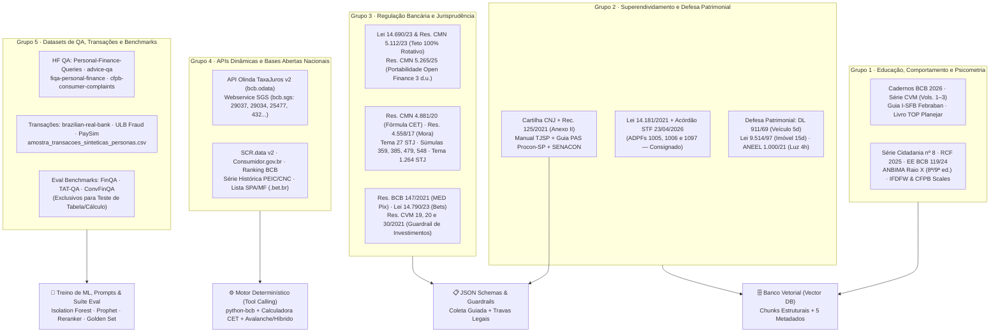

# 🗂️ Catálogo Consolidado de Fontes: Agrupamento, Uso, Finalidade e Implementação Técnica — PANDORA

> **Navegação:** [⬅️ Voltar ao Índice de Evidências](README.md) · [📚 Ler Coletânea Completa do RAG (43 p.)](coletanea-datasets-documentos-rag-superendividamento.md) · [📰 Notícias](noticias/README.md) · [📊 Datasets](datasets/README.md) · [📖 Artigos e Leis](artigos/README.md)

Este documento agrupa e define todas as **fontes primárias, marcos legais, jurisprudências, APIs dinâmicas e datasets** coletados para o projeto **PANDORA**, detalhando para cada fonte:
1. **O que é (Definição e Escopo):** Instituição emissora, natureza documental e cobertura temporal.
2. **Uso no Sistema:** Qual agente/módulo do PANDORA consome a fonte e quais personas ela atende diretamente.
3. **Finalidade Estratégica:** Qual problema de negócio, vulnerabilidade social ou risco técnico (como alucinação numérica ou obsolescência jurídica) a fonte resolve.
4. **Como Será Implementada:** Especificação exata de engenharia de dados (*Vector DB* com estratégia de *chunking* e metadados, *JSON Schema*, *Tool Calling* via API/fórmula determinística, *Pipeline de ML/Anomalia* ou *Evaluation Benchmark*).

---

## 🧭 Visão Geral da Arquitetura de Implementação das Fontes

---

## Grupo 1 — Educação Financeira, Comportamento, Psicometria e Diagnóstico de Risco

Fontes oficiais do Sistema Financeiro Nacional e da literatura científica internacional que fundamentam o **acolhimento sem julgamento**, a **organização do orçamento doméstico** e a **classificação psicométrica e estatística do risco**.

| Fonte Coletada | Definição (O que é) | Uso no PANDORA (Módulo / Personas) | Finalidade Estratégica | Como Será Implementada Tecnicamente |
|---|---|---|---|---|
| **1. Caderno de Educação Financeira: Gestão de Finanças Pessoais (2ª ed., 2026)** *(Banco Central do Brasil – DEPEF)* | Manual oficial de 98 páginas (ou 6 PDFs modulares) com a metodologia de orçamento em 4 etapas, troca intertemporal, juros compostos, CET e exercícios práticos com gabarito. | **Módulo 4 (Orçamento)** e **Módulo 6 (Educação RAG)**. Atende todas as personas, em especial **Carla (01)**, **Mariana (04)**, **Júlia (05)** e **Lucas (08)**. | Ensinar o usuário a organizar o fluxo de caixa (*1ª Planejamento, 2ª Registro, 3ª Agrupamento, 4ª Avaliação*) e diferenciar despesas fixas, variáveis e sazonais sem jargão técnico. | **Vector DB (`camada_dominio: educacao_orcamento`):** Segmentação semântica por seção para o texto conceitual e extração em **pares atômicos (`Pergunta + Resposta`)** dos exercícios comentados dos 6 módulos para *few-shot* educativo. |
| **2. Série Cidadania Financeira nº 8: Endividamento de Risco no Brasil (2ª ed.) & RCF 2025** *(Banco Central do Brasil)* | Estudos técnicos que definem matematicamente os **4 critérios de Endividamento de Risco** no SCR e mapeiam os 15,8 milhões de brasileiros em risco crítico (73% até 2 SM). | **Módulo 1 (Raio-X e Triagem Inicial)**. Acionado no onboarding de **Carla (01)**, **Rosângela (06)**, **Rafael (07)** e **Patrícia (10)**. | Classificar objetivamente a gravidade do usuário e calibrar o peso maior da **Exposição a Multimodalidades (M = 73% de risco)** frente ao comprometimento de renda isolado (**R50 = 39%**). | **Regra Determinística no Motor de Triagem + Vector DB:** Implementação em código Python da função booleana dos 4 indicadores (`I`, `R50`, `M`, `RPOB` — alerta crítico se $\ge 2$) combinada com *chunks* de contexto no banco vetorial. |
| **3. Guia de Boas Práticas em Educação e Saúde Financeira (v7, 2025) & Acervo "Meu Bolso em Dia"** *(Febraban e Banco Central)* | Documento normativo e plataforma que estruturam as **4 dimensões** (*Segurança, Comportamento, Habilidade, Liberdade*) e as **7 faixas de pontuação (0 a 100)** do **I-SFB**. | **Módulo 1 (Diagnóstico)** e **Módulo 4 (Orçamento)**. Atende todas as 10 personas no cálculo do *score* inicial e acompanhamento de 120 dias. | Situar o usuário na régua nacional (identificando a *Zona de Intervenção Crítica* de **0 a 49 pontos**: faixas *Ruim* e *Muito Baixa*) e fornecer modelos práticos de planilha mensal. | **JSON Schema Diagnóstico + Vector DB:** Questionário estruturado do I-SFB convertido em *JSON Schema* com cálculo determinístico da faixa (0–100 pts) e *chunks* dos guias práticos indexados com `nivel_urgencia` correspondente à faixa. |
| **4. Série CVM Comportamental – Vols. 1, 2 e 3 (Investidor, Poupador e Consumidor)** *(Comissão de Valores Mobiliários – CVM)* | Três volumes oficiais que mapeiam heurísticas e vieses cognitivos (*Viés do Presente, Status Quo, Custos Irrecuperáveis, Heurística do Afeto, Ilusão de Controle*) e seus antídotos. | **Módulo 2 (Coach Comportamental)** e **Módulo 6 (Educação)**. Foco em **Diego (02)**, **Mariana (04)**, **Rafael (07)** e **Lucas (08)**. | Identificar gatilhos emocionais de compra por impulso, apego ao cheque especial (*Status Quo*) ou *chasing losses* (*Custos Irrecuperáveis*) e aplicar intervenções que acionem o **Sistema 2** (racional). | **Vector DB (`camada_dominio: comportamental_vieses`) + Prompt System:** Indexação por viés cognitivo (1 *chunk* por viés + antídoto prático) acionada quando o detector comportamental identifica anomalia de horário ou categoria. |
| **5. Livro TOP: Planejamento Financeiro Pessoal & Mercado de Valores Mobiliários (Cap. 12)** *(CVM e Planejar)* | Manuais técnicos de referência da certificação CFP® sobre os **6 passos do planejamento financeiro pessoal**, gestão de fluxo de caixa, reserva de emergência e proteção patrimonial. | **Módulo 4 (Planejador de Orçamento)** e **Módulo 6 (Educação)**. Foco em **Júlia (05)** e **Fernanda (09)**. | Estruturar a transição segura do usuário recém-desendividado ou demitido (uso da rescisão/reserva de fôlego) sem incorrer em recomendação irregular de ativos. | **Vector DB (`camada_dominio: educacao_orcamento`, `nivel_urgencia: preventivo`):** *Chunks* estruturais dos 6 passos de planejamento e regras de dimensionamento de reserva de emergência (3 a 12 meses conforme volatilidade da renda). |
| **6. Estudo Especial BCB nº 119/2024 & Raio X do Investidor Brasileiro (7ª a 9ª ed., 2024–2026)** *(Banco Central e ANBIMA / Datafolha)* | Levantamentos oficiais sobre o mercado de apostas online (*Bets*: R\$ 20,8 bi/mês via Pix, 24 mi de apostadores, retenção de ~15%, 39% jogando por necessidade e 11% em risco de vício). | **Módulo 2 (Detector de Compulsão)** e **Módulo 5 (Guardião)**. Foco direto em **Diego (02)** e **Rosângela (06)**. | Desconstruir com dados oficiais a ilusão de "recuperar dinheiro rápido" em apostas e proteger benefícios sociais (Bolsa Família) contra desvio para plataformas de jogo. | **Vector DB (`camada_dominio: comportamental_vieses`) + Gatilho de Nudge:** *Chunks* de evidência estatística injetados automaticamente nos alertas de fricção positiva quando o sistema detecta Pix para CNPJ/domínio de *bet*. |
| **7. Escalas Psicométricas Internacionais (*IFDFW Scale*, *CFPB Scale*, *ICD-11 6C50* e *Nudge*)** *(Prawitz et al., 2006; CFPB, 2017; OMS; Thaler & Sunstein, 2008)* | Escalas científicas validadas de estresse/bem-estar financeiro (*IFDFW* de 8 itens / nota 1–10; *CFPB Scale* de 10 itens / score 0–100) e critérios clínicos do transtorno do jogo (`6C50`). | **Módulo 1 (Avaliação de Qualidade de Vida)** e **Módulo 2 (Fricção Positiva)**. Aplicado a todas as personas no marco $T_0$, $T_{30}$ e $T_{90}$. | Medir cientificamente a **Métrica de Sucesso de Qualidade de Vida** do projeto (redução do estresse financeiro e aumento do bem-estar) e fundamentar períodos de *cooling-off* sem tom punitivo. | **Formulário Psicométrico Estruturado (JSON/DB) + Regra de Negócio:** Aplicação dos 8 itens da escala *IFDFW* e 10 itens da *CFPB Scale* no banco relacional para comparar os scores pré e pós-intervenção. |

---

## Grupo 2 — Tratamento Jurídico do Superendividamento, Cartilhas Processuais e Defesa Patrimonial

Fontes legais e manuais operacionais do Poder Judiciário, Procons, SENACON e Defensorias Públicas para usuários que já ultrapassaram a linha da insolvência e precisam proteger seu mínimo existencial, sua moradia, seu veículo de trabalho ou o fornecimento de água e luz.

| Fonte Coletada | Definição (O que é) | Uso no PANDORA (Módulo / Personas) | Finalidade Estratégica | Como Será Implementada Tecnicamente |
|---|---|---|---|---|
| **8. Lei Federal nº 14.181/2021 (Lei do Superendividamento)** *(Arts. 54-A a 54-G e 104-A a 104-C do CDC)* | Diploma legal que institui a prevenção e o tratamento do superendividamento da pessoa física de boa-fé, a preservação do mínimo existencial e o plano de pagamento em até **5 anos (60 meses)**. | **Módulo 3 (Estrategista de Dívidas)**. Foco em **Carla (01)**, **Sr. Antônio (03)**, **Rosângela (06)** e **Rafael (07)**. | Garantir que o plano de repactuação preserve as despesas básicas de sobrevivência da família e informe as sanções do **art. 104-A, § 2º** ao credor que faltar à audiência (suspensão de juros e fim da fila). | **Vector DB (`camada_dominio: juridico_superendividamento`) + Regra de Elegibilidade:** *Chunking* estrutural **por artigo completo** (*caput* + parágrafos + incisos juntos) e filtro booleano `elegivel_lei_14181`. |
| **9. Julgamento do STF nas ADPFs 1005, 1006 e 1097 (Concluído em 23/04/2026)** *(Supremo Tribunal Federal / MPF)* | Decisão constitucional vinculante que **declarou inconstitucional a exclusão do crédito consignado** do cálculo do mínimo existencial (anulando o art. 4º, parágrafo único, I, *h* do Dec. 11.150/22). | **Módulo 1 (Cálculo do Mínimo Existencial)** e **Módulo 3 (Reestruturação)**. Crucial para **Sr. Antônio (03)**, **Rafael (07)** e **Patrícia (10)**. | Impedir que o RAG reproduza a regra revogada de 2022–2025 e **incluir obrigatoriamente os descontos de empréstimo e cartão consignado** na apuração de comprometimento do mínimo existencial. | **Higienização de Dados (*Data Cleaning*) + Metadado `data_referencia_normativa: 2026-04-23`:** Anotação explícita de revogação em todos os *chunks* de cartilhas anteriores a abr/2026 e inclusão do consignado na fórmula do motor de cálculo. |
| **10. Cartilha do Superendividamento do CNJ (2022) + Recomendação CNJ nº 125/2021** *(Conselho Nacional de Justiça)* | Manual técnico-jurídico (59 p.) contendo os 10 paradigmas da lei, FAQ completo (Anexo F) e o **Formulário-Padrão Socioeconômico (Anexo II da Rec. 125/2021)**. | **Módulo 3 (Dossiê de Repactuação para Procon/CEJUSC)**. Foco em **Carla (01)**, **Sr. Antônio (03)** e **Rosângela (06)**. | Padronizar o levantamento de receitas, despesas essenciais e dívidas exatamente no formato exigido pelos juízes e conciliadores dos CEJUSCs em todo o país. | **JSON Schema (`Anexo II CNJ`) + Vector DB (`Anexo F`):** O Anexo II é implementado como **JSON Schema** para coleta guiada e geração automática do PDF/dossiê; o Anexo F é indexado em pares atômicos `Pergunta + Resposta`. |
| **11. Manual do Superendividamento do TJSP & Guia PAS (Programa de Apoio ao Superendividado)** *(TJSP e Fundação Procon-SP)* | Manuais operacionais e planilha de controle orçamentário que detalham a jornada em **5 etapas** entre o Procon e o CEJUSC (triagem, oficina *"Dívidas e Dúvidas"*, plano de 60 meses e audiência global). | **Módulo 3 (Passo a Passo Processual)**. Foco em **Carla (01)** e demais personas em insolvência. | Orientar o usuário sobre onde ir, quais documentos separar e como funciona a tentativa administrativa no Procon (30 dias) seguida da fase judicial compulsória (art. 104-B). | **Vector DB (`camada_dominio: juridico_superendividamento`) + JSON Schema:** Fluxograma de 5 etapas indexado como *chunks* procedimentais e planilha do Procon-SP mapeada junto ao schema de orçamento. |
| **12. Produto 2: Cenário do Superendividamento (SENACON/PNUD) & Cartilhas das Defensorias (DPDF, DPRJ, DPES, MPCE)** | Estudos e cartilhas cidadãs que distinguem **superendividamento ativo** (consciente/inconsciente) de **passivo** (desemprego, doença, divórcio) e orientam idosos e servidores. | **Módulo 1 (Triagem de Perfil)** e **Módulo 3 (Orientação Cidadã)**. Foco em **Sr. Antônio (03)**, **Fernanda (09)** e **Patrícia (10)**. | Adaptar o tom e a estratégia do plano quando a dívida decorre de choque externo involuntário (*passivo*, como demissão ou doença na família) e listar os documentos exigidos pela Defensoria Pública. | **Vector DB (`camada_dominio: juridico_superendividamento`):** *Chunks* em linguagem simples para resposta direta ao cidadão e classificação da causa do endividamento (`ativo_inconsciente` vs. `passivo_choque`). |
| **13. Protocolos de Defesa de Passivos Excluídos: Veículos (DL 911/69 e Lei 14.711/23), Imóveis (Lei 9.514/97) e Água/Luz (Lei 14.015/20 e REN ANEEL 1.000/21)** | Regras legais e jurisprudenciais do STJ/STF para passivos com garantia real (`elegivel_lei_14181: false`) e serviços públicos essenciais. | **Módulo 3 (Defesa Patrimonial de Urgência)** e **Módulo 5 (Guardião)**. Foco em **Carla (01 — luz/água)** e **Diego (02 — financiamento da moto)**. | Evitar o erro fatal de incluir veículo ou imóvel no plano da Lei 14.181 e acionar alertas de **Urgência Crítica**: **5 dias corridos** pós-apreensão de veículo (Tema 1279/STJ), **15 dias** pós-intimação de imóvel e **4 horas** para religação de luz cortada indevidamente. | **Vector DB (`camada_dominio: defesa_bens_servicos`, `elegivel_lei_14181: false`, `nivel_urgencia: critico_imediato`) + Guardrail de Triagem:** Roteamento prioritário sempre que o usuário mencionar busca e apreensão, leilão de imóvel ou aviso de corte de luz/água. |

---

## Grupo 3 — Regulação Bancária, Cartão de Crédito, Portabilidade, Fraudes e Jurisprudência

Conjunto cirúrgico de resoluções do CMN/BCB, normas da CVM e súmulas/temas repetitivos do STJ que alimentam o **Filtro de Guardrails Jurídicos** e a **auditoria matemática de contratos**.

| Fonte Coletada | Definição (O que é) | Uso no PANDORA (Módulo / Personas) | Finalidade Estratégica | Como Será Implementada Tecnicamente |
|---|---|---|---|---|
| **14. Lei nº 14.690/2023 e Resolução CMN nº 5.112/2023** *(Congresso Nacional e CMN / BCB)* | Limita a soma total de juros e encargos do **rotativo e parcelamento de fatura de cartão a 100% do valor original da dívida** (desde jan/2024) e garante portabilidade gratuita da fatura. | **Módulo 3 (Auditoria de Cartão e Modelo Híbrido)**. Foco em **Carla (01)**, **Mariana (04)**, **Lucas (08)** e **Patrícia (10)**. | Auditar se o banco cobrou juros acima do dobro da dívida original em operações posteriores a jan/2024 (observando a não retroatividade fixada pelo STJ no AREsp 3.191.218/MT) e acionar a portabilidade da fatura. | **Trava Matemática no Motor Quantitativo + Vector DB (`modalidade_divida: cartao_credito`):** Função determinística que verifica `encargos_acumulados <= 1.0 * valor_original` para faturas a partir de `2024-01-01`. |
| **15. Resoluções CMN nº 5.057/2022, nº 5.265/2025 e Resolução Conjunta nº 15/2025** *(CMN e Banco Central)* | Regulam a **portabilidade de crédito gratuita** e instituem a jornada 100% digital via **Open Finance** (em vigor em 2026), reduzindo o prazo de migração de **5 para 3 dias úteis**. | **Módulo 3 (Simulador de Portabilidade e Modelo Híbrido)**. Foco em **Carla (01)**, **Sr. Antônio (03)** e **Rafael (07)**. | Estancar rapidamente juros altos trocando dívidas caras por contratos mais baratos em outra instituição em 3 dias úteis, sem custos, sem aumento de saldo/prazo e sem venda casada. | **Tool Calling + Vector DB (`camada_dominio: regulatorio_bancario`):** Quando a API `TaxaJuros` do BCB aponta spread vantajoso, o agente recomenda a portabilidade digital em 3 dias úteis fundamentada na Res. CMN 5.265/2025. |
| **16. Resolução CMN nº 4.881/2020 & Resolução BCB nº 365/2023** *(CMN e Banco Central)* | A Res. 4.881/2020 define a **fórmula oficial do CET** (base 365 dias corridos); a Res. 365/2023 obriga faturas de cartão transparentes divididas em 3 áreas com CET explícito. | **Módulo 1 (Parser de Faturas)** e **Módulo 3 (Calculadora CET)**. Aplicado a todas as personas que tomam ou renegociam crédito. | Impedir que o LLM erre cálculos de juros compostos ou seja enganado por taxas nominais aparentes que escondem TAC, IOF e seguros. | **Tool Calling Determinístico (Python):** Implementação exata da equação $\sum_{j=1}^{N} \frac{FC_j}{(1 + \text{CET})^{(d_j - d_0)/365}} - FC_0 = 0$ via método numérico (`scipy.optimize` / Newton-Raphson) invocada pelo agente. |
| **17. Resoluções CMN nº 4.558/2017, 4.882/2020 e 4.655/2018** *(CMN e Banco Central)* | **Proíbem a Comissão de Permanência** em contratos a partir de 01/09/2017, limitando o atraso a: juros remuneratórios contratados + multa de **até 2%** (Súmula 285/STJ) + mora de **até 1% a.m.** (Súmula 379/STJ). | **Módulo 3 (Auditoria de Encargos de Atraso)**. Foco em **Carla (01)**, **Mariana (04)** e **Rafael (07)**. | Detectar cobranças ilegais de comissão de permanência ou multas abusivas em contratos bancários firmados a partir de setembro de 2017. | **Filtro Temporal nos Metadados + Validador de Contrato:** Súmulas antigas (30, 294, 296 e 472/STJ) restritas a contratos até `2017-08-31`; contratos $\ge$ `2017-09-01` validados pelas travas da Res. CMN 4.558/2017. |
| **18. Tema Repetitivo 27 do STJ (REsp 1.061.530/RS) & Súmulas 596/STF, 283, 381, 382, 539 e 541/STJ** | Consolidam que bancos não se limitam a 12% a.a., mas admitem a **revisão judicial dos juros para a taxa média de mercado do BCB** quando provada abusividade cabal (1,5x, 2x ou 3x a média do BCB). | **Módulo 3 (Auditoria de Abusividade Contratual)**. Foco em **Carla (01)**, **Sr. Antônio (03)** e **Rafael (07)**. | Fundamentar pedidos de renegociação ou encaminhamento à Defensoria Pública quando a taxa do contrato supera drasticamente a série histórica do BCB da época da contratação. | **Tool Calling (`bcb.sgs` / `bcb.odata`) + Vector DB:** Comparação automática entre a taxa efetiva do contrato do usuário e a taxa média do BCB na data de assinatura, sinalizando alerta se $\ge 1,5\times$ a média. |
| **19. Súmulas 359, 385, 479 e 548 do STJ, Art. 206, § 5º, I do CC, Art. 43 do CDC, Tema 1.264 do STJ e Res. BCB 147/2021 (MED)** | Regras sobre prescrição em **5 anos**, distinção entre birôs (Serasa/SPC) e **SCR/Registrato**, baixa em **5 dias úteis** após pagamento (Súmula 548), responsabilidade objetiva por fraudes (Súmula 479) e devolução de Pix por golpe (**MED**). | **Módulo 3 (Dívidas Prescritas / Cadastros)** e **Módulo 5 (Guardião Antifraude)**. Foco em **Sr. Antônio (03)**, **Lucas (08)** e **Patrícia (10)**. | Evitar pagamento desnecessário de dívida prescrita (>5 anos) sob ameaça ilegal, orientar a exclusão de negativação em 5 dias úteis e acionar imediatamente o **MED do Pix** em caso de golpe. | **Vector DB (`modalidade_divida: divida_prescrita` / `regulatorio_bancario`) + Playbook de Resposta a Golpes:** *Checklists* acionáveis de 1 clique para contestação via MED, boletim de ocorrência e reclamação no Registrato/BCB. |
| **20. Resoluções CVM nº 19/2021, 20/2021 e 30/2021 & Lei nº 13.709/2018 (LGPD)** | Normas que regulam a consultoria e análise de valores mobiliários (*suitability*) e a proteção de dados pessoais sensíveis. | **Módulo 6 (Compliance Guard CVM)** e **Camada de Privacidade LGPD**. Foco especial em **Júlia (05)**, **Fernanda (09)** e **Patrícia (10)**. | Impedir que a IA recomende compra/venda de valores mobiliários específicos (*tickers*) sem credenciamento CVM e garantir anonimização de PII e consentimento granular. | **Guardrail de Saída (Regex + Classificador LLM) + Mascaramento de PII:** Bloqueia indicação de *tickers* específicos (permitindo apenas educação sobre classes como Tesouro Selic/CDB DI) e mascara CPF/contas antes de chamadas ao LLM. |

---

## Grupo 4 — APIs Dinâmicas e Bases Abertas Nacionais (Tool Calling e Calibragem Macroeconômica)

Fontes conectadas programaticamente ao motor quantitativo do PANDORA para garantir **zero alucinação em taxas de juros, indicadores econômicos e reputação de bancos**.

| Fonte / API Coletada | Definição (O que é) | Uso no PANDORA (Módulo / Personas) | Finalidade Estratégica | Como Será Implementada Tecnicamente |
|---|---|---|---|---|
| **21. API Olinda / OData: Taxas de Juros de Operações de Crédito (`TaxaJuros v2`)** *(Banco Central do Brasil)* | Endpoints públicos (`TaxasJurosDiariaPorInicioPeriodo` e `TaxasJurosMensalPorMes`) com as taxas médias praticadas por todas as instituições do SFN nos últimos 5 dias úteis e por mês. | **Módulo 3 (Motor Quantitativo de Portabilidade e Revisão)**. Atende **Carla (01)**, **Sr. Antônio (03)**, **Mariana (04)** e **Rafael (07)**. | Buscar em tempo real quais bancos oferecem os menores juros na modalidade do usuário para indicar **portabilidade via Open Finance** e aferir abusividade pelo Tema 27 do STJ. | **Tool Calling Assíncrono via `python-bcb (v0.4.1)`:** Uso do módulo `bcb.odata` (`async_get()` e `ODataQuery.async_collect()`) invocado como *tool* determinística pelo agente `Estrategista de Dívidas`. |
| **22. Webservice SGS – Séries Temporais do Banco Central (`bcb.sgs`)** *(Séries 29037, 29038, 29034, 29033, 21085, 25477, 25463, 25464, 25467, 432, 433, 12, 1619)* | API oficial de séries históricas do BCB contendo endividamento e comprometimento de renda das famílias, inadimplência PF, juros médios por modalidade, Selic, IPCA, CDI e Salário Mínimo. | **Módulo 1 (Raio-X)**, **Módulo 3 (Simulador)** e **Módulo 6 (Simulador de Reserva)**. Atende todas as 10 personas. | Fornecer os indexadores reais atualizados para simular o custo de oportunidade da dívida versus reserva segura (Selic `432`, IPCA `433`, CDI `12`) e comparar o usuário à média nacional (`29034` e `29037`). | **Tool Calling via `bcb.sgs.get(..., tidy=True)` + Cache Redis/Local:** Pipeline em Python que consulta e armazena em cache diário/mensal os valores oficiais em *DataFrames* pandas para alimentar os simuladores. |
| **23. SCR.data – Painel e Base Aberta de Operações de Crédito (Versão 2)** *(Banco Central do Brasil – Desig)* | Base aberta mensal (>700 mil séries em `.CSV`/`.ZIP`) que cruza ocupação, porte de renda PF, UF, modalidade de crédito, atraso (15–90d), inadimplência (>90d) e **ativo problemático** (caract. 19). | **Módulo 1 (Calibragem de Risco Demográfico)**. Atende todas as personas na contextualização regional e ocupacional. | Comparar o perfil de risco do usuário com o comportamento estatístico real da sua faixa de renda, ocupação (assalariado, autônomo, aposentado, servidor) e unidade da federação. | **Tabela Analítica Local (DuckDB / Parquet):** Ingestão mensal dos arquivos `.CSV` agregados do `SCR.data` para consulta SQL rápida pelo agente `Analista de Dados`. |
| **24. Base Aberta Consumidor.gov.br, SINDEC & Ranking de Reclamações do BCB** *(SENACON/MJ e BCB/DEATI)* | Microdados abertos com índice de resolutividade (média 80,8%), nota do consumidor (1–5), prazo de resposta (máx. 10 dias) e ranking trimestral de reclamações procedentes no BCB. | **Módulo 3 (Estratégia de Negociação)** e **Módulo 5 (Guardião)**. Foco em **Carla (01)**, **Sr. Antônio (03)** e **Patrícia (10)**. | Informar ao usuário a probabilidade real de acordo administrativo com o seu banco no Consumidor.gov.br e alertar sobre instituições líderes em reclamações procedentes. | **Consulta Estruturada (SQL/Parquet) + Tool de Notificação:** Filtro por `Área = Serviços Financeiros` e nome da instituição financeira para exibir o *score* de resolutividade junto à carta de negociação. |
| **25. Série Histórica da PEIC (CNC) & Mapa da Inadimplência (Serasa)** | Levantamentos mensais da CNC (jan/2010 a 2026) por faixa salarial (até 3 SM, 3–5, 5–10 e >10 SM) e série histórica da Serasa (81,7 milhões de inadimplentes; 42% de reincidência). | **Módulo 1 (Benchmark Socioeconômico)** e **Documentação de Evidências**. Base estatística de todas as personas. | Calibrar os cortes de vulnerabilidade por faixa de renda (ex.: 38,5% de atraso e 17,8% de incapacidade de pagamento até 3 SM) e justificar a necessidade de acompanhamento pós-dívida. | **Tabelas de Referência no Motor de Triagem (`Quadro 1`):** Parâmetros estáticos atualizados mensalmente no módulo diagnóstico para contextualizar o relatório inicial do usuário. |
| **26. Lista Oficial de Operadoras de Apostas Autorizadas (`.bet.br`)** *(Secretaria de Prêmios e Apostas – SPA/MF)* | Base pública instituída pela Lei nº 14.790/2023 contendo razão social, CNPJ e domínios `.bet.br` das operadoras autorizadas (e identificação por exclusão de plataformas ilegais). | **Módulo 2 (Detector de Compulsão)** e **Módulo 5 (Guardião)**. Foco em **Diego (02)** e **Rosângela (06)**. | Identificar instantaneamente transferências Pix ou débitos destinados a casas de apostas (autorizadas ou clandestinas) e acionar os mecanismos de autoexclusão e limite da Lei 14.790/2023. | **Lookup Table Determinística (Hash/Set de CNPJs e Domínios) + Regra MCC `7995`:** Verificação em tempo real ($O(1)$) em cada transação ingerida para rotular `is_bet = true`. |

---

## Grupo 5 — Datasets de QA, Diálogos, Transações e Benchmarks de Avaliação (ML & Eval)

Bases estruturadas do Hugging Face, Kaggle, OpenML e do próprio repositório PANDORA utilizadas para **treinar os modelos de Machine Learning**, **calibrar os prompts empáticos** e **executar a suíte de validação científica (*Evaluation Benchmark*)**.

| Dataset Coletado | Definição (O que é) | Uso no PANDORA (Módulo / Personas) | Finalidade Estratégica | Como Será Implementada Tecnicamente |
|---|---|---|---|---|
| **27. `Akhil-Theerthala/Personal-Finance-Queries` & `flamiinngo/personal-finance-advice-qa`** *(Hugging Face)* | Perguntas longas de usuários reais em crise financeira (Reddit curado por *LLM voting*) e 3.805 pares diretos de QA sobre orçamento doméstico e priorização de dívidas. | **Módulo 2 (Coach Comportamental)** e **Módulo 3 (Estrategista)**. Atende todas as personas na qualidade do diálogo. | Ensinar ao agente a estrutura empática de acolhimento e decomposição passo a passo de planos de saída de dívidas para usuários ansiosos ou desorganizados. | **Few-Shot Prompting & Fine-Tuning Curado:** Filtragem exclusiva pela categoria `Debt Management & Credit`, tradução/adaptação para PT-BR e **expurgo de termos exclusivos dos EUA** (401k, Roth IRA, PSLF). |
| **28. `vivekkopthsd/cfpb-consumer-complaints` & `beatrizmsarmento/relatos-consumidor-gov-br`** *(Hugging Face e Kaggle)* | Mais de 3,8 milhões de narrativas reais do CFPB e relatos brasileiros do Consumidor.gov.br (2022–2024) descrevendo cobranças abusivas, ameaças, fraudes e dificuldades de pagamento. | **Roteador de Intenção (*Intent Classifier*)** e **Módulo 3 (Gerador de Notificações)**. Foco em **Carla (01)**, **Sr. Antônio (03)** e **Patrícia (10)**. | Treinar o classificador para reconhecer como cidadãos comuns relatam problemas financeiros e gerar minutas formais de reclamação para o Consumidor.gov.br / Procon. | **Treino do *Intent Router* + Templates de Notificação:** No CFPB, filtro por `Debt collection`, `Credit card` e `Struggling to repay your loan`; no dataset BR, uso direto dos pares `relato → resposta da empresa`. |
| **29. `bilalRahib/fiqa-personal-finance-dataset`, `dnacx/reclamacao-agua-e-saneamento` & `ufca-llms/juris-tcu` / `normas-tcu`** *(Hugging Face)* | Curadoria de finanças pessoais do FiQA (1K–10K linhas), reclamações de saneamento em PT-BR e *datasets* jurídicos brasileiros da UFCA/MJ. | **Camada de Recuperação (*Retrieval*) do RAG**. Suporte transversal a todas as consultas. | Maximizar o *Recall@5* e o *MRR* da busca vetorial em língua portuguesa para dúvidas financeiras abertas, contas de consumo (água/luz) e textos normativos. | **Treino e Calibragem de *Embedding / Reranker*:** Utilizados para avaliar e ajustar o modelo de *reranking* semântico antes da passagem dos *chunks* ao LLM. |
| **30. `sufyant/brazilian-real-bank-dataset`, `ULB Credit Card Fraud`, `PaySim` & [`amostra_transacoes_sinteticas_personas.csv`](datasets/amostra_transacoes_sinteticas_personas.csv)** *(Kaggle, OpenML e PANDORA)* | 4.955 transações reais de cartão no Brasil (`sufyant`), 284k transações de fraude (`ULB`), 6,3M de transações *mobile money* (`PaySim`) e o dataset sintético rotulado das 10 personas do PANDORA. | **Módulo 1 (Categorizador)**, **Módulo 2 (Detector de Compulsão)** e **Módulo 5 (Antifraude)**.  Simula e valida o fluxo das **10 personas**. | Treinar a categorização automática de faturas brasileiras, calibrar a detecção de anomalias (`Isolation Forest` / `LOF` para gastos noturnos em *bets* e golpes Pix) e testar o sistema ponta a ponta sem expor PII real. | **Pipeline de ML Supervisionado e Não Supervisionado:** Treino do classificador de categorias (`category`), cálculo de `anomaly_score` ($0..1$, alerta se $\ge 0,80$) e previsão de fluxo de caixa 30/60/90d (`Prophet` / `ETS`). |
| **31. `ibm-research/finqa`, `next-tat/TAT-QA` e `TheFinAI/en-convfinqa`** *(Hugging Face)* | Benchmarks internacionais de raciocínio numérico (*numerical reasoning*) e conversacional (*multi-turn*) sobre documentos híbridos com texto e tabelas financeiras (mais de 37 mil pares de QA). | **Suíte de Avaliação Científica (*Evaluation Benchmark* — Seção de Métricas do Escopo)**. Uso interno da equipe de engenharia. | Testar rigorosamente a capacidade do agente de ler tabelas de evolução de dívidas, extrair variações percentuais, somar parcelas e calcular amortizações **sem alucinar**. | **Exclusivo para *Eval* (Proibido ingerir no Vector DB do usuário):** Integrado ao pipeline de testes automatizados (junto ao *Golden Set* nacional) para aferir *Exact Match* numérico e *Faithfulness* ($\ge 0,95$). |

---

## 🛠️ Resumo Operacional do Protocolo de Engenharia de Dados (Como Tudo se Conecta)

Para que as 31 fontes acima operem em harmonia na branch e na arquitetura do **PANDORA**, a implementação obedece a **quatro travas de engenharia**:

1. **Proibição de Índices Corporativos (Anti-Contaminação Semântica):** Datasets como `virattt/financial-qa-10K` e `adityarane/financial-qa-dataset` (relatórios 10-K de empresas da bolsa americana) são **bloqueados na ingestão** para não poluir a busca vetorial de pessoas físicas.
2. **Esquema Obrigatório de 5 Metadados em Cada Chunk do Vector DB:**
   - `camada_dominio`: `educacao_orcamento` | `comportamental_vieses` | `juridico_superendividamento` | `regulatorio_bancario` | `defesa_bens_servicos`
   - `modalidade_divida`: `cartao_credito` | `cheque_especial` | `emprestimo_pessoal` | `credito_consignado` | `financiamento_veiculo` | `financiamento_imobiliario` | `contas_consumo_luz_agua` | `divida_prescrita` | `geral`
   - `elegivel_lei_14181`: `true` (dívidas de consumo + consignado pós-STF 23/04/2026) | `false` (garantias reais como veículo/imóvel, impostos, pensão alimentícia e crédito rural)
   - `nivel_urgencia`: `critico_imediato` (corte de luz em 4h, apreensão de veículo em 5d corridos, intimação de imóvel em 15d, golpe Pix MED) | `alto_atraso_90d` | `moderado_reorganizacao` | `preventivo`
   - `data_referencia_normativa`: formato ISO `YYYY-MM-DD` (garantindo precedência às normas de 2024–2026).
3. **Separação Estrita entre Busca Semântica (*Vector DB*) e Cálculo Determinístico (*Tool Calling*):** Nenhum juro composto, CET, conversão de índice (Selic/IPCA) ou ordenação de amortização (*Avalanche vs. Bola de Neve vs. Modelo Híbrido Brasileiro*) é calculado "de cabeça" pelo LLM; o agente sempre invoca a ferramenta determinística em Python (`python-bcb` + motor matemático).
4. **Rastreabilidade de Citação (*Citation Precision* = 100%):** Toda orientação jurídica ou regulatória exibida ao usuário cita explicitamente a fonte oficial correspondente deste catálogo (ex.: *"Conforme o art. 104-A, § 2º da Lei nº 14.181/2021..."* ou *"Segundo a decisão do STF nas ADPFs 1005, 1006 e 1097 de 23/04/2026..."*).

---

> **Navegação:** [⬅️ Voltar ao Índice de Evidências](README.md) · [📚 Ler Coletânea Completa do RAG (43 p.)](coletanea-datasets-documentos-rag-superendividamento.md)
