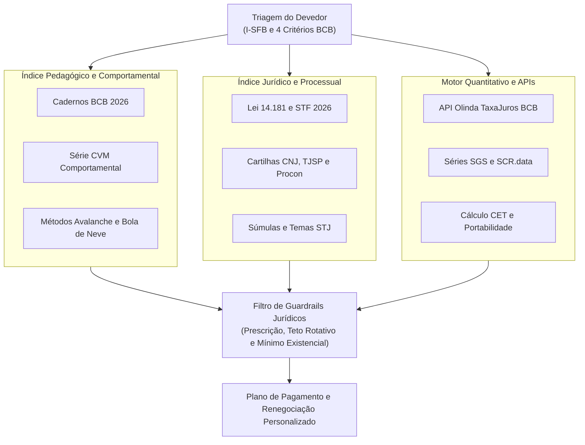

# Coletânea de Datasets e Documentos para RAG de Reestruturação Financeira e Tratamento do Superendividamento

> **Navegação:** [⬅️ Voltar ao Índice de Evidências](README.md) · [🗂️ Ver Catálogo de Uso, Finalidade e Implementação](01-catalogo-fontes-uso-finalidade-e-implementacao.md) · [📰 Notícias](noticias/README.md) · [📊 Datasets](datasets/README.md) · [📖 Artigos e Leis](artigos/README.md)

A construção de um sistema de *Retrieval-Augmented Generation* (RAG) de alta precisão voltado à reestruturação financeira de pessoas físicas em situação de dívida ou risco exige uma arquitetura de dados segmentada em quatro camadas complementares: **corpus pedagógico e comportamental** (manuais do Banco Central do Brasil, da Comissão de Valores Mobiliários, da Febraban e da ANBIMA), **corpus jurídico e processual de repactuação** (Lei nº 14.181/2021, cartilhas operacionais do CNJ, TJSP, Procons, SENACON e Defensorias Públicas), **regras normativas e jurisprudenciais bancárias atualizadas até 2026** (resoluções do CMN/BCB e súmulas/temas repetitivos do STJ e STF) e **datasets estruturados e APIs em tempo real** (endpoints OData/Olinda e séries SGS do Banco Central, microdados do Consumidor.gov.br e coleções de *Question Answering* do Hugging Face e Kaggle) [1].

Diferentemente de assistentes financeiros genéricos voltados a investimentos corporativos, um RAG para indivíduos endividados opera em um domínio de alta sensibilidade social e forte regulação estatal, onde uma orientação imprecisa pode levar o usuário a perder a proteção do seu mínimo existencial, sofrer busca e apreensão de bens essenciais ou realizar pagamentos indevidos em dívidas prescritas ou com encargos ilegais [6].

A principal armadilha técnica ao popular esse RAG reside na contaminação semântica e na obsolescência normativa. Em primeiro lugar, muitos datasets populares de finanças no Hugging Face (como `virattt/financial-qa-10K` e `adityarane/financial-qa-dataset`) são compostos por relatórios contábeis corporativos norte-americanos (formulários 10-K de empresas como a NVIDIA), cuja terminologia sobre "dívida de longo prazo" ou "reestruturação de passivos" polui a busca vetorial de finanças pessoais e deve ser excluída do índice principal [10]. Em segundo lugar, o arcabouço regulatório brasileiro sofreu transformações profundas entre 2024 e 2026 que invalidam trechos de cartilhas antigas: destacam-se a decisão do Supremo Tribunal Federal (STF) concluída em **23 de abril de 2026** (ADPFs 1005, 1006 e 1097), que declarou inconstitucional a exclusão do empréstimo consignado do cálculo do mínimo existencial na Lei do Superendividamento [6]; a entrada em vigor da **portabilidade de crédito via Open Finance** em fevereiro de 2026 (Resolução CMN nº 5.265/2025 e Resolução Conjunta nº 15/2025), que reduziu o prazo de troca de informações e migração de dívidas de cinco para três dias úteis [3]; o **teto de 100%** para juros do rotativo e parcelamento de fatura de cartão de crédito e sua portabilidade gratuita (Resolução CMN nº 5.112/2023) [15]; e a afetação do **Tema Repetitivo 1.264 no STJ** sobre a licitude da cobrança extrajudicial de dívidas prescritas em plataformas como o *Serasa Limpa Nome* [17].

Para garantir qualidade máxima de recuperação (*retrieval*) e geração, o acervo abaixo foi curado priorizando fontes primárias oficiais, documentos estruturados com exercícios e fluxogramas passo a passo, e bases de dados abertas auditáveis. Além do catálogo completo de documentos e datasets, este relatório detalha as regras de negócio extraídas de cada fonte, a distinção entre o que deve ser indexado em banco vetorial (*Vector DB*) versus o que deve ser consultado via execução de ferramentas (*Tool Calling*), e o protocolo de higienização de metadados necessário para colocar o sistema em produção.

---

## Arquitetura do Acervo e Estratégia de Ingestão no RAG

Um sistema RAG focado em reestruturação financeira pessoal apresenta falhas graves quando tenta responder a todas as demandas do usuário apenas por similaridade semântica sobre textos estáticos. Quando um cidadão endividado interage com o sistema, sua consulta geralmente combina três dimensões: **desorganização orçamentária e estresse emocional** (que exige acolhimento comportamental e metodologia de fluxo de caixa), **assimetria financeira perante os bancos** (que exige cálculo exato do Custo Efetivo Total, comparação de taxas de juros para portabilidade e priorização matemática entre os métodos Avalanche e Bola de Neve) e **vulnerabilidade jurídica aguda** (ameaça de corte de energia elétrica, busca e apreensão de veículo, leilão extrajudicial de imóvel ou comprometimento severo da folha salarial) [1].

Por essa razão, a arquitetura do acervo deve ser desenhada sob o paradigma de **RAG Híbrido com Roteamento de Intenção (*Intent Routing*) e *Tool Calling***. Textos conceituais, metodologias de orçamento doméstico, vieses comportamentais e ritos processuais de conciliação (como as cartilhas do BCB, da CVM, do CNJ e dos Procons) devem ser processados em *chunks* semânticos enriquecidos com metadados e armazenados no banco de dados vetorial [1]. Em contrapartida, dados dinâmicos ou que exigem agregação numérica — como as taxas médias de juros praticadas por cada instituição financeira nos últimos cinco dias úteis (API TaxaJuros do BCB), o comprometimento agregado de renda das famílias (Séries SGS 29034 e 29037) e o cálculo do Custo Efetivo Total (fórmula da Resolução CMN nº 4.881/2020) — jamais devem depender da memória paramétrica do LLM ou de busca textual simples, devendo ser integrados como ferramentas determinísticas invocadas pelo agente [5].

---

## Corpus Documental 1: Educação Financeira, Orçamento, Comportamento e Diagnóstico de Risco

O primeiro pilar documental abrange os materiais oficiais produzidos pelos órgãos reguladores do Sistema Financeiro Nacional (Banco Central e CVM) e pelas entidades representativas do setor (Febraban e ANBIMA) no âmbito da Estratégia Nacional de Educação Financeira (ENEF, instituída originalmente pelo Decreto nº 7.397/2010 e reformulada pelo Decreto nº 10.393/2020, que criou o Fórum Brasileiro de Educação Financeira – FBEF) [26]. Estes documentos fornecem a linguagem acessível, os exercícios práticos de fixação, a metodologia de construção de orçamento doméstico e os critérios estatísticos e psicométricos para classificar o grau de risco do usuário [1].

| Documento / Publicação Oficial | Instituição Autora | Formato e Extensão | Conteúdo Central e Papel no RAG | Identificador / Caminho de Referência |
|---|---|---|---|---|
| **Caderno de Educação Financeira: Gestão de Finanças Pessoais (Conteúdo Básico – 2ª ed., 2026)** | Banco Central do Brasil (DEPEF) | PDF (98 p. completo ou 6 PDFs modulares) | Metodologia oficial de orçamento em 4 etapas, troca intertemporal, juros compostos, CET e passo a passo para sair das dívidas; inclui exercícios e gabaritos [1]. | `bcb.gov.br/cidadaniafinanceira` (`caderno_cidadania_financeira.pdf` e `v4_modulo_1` a `3_..._2026.pdf`) [1] |
| **Série Cidadania Financeira nº 8: Endividamento de Risco no Brasil (2ª ed., nov/2023) e nº 6 (jun/2020)** | Banco Central do Brasil | PDF (42 p.) | Define matematicamente os **4 critérios de Endividamento de Risco** no SCR e cruza os dados de crédito com a autopercepção da saúde financeira [28]. | `serie_cidadania_financeira_8_endividamento_risco_2ed.pdf` [28] |
| **Relatório de Cidadania Financeira (RCF 2025 e RCF 2021)** | Banco Central do Brasil | PDF (125+ p.) e Anexo XLSX | Panorama nacional do superendividamento (15,8 milhões de endividados de risco em dez/2024), impacto da digitalização/Pix na "dor do pagamento", golpes digitais, Projeto Endiv-IA e relação I-SFB vs. inadimplência [34]. | `relatorio_de_cidadania_financeira_2025.pdf` [34] |
| **Guia de Excelência na Oferta de Produtos e Serviços Financeiros – Operações de Crédito & Glossário** | Banco Central do Brasil | PDF | Padrões de oferta de crédito responsável exigidos das instituições financeiras e dicionário oficial de termos do SFN para normalização de vocabulário no RAG [35]. | Biblioteca Digital de Cidadania Financeira BCB (`bcb.gov.br/cidadaniafinanceira/cidadania_biblioteca`) [35] |
| **Série CVM Comportamental – Vol. 1 (Investidor, 2015), Vol. 2 (Poupador, 2016) e Vol. 3 (Consumidor, 2017)** | Comissão de Valores Mobiliários (CVM) | PDF (3 volumes) | Mapeamento de heurísticas e vieses cognitivos que levam ao endividamento (Viés do Presente, Status Quo, Custos Irrecuperáveis, Heurística do Afeto, Ilusão de Controle) e antídotos práticos [18]. | `gov.br/investidor` (`volume-1-vieses-do-investidor.pdf`, `volume-2-vieses-do-poupador.pdf`, `volume-3-vieses-do-consumidor.pdf`) [18] |
| **Livro TOP: Planejamento Financeiro Pessoal & Livro TOP: Mercado de Valores Mobiliários (4ª/5ª ed., Cap. 12)** | CVM e Planejar | PDF | Estrutura técnica do processo de Planejamento Financeiro Pessoal em 6 passos recomendado pela certificação CFP®, gestão de fluxo de caixa e proteção patrimonial [39]. | Portal do Investidor (`investidor.gov.br` / `cvm.gov.br`) [40] |
| **Guia de Boas Práticas em Educação e Saúde Financeira (v7, nov/2025) & Metodologia do I-SFB** | Febraban e Banco Central | PDF e Plataforma Web | Estrutura as **4 dimensões e 7 faixas de pontuação (0 a 100)** do Índice de Saúde Financeira do Brasileiro (I-SFB) e diretrizes da plataforma *Meu Bolso em Dia* [29]. | `febraban-guia de boas práticas-v7-web.pdf` e `meubolsoemdia.com.br` [29] |
| **Acervo e Planilhas da Plataforma "Meu Bolso em Dia"** | Febraban e Banco Central | Artigos Web, PDF e XLSX | Conteúdos direcionados a pessoas no vermelho ("Como limpar o nome", aplicação da Lei do Superendividamento) e planilha gratuita em Excel para controle mensal de gastos [44]. | `meubolsoemdia.com.br` [43] |
| **Raio X do Investidor Brasileiro (7ª, 8ª e 9ª Edições – 2024 a 2026) & Programa "Como Investir em Você"** | ANBIMA e Datafolha | PDF e Dashboard Interativo | Diagnóstico de estresse financeiro (47% em nível alto), ausência de reserva (31%), impacto das apostas online (*Bets* – 17% da população, risco de vício) e trilha educativa *"Dívida? Tá pago"* [48]. | `Raio-X-do-Investidor-9-edicao.pdf` e `comoinvestiremvoce.anbima.com.br` [48] |

### Regras de Diagnóstico e Triagem Extraídas para o Motor do RAG

Para que o RAG atue como um consultor técnico de reestruturação financeira, o prompt de sistema e o módulo de triagem inicial devem incorporar as métricas formais definidas pelo Banco Central e pela Febraban nos documentos acima. O estudo *Endividamento de Risco no Brasil* (Série Cidadania Financeira nº 8 e RCF 2025) define como **Endividado de Risco** o tomador de crédito pessoa física que se enquadra simultaneamente em **dois ou mais** de quatro indicadores objetivos:

1. **Inadimplemento (I):** Existência de parcelas de crédito com atraso superior a 90 dias [28].
2. **Comprometimento de Renda Acima de 50% (R50):** Mais da metade da renda mensal consumida pelo serviço da dívida, incorporando inclusive o parcelamento lojista [28].
3. **Exposição a Multimodalidades (M):** Uso simultâneo de três modalidades de crédito rotativo/curto prazo sem garantia real e de alto custo: **cheque especial, crédito pessoal sem consignação e crédito rotativo do cartão de crédito** [28].
4. **Renda Disponível Pós-Dívida Abaixo da Linha de Pobreza (RPOB):** Rendimento mensal remanescente, após o pagamento do serviço das dívidas, inferior à linha da pobreza [28].

Uma evidência empírica fundamental do Banco Central (obtida pelo cruzamento de 3.659 adultos respondentes da pesquisa do I-SFB com as marcações anônimas do SCR) que deve calibrar a heurística de alerta do RAG é a assimetria de gravidade entre esses critérios: enquanto **39%** dos indivíduos que caem no critério de comprometimento de renda acima de 50% (R50) são classificados como endividados de risco (visto que a maioria não acumula outro critério simultâneo), **73%** dos indivíduos que incorrem no critério de **Multimodalidades (M)** enquadram-se como endividados de risco [28]. Ademais, o *Relatório de Cidadania Financeira 2025* aponta que, em dezembro de 2024, o país contabilizava **15,8 milhões de endividados de risco** (13,8% dos 114,6 milhões de tomadores registrados no SCR), dos quais **11,6 milhões (73%)** possuíam renda de até 2 salários mínimos, com maior incidência proporcional entre mulheres (15,4% ante 12,1% dos homens), pessoas mais velhas e residentes nas regiões Norte e Nordeste [28].

#### Quadro 1 — Parâmetros Nacionais de Risco e Régua de Triagem do Endividado no Brasil

*(Indicadores macroeconômicos do Sistema Financeiro Nacional — SGS/SCR, estratificação de inadimplência por renda — PEIC/CNC e cortes diagnósticos do I-SFB de 0 a 100 pontos)*

**1. Referenciais Macroeconômicos e de Risco Crítico (SFN / SCR / MBeD):**

| Indicador / Fonte | Métrica Principal | Detalhamento Metodológico |
|---|---|---|
| **SGS 29037 · Jul/2026** (Endividamento no SFN) | **49,9%** da renda 12m | Estoque de dívida no SFN (49,86%; ex-habitacional 30,2%). -0,7 p.p. no mandato atual; iguala máxima desde 2005. |
| **SGS 29034 · Jul/2026** (Comprometimento de Renda) | **28,7%** da renda mensal | Serviço mensal da dívida c/ ajuste sazonal (28,72%). Alta de +1,1 p.p. no mandato atual. |
| **SCR / BCB · Dez/2024** (Endividados de Risco) | **15,8 mi** (13,8% no SCR) | 114,6 mi de tomadores avaliados. 73% (11,6 mi) ganham até 2 salários mínimos. |
| **I-SFB / MBeD · 2024–25** (Ingressantes em Risco no MBeD) | **82,6%** vs. 35,2% país | Usuários nas faixas *Ruim* ou *Muito Baixa* ao buscar apoio no *Meu Bolso em Dia*. |

**2. Inadimplência e Incapacidade de Pagamento por Renda (PEIC/CNC · Jul/2026):**
- *Síntese Nacional (Jul/2026):* **79,5%** endividadas · **29,6%** em atraso · **12,1%** muito endividadas.

| Faixa Salarial (SM) | Dívidas em Atraso | Não Terão Condições de Pagar | Observação |
|---|---|---|---|
| **Até 3 SM** | **38,5%** | **17,8%** (46% dos atrasados) | Única faixa em alta (+0,5 p.p.); máxima vulnerabilidade. |
| **3 a 5 SM** | **28,1%** | **10,6%** (38% dos atrasados) | Retração no atraso no ano. |
| **5 a 10 SM** | **21,4%** | **8,8%** (41% dos atrasados) | Estabilidade intermediária. |
| **Mais de 10 SM** | **15,1%** | **5,2%** (34% dos atrasados) | Menor taxa de inadimplência. |

**3. Régua Diagnóstica de 7 Faixas do I-SFB (Febraban / Banco Central · 0 a 100 Pontos):**
- *Dimensões:* Segurança, Comportamento, Habilidade e Liberdade.
- *Zona de Intervenção Crítica (0 a 49 pts):* Concentra **82,6%** dos ingressantes no MBeD e **35,2%** da população.

| Faixa de Pontuação | Classificação | Diagnóstico Operacional |
|---|---|---|
| **0 a 36 pts** | **Ruim** *(Zona de Intervenção Crítica)* | Círculo de fragilidade, estresse e desorganização financeira. |
| **37 a 49 pts** | **Muito Baixa** *(Zona de Intervenção Crítica)* | Risco de atingir uma situação crítica. |
| **50 a 56 pts** | **Baixa** | Primeiros sinais de desequilíbrio e risco de entrar em alto estresse financeiro. |
| **57 a 60 pts** | **Ok** | Equilíbrio financeiro no limite, com pouco espaço para erro. |
| **61 a 68 pts** | **Boa** | Básico bem-feito. |
| **69 a 82 pts** | **Muito Boa** | Domínio do dia a dia, mas precisa dar o salto do patrimônio. |
| **83 a 100 pts** | **Ótima** | Vida financeira sem estresse. As finanças proporcionam segurança e liberdade financeira. |

> *Fontes de dados do quadro:* CNC (PEIC Julho/2026) · Valor Final (Séries SGS 29037 e 29034 / BCB) · OrganizeSee (Estatísticas de Crédito SGS/BCB) · Banco Central (Série Cidadania Financeira nº 8 – Endividamento de Risco) · Febraban (Guia I-SFB e Plataforma Meu Bolso em Dia) · Banco Central (Relatório de Cidadania Financeira 2025).

Complementarmente, a ingestão do *Guia de Boas Práticas da Febraban (v7)* e do *Relatório de Cidadania Financeira 2025* permite ao RAG aplicar o **Índice de Saúde Financeira do Brasileiro (I-SFB)**, que avalia quatro dimensões principais (*Segurança, Comportamento, Habilidade e Liberdade Financeira*, além de um bloco opcional de autopercepção) em uma escala de 0 a 100 dividida em sete categorias: **Ruim (0 a 36)** — círculo de fragilidade, estresse e desorganização; **Muito Baixa (37 a 49)** — risco de atingir situação crítica; **Baixa (50 a 56)** — primeiros sinais de desequilíbrio e risco de alto estresse; **Ok (57 a 60)** — equilíbrio no limite, com pouco espaço para erro; **Boa (61 a 68)** — básico bem-feito; **Muito Boa (69 a 82)** — domínio do dia a dia; e **Ótima (83 a 100)** — segurança e liberdade financeira [29]. Análises econométricas com o modelo de Diferenças-em-Diferenças (DiD) conduzidas pelo Banco Central e pela Febraban indicam que usuários expostos à plataforma *Meu Bolso em Dia* (dos quais 82,6% ingressam nas faixas *Muito Baixa* ou *Ruim*, frente a 35,2% na média nacional em 2024) apresentam desaceleração significativa e sustentada no ritmo de atrasos superiores a 15 e a 90 dias a partir de **120 dias de uso da plataforma** [29].

No plano pedagógico e orçamentário, os **Módulos 1, 2 e 3 do Caderno de Educação Financeira do BCB (2026)** fornecem a estrutura prescritiva que o RAG deve utilizar para guiar a reorganização do orçamento doméstico através de quatro etapas sequenciais: **1ª Planejamento** (estimar receitas e despesas futuras com base na rotina passada, diferenciando receitas e despesas fixas — como aluguel e prestação de financiamento — das variáveis — como comissões, aulas particulares, vestuário e lazer); **2ª Registro** (anotação frequente, preferencialmente diária, de todas as entradas e saídas a partir de notas fiscais, recibos, extratos bancários e faturas de cartão); **3ª Agrupamento** (categorização por grupos como alimentação, habitação, transporte e lazer); e **4ª Avaliação** (confronto entre Receitas e Despesas para diagnosticar se o orçamento foi superavitário, neutro ou deficitário, cortando gastos desnecessários, planejando despesas sazonais como IPTU, IPVA e material escolar e aplicando a estratégia de "pagar-se primeiro" assim que alcançar o superávit) [1].

Por sua vez, os **Volumes 2 e 3 da Série CVM Comportamental** e as **8ª e 9ª edições do Raio X do Investidor Brasileiro da ANBIMA** abastecem o RAG com repertório para identificar armadilhas psicológicas e comportamentais contemporâneas. No Volume 2 da CVM, pesquisas demonstram que indivíduos mais afetados pelo **Viés do Presente** têm probabilidade significativamente maior de acumular dívida de cartão de crédito, enquanto o **Viés do Status Quo** paralisa a busca por alternativas mais baratas por apego ao que já se conhece ou aversão à perda [18]. No Volume 3 da CVM, detalham-se sete vieses do consumidor — **Efeito Adesão, Efeito Halo, Falácia dos Custos Irrecuperáveis** (apego a gastos passados que não podem mais ser reavidos), **Heurística do Afeto** (decisões automáticas e emocionais acionadas pelo Sistema 1 da mente sob estresse), **Ilusão de Controle, Viés da Atribuição e Viés do Ponto Cego** — acompanhados de estratégias práticas de mitigação, como não sair com o cartão de crédito e impor intervalos de pesquisa de preços antes da compra para acionar o Sistema 2 (racional e deliberativo) [18]. Por fim, os relatórios de 2025 e 2026 da ANBIMA (8ª e 9ª edições do Raio X) e os Estudos Especiais do BCB fornecem dados essenciais para que o RAG identifique o endividamento por **jogos e apostas online (*Bets*)**: **17% da população brasileira** fez apostas online em 2025 (concentrando-se em jovens de 20 a 30 anos que apostam em torno de R\$ 100 por mês), sendo que **39% dos apostadores** jogam com a motivação principal de *"ganhar dinheiro rápido em momentos de necessidade"* e **11% já apresentam alto nível de risco de vício em apostas** [49]. O RAG deve utilizar esses documentos para alertar o usuário de que estima-se que 15% do total apostado fica retido nas empresas de apostas e que tentar recuperar perdas financeiras por meio de *Bets* agrava rapidamente a insolvência familiar [51].

---

## Corpus Documental 2: Tratamento Jurídico do Superendividamento, Cartilhas Processuais e Defesa Patrimonial

Quando o usuário do RAG já ultrapassou a linha da insolvência — situação em que o corte de despesas supérfluas não basta para honrar os compromissos sem sacrificar a alimentação, a moradia ou a saúde —, o sistema precisa transitar da educação financeira para a orientação sobre o **tratamento jurídico e extrajudicial do superendividamento** e a defesa de bens e serviços essenciais. A espinha dorsal desse corpus é a **Lei nº 14.181/2021** (que atualizou o Código de Defesa do Consumidor – Lei nº 8.078/1990 e o Estatuto do Idoso – Lei nº 10.741/2003), regulamentada pelos Decretos nº 11.150/2022 e nº 11.567/2023 e reinterpretada pelo **Supremo Tribunal Federal em abril de 2026** [6].

| Documento / Norma Jurídica | Órgão Emissor | Tipo Documental | Conteúdo Estratégico para o RAG | Referência / Localização |
|---|---|---|---|---|
| **Lei Federal nº 14.181/2021 (Lei do Superendividamento)** | Presidência da República / Congresso Nacional | Texto Legal (Artigos 54-A a 54-G e 104-A a 104-C do CDC) | Define superendividamento, deveres de informação prévia (CET), proibição de assédio de consumo (especialmente contra idosos/vulneráveis), contratos conexos e o rito de repactuação em até 5 anos [6]. | `planalto.gov.br/ccivil_03/_Ato2019-2022/2021/Lei/L14181.htm` [56] |
| **Julgamento do STF nas ADPFs 1005, 1006 e 1097 (Concluído em 23/04/2026)** | Supremo Tribunal Federal (STF) / MPF | Jurisprudência Constitucional Vinculante | **Crucial para 2026: Declara inconstitucional a exclusão do crédito consignado** do cálculo do mínimo existencial (anulando a alínea *h*, art. 4º do Decreto 11.150/2022) e obriga o CMN a realizar estudos técnicos anuais para atualizar o valor do mínimo existencial [6]. | Portal do STF (`noticias.stf.jus.br`) e PGR/MPF (`mpf.mp.br`) [12] |
| **Cartilha sobre o Tratamento do Superendividamento do Consumidor (2022, 59 p.) + Recomendação CNJ nº 125/2021** | Conselho Nacional de Justiça (CNJ) | Manual Técnico-Jurídico e Anexos Operacionais (PDF) | Detalha os 10 paradigmas da Lei 14.181/2021, o sistema binário (extrajudicial e judicial), o **Formulário-Padrão Socioeconômico (Anexo II da Rec. 125/2021)**, modelos de termos de audiência, portarias para Procons e FAQ completo (Anexo F) [2]. | `bibliotecadigital.cnj.jus.br/xmlui/handle/123456789/594` (`cartilha-superendividamento.pdf`) e `atos.cnj.jus.br` [2] |
| **Manual de Tratamento do Superendividamento do TJSP & Guia PAS (Programa de Apoio ao Superendividado)** | Tribunal de Justiça de SP (TJSP) e Fundação Procon-SP | Manuais de Procedimento e Planilha (PDF) | Passo a passo prático da jornada do consumidor entre o Procon (Núcleo de Tratamento do Superendividamento) e o CEJUSC/Cejuscom: triagem, entrevista, palestra *"Dívidas e Dúvidas"*, planilha orçamentária e audiência coletiva [22]. | `tjsp.jus.br/Download/Conciliacao/Manual-Superindividamento.pdf` e `procon.sp.gov.br` (`como_participar_pas.pdf` e `Planilha_de_Controle_Orcamentario.pdf`) [22] |
| **Produto 2: Cenário do Superendividamento & Manual de Prevenção e Tratamento da ENDC** | SENACON / Ministério da Justiça e Segurança Pública / PNUD | Estudo Técnico e Manual Oficial (PDF) | Distinção doutrinária entre **superendividamento ativo** (consciente/inconsciente) e **passivo** (desemprego, doença, divórcio), diretrizes da OCDE e análise demográfica [62]. | `gov.br/mj` (`produto_2__cenario_do_superendividamento.pdf` e `prevencao-e-tratamento-do-superendividamento.pdf`) [62] |
| **Cartilhas Estaduais: DPDF ("Como evitar e se livrar..."), DPRJ/NUDECON, DPES e MPCE ("Pessoa Idosa", 2024)** | Defensorias Públicas (DF, RJ, ES), MPCE e Procon-JF | Cartilhas de Orientação ao Cidadão (PDF) | Linguagem direta para atendimento ao público: direitos básicos, perfil vulnerável (idosos e servidores públicos com consignado), prevenção a golpes e documentação exigida na Defensoria Pública [55]. | `seape.df.gov.br` (DPDF), `defensoria.rj.def.br` (DPRJ), `mpce.mp.br` (MPCE 2024) e `pjf.mg.gov.br` (Procon-JF) [55] |

### Parametrização das Regras de Repactuação e Defesa Patrimonial no RAG

A ingestão dos documentos jurídicos acima exige que o engenheiro de RAG estruture as regras de elegibilidade e os prazos processuais de forma rigorosa. Pela Lei nº 14.181/2021 (art. 54-A do CDC), o direito à repactuação global exige três requisitos cumulativos: ser **pessoa física (natural)** (pessoas jurídicas ficam de fora, mas a prática jurídica indica que o Microempreendedor Individual – MEI pode acionar a lei para dívidas contraídas na condição pessoal de consumidor, como cartão de crédito pessoal, excluindo empréstimos para compra de equipamentos ou veículos de trabalho) [6]; agir com **boa-fé objetiva** (presumida em favor do consumidor, excluindo apenas dívidas contraídas mediante fraude, má-fé ou com propósito deliberado de não pagar, além de produtos e serviços de luxo de alto valor) [6]; e sofrer **comprometimento do mínimo existencial** [6].

Aqui reside a atualização normativa mais relevante de 2026 para o seu RAG: originalmente, o Decreto nº 11.150/2022 fixou o mínimo existencial em 25% do salário mínimo vigente à época (R\$ 303,05) e o Decreto nº 11.567/2023 alterou-o para R\$ 600,00 fixos, mantendo, contudo, a exclusão dos empréstimos consignados do cômputo (art. 4º, parágrafo único, I, alínea *h*) [6]. No julgamento conjunto das **ADPFs 1005, 1006 e 1097** (suspenso em 22 de abril e concluído em **23 de abril de 2026** pelo Plenário do STF), a Corte declarou **inconstitucional** o dispositivo que excluía o crédito consignado, firmando o entendimento de que tais empréstimos têm objetivo geral de consumo e que suas parcelas **devem ser protegidas pelo mínimo existencial** na renegociação de dívidas [6]. Adicionalmente, o STF determinou por unanimidade que o Conselho Monetário Nacional (CMN) promova estudos técnicos anuais para atualizar o valor do mínimo existencial em conformidade com a dignidade da pessoa humana [6]. Na prática forense documentada nas cartilhas do CNJ e dos Procons, o RAG deve orientar o usuário a preencher a planilha socioeconômica (baseada no **Anexo II da Recomendação CNJ nº 125/2021**) comprovando todas as despesas mensais correntes da família (luz, água, aluguel, condomínio, telefone/internet, alimentação, educação, plano de saúde, medicamentos e pensão alimentícia) para demonstrar ao juiz ou conciliador a quantia mínima necessária à sua sobrevivência [6].

#### Quadro 2 — Matriz de Elegibilidade da Lei 14.181/2021 e Prazos Críticos de Defesa do Devedor

- **Plano de Repactuação (CDC):** Até 60 meses (5 anos) · Audiência global unificada (Art. 104-A).
- **Requisitos Cumulativos:** Pessoa Física + Boa-Fé · Comprometimento do mínimo existencial.
- **Decisão STF (23/04/2026):** Consignado Incluído (ADPFs 1005, 1006 e 1097 · Revisão anual CMN).
- **Diretriz de Triagem do RAG:** Incluir obrigatoriamente as parcelas de empréstimos e cartões consignados na soma de comprometimento da renda mensal do consumidor. O STF declarou inconstitucional a alínea *h* do art. 4º do Decreto 11.150/2022 e determinou estudos técnicos anuais pelo CMN para atualização do mínimo existencial.

**1. Matriz de Triagem de Passivos (Lei 14.181/2021):**

| Categoria | Modalidade de Passivo | Fundamento Legal | Regra Operacional para o RAG |
|---|---|---|---|
| **Entram no Plano de 60 Meses** *(Passivos Elegíveis à Repactuação Global — Art. 104-A e 104-B)* | **Crédito Consignado (Empréstimo e Cartão)** | **NOVO STF ABR/2026** (ADPFs 1005/1006/1097) | Declarada inconstitucional a exclusão do Decreto 11.150/22. Descontos em folha entram no cálculo do mínimo existencial. |
| **Entram no Plano de 60 Meses** | **Cartão de Crédito e Cheque Especial** | Art. 54-A, § 2º CDC | Dívidas rotativas sem garantia real entram integralmente. Credor ausente na audiência tem juros suspensos e vai para o fim da fila (Art. 104-A, § 2º). |
| **Entram no Plano de 60 Meses** | **Empréstimo Pessoal (Bancos e Financeiras)** | Art. 54-A, § 2º CDC | Contratos pessoais sem garantia real. Para **MEI**, aplica-se apenas a dívidas contraídas como pessoa física para uso pessoal. |
| **Entram no Plano de 60 Meses** | **Carnês, Boletos e Crediários** | Art. 54-A, § 2º CDC | Compras a prazo e parcelamentos comerciais em geral (vencidos e a vencer) compõem o passivo renegociável em bloco. |
| **Entram no Plano de 60 Meses** | **Contas de Água, Luz e Gás** | Art. 54-A, § 2º CDC | Serviços de prestação continuada (contas vencidas e a vencer) entram no plano para preservar a subsistência familiar. |
| **Ficam de Fora da Lei 14.181** *(Passivos Excluídos — Exigem Rito Próprio — Art. 54-A, § 3º e Art. 104-A, § 1º)* | **Veículos com Alienação Fiduciária** | Rito DL 911/69 · Art. 104-A, § 1º CDC | Garantia real não entra. Sujeito a busca e apreensão liminar com **prazo de 5 dias corridos** para quitação integral. |
| **Ficam de Fora da Lei 14.181** | **Financiamento Habitacional / Imóvel Alienado** | Rito Lei 9.514/97 · Art. 104-A, § 1º CDC | Excluído. Execução extrajudicial em cartório: **prazo de 15 dias** após intimação pessoal para purgar a mora. |
| **Ficam de Fora da Lei 14.181** | **Crédito Rural, Penhor e Hipoteca** | Art. 104-A, § 1º CDC | Expressamente excluídos pela lei. Exigem renegociação pelas normas específicas do crédito rural ou execução de garantia real. |
| **Ficam de Fora da Lei 14.181** | **Impostos, Tributos e Dívidas Fiscais** | Rito Fiscal | Não configuram relação de consumo (Procon/CDC). Devem ser regularizados via parcelamento fiscal junto ao município, estado ou União. |
| **Ficam de Fora da Lei 14.181** | **Pensão Alimentícia** | Vara de Família | Obrigação alimentar não é dívida de consumo. Sujeita a rito próprio de execução/prisão civil; exige Ação Revisional de Alimentos. |
| **Ficam de Fora da Lei 14.181** | **Produtos de Luxo ou Fraude / Má-Fé** | Art. 54-A, § 3º CDC | Contratos firmados com propósito deliberado de não pagar, fraude ou artigos de luxo de alto valor são barrados na triagem. |

**2. Prazos Legais Críticos de Monitoramento e Defesa do Devedor:**

| Evento / Direito de Defesa | Prazo Legal | Fundamento Normativo | Regra Operacional / Trava Legal |
|---|---|---|---|
| **Religação urbana de luz cortada indevidamente** | **4 horas** *(Urgência Crítica)* | REN ANEEL 1.000/2021 (Arts. 357, 359 e 360) | Contado do aviso do consumidor (qualquer dia/horário). Corte é ilegal se a conta foi paga via Pix, vencida **> 90 dias** ou na sexta, fim de semana e feriado (Lei 14.015/2020). |
| **Portabilidade de crédito via Open Finance** | **3 dias úteis** *(Atenção Tática)* | Resolução CMN 5.265/2025 (Jornada Digital 2026) | Redução do padrão anterior (de 5 para 3 dias úteis no App). Troca ágil de dívidas caras por juros menores via compartilhamento de dados no Open Finance. |
| **Pagamento integral para reaver veículo apreendido** | **5 dias corridos** *(Urgência Crítica)* | Decreto-Lei 911/69 (Art. 3º, § 1º) e Tema 1279 STJ | Fluência a partir da execução da medida liminar de apreensão. Exige quitação de **vencidas + vincendas** (REsp 1.418.593/MS); após 5 dias, consolida-se a posse e propriedade do banco. |
| **Exclusão de negativação após quitação do débito** | **5 dias úteis** *(Atenção Tática)* | Súmula 548 do STJ (Obrigação do credor) | Contado a partir do integral e efetivo pagamento da dívida. Incumbe ao credor dar baixa no registro de inadimplência; descumprimento gera direito a reparação. |
| **Purgação da mora de Imóvel e Aviso de corte de luz** | **15 dias** *(Janela Preventiva e Defesa)* | Lei 9.514/97 (Art. 26, § 1º) · REN ANEEL 1.000 (Art. 360) | Da intimação pessoal do cartório (imóvel) / Antecedência de corte (luz). No imóvel, pagar o atraso em 15 dias impede a consolidação da propriedade pelo banco e o leilão em 60 dias. |
| **Aviso prévio obrigatório de corte de água** | **30 dias** *(Janela Preventiva e Defesa)* | Lei 11.445/2007 c/c Lei 14.015/2020 | Notificação prévia mínima antes da suspensão do fornecimento. Vedado iniciar suspensão na sexta-feira, sábado, domingo, feriado ou véspera de feriado. |

> *Fontes de dados do quadro:* Ministério Público Federal / STF (ADPFs 1005, 1006 e 1097) · João Coelho Advocacia (Guia Lei 14.181/2021) · Procon Juiz de Fora (Cartilha do Superendividamento) · Superior Tribunal de Justiça (Súmula 548 STJ) · Banco BV (Resolução CMN 5.265/2025) · Modelo Inicial (Decreto-Lei 911/1969 e Tema 1279 STJ) · TML Advocacia (Lei 9.514/1997) · Só Advogados (REN ANEEL 1.000/2021 e Lei 14.015/2020).

Quanto ao fluxo procedimental de repactuação detalhado no *Manual do TJSP*, no *Guia PAS do Procon-SP* e na *Cartilha do CNJ*, o RAG deve orientar o consumidor através das cinco etapas operacionais que integram a fase administrativa/conciliatória (arts. 104-A e 104-C do CDC) e a fase judicial compulsória (art. 104-B do CDC):

1. **Preparação e Levantamento Documental:** O consumidor reúne comprovantes de renda individual e familiar, comprovantes de despesas básicas e demonstrativos de todas as dívidas vencidas e a vencer (contratos, extratos, carnês e faturas), cadastrando o pedido no portal do Tribunal de Justiça (como o e-SAJ no TJSP/Cejuscom), no Procon ou na Defensoria Pública [22].
2. **Triagem e Entrevista de Apoio:** O órgão público (como o Núcleo de Tratamento do Superendividamento do Procon) verifica o enquadramento legal nos critérios de superendividamento, emite extratos de apontamentos nos cadastros restritivos (SCPC e Serasa) e auxilia na requisição de contratos faltantes [22].
3. **Oficina Educativa e Elaboração do Plano de Pagamento:** O consumidor participa de palestra obrigatória de educação financeira e psicologia econômica (como a oficina *"Dívidas e Dúvidas"* no PAS/Procon-SP) e preenche a planilha de controle orçamentário propondo um plano de pagamento com prazo máximo de **5 anos (60 meses)** que preserve o seu mínimo existencial [2].
4. **Renegociação Administrativa e Audiência Global de Conciliação (Art. 104-A e 104-C do CDC):** Caso a tentativa administrativa prévia no Procon (prazo de até 30 dias) não resulte em acordo integral, realiza-se no CEJUSC/Judiciário uma **audiência coletiva de conciliação** com todos os credores simultaneamente [2]. Se um credor regularmente notificado faltar injustificadamente à audiência, o **art. 104-A, § 2º do CDC** impõe a suspensão da exigibilidade do débito, a interrupção dos encargos de mora, a sujeição compulsória ao plano aprovado e o rebaixamento desse credor para o **"fim da fila"**, recebendo apenas após os credores que compareceram [6].
5. **Processo por Superendividamento e Plano Judicial Compulsório (Art. 104-B do CDC):** Não havendo acordo com algum credor na conciliação, o consumidor (assistido pela Defensoria Pública ou advogado) solicita a instauração do processo judicial compulsório, no qual os credores citados têm 15 dias para juntar documentos e justificar a recusa, e o juiz revisa os contratos e estabelece compulsoriamente um plano judicial de pagamento em até 5 anos [2].

### Protocolos para Passivos Excluídos da Lei 14.181/2021: Veículos, Imóveis e Contas de Consumo

Como contratos com garantia real, financiamentos imobiliários, crédito rural, dívidas fiscais e pensão alimentícia ficam de fora da repactuação da Lei do Superendividamento (art. 104-A, § 1º do CDC) [6], o seu RAG precisa incorporar três blocos normativos específicos em sua base de conhecimento para proteger o patrimônio e os serviços essenciais do usuário.

No caso de **financiamento de veículos com alienação fiduciária (Decreto-Lei nº 911/1969 e Lei nº 14.711/2023)**, a mora nasce do simples vencimento e comprova-se por carta registrada com aviso de recebimento entregue no endereço do devedor, não se exigindo assinatura pessoal do próprio destinatário (art. 2º, § 2º do DL 911/69 e Súmulas 72 e 245 do STJ) [8]. Comprovada a mora, o banco pode requerer busca e apreensão judicial liminar (art. 3º) ou acionar os procedimentos de **consolidação da propriedade e busca e apreensão extrajudicial via cartório** introduzidos pelos arts. 8º-B a 8º-E da Lei nº 14.711/2023 (Marco Legal das Garantias), considerados constitucionais pelo STF (Informativo 1184) desde que adotadas cautelas para evitar violação aos direitos fundamentais do devedor [8]. O RAG deve alertar o usuário com máxima urgência: desde a Lei nº 10.931/2004 e o julgamento do **REsp 1.418.593/MS**, não se aplica a teoria do adimplemento substancial nem é permitido pagar apenas as parcelas em atraso; executada a liminar de apreensão, o devedor tem apenas **5 dias corridos** (prazo de direito material que flui a partir da data da efetiva execução da medida liminar, conforme o **Tema Repetitivo 1279 do STJ**) para pagar a **integralidade da dívida pendente** (parcelas vencidas, vincendas e encargos), e 15 dias para apresentar defesa (na qual pode alegar abusividade contratual que descaracterize a mora) [8]. Caso o bem seja vendido extrajudicialmente pelo credor (o que independe de prévia intimação do devedor, conforme REsp 2.163.612/PR), o banco tem a obrigação legal de **prestar contas** (art. 2º do DL 911/69, pleiteável em ação autônoma) e devolver eventual saldo excedente, enquanto o devedor continua obrigado pelo saldo remanescente se o valor da venda não cobrir a dívida [19].

Já no **financiamento imobiliário com alienação fiduciária (Lei nº 9.514/1997 e Lei nº 14.711/2023)**, a regra de defesa é substancialmente distinta e oferece uma janela essencial para salvar o imóvel. Vencida a prestação e decorrido o prazo de carência contratual (ou 15 dias se o contrato for omisso, art. 26, § 2º-A), o Oficial do Registro de Imóveis intima pessoalmente o devedor (admitida intimação por edital apenas se estiver se ocultando, conforme Info 794/STJ) para **purgar a mora no prazo de 15 dias** (art. 26, § 1º), pagando somente as parcelas em atraso e os encargos [71]. Caso não ocorra o pagamento nesses 15 dias, o banco recolhe o ITBI e consolida a propriedade em seu nome na matrícula (art. 26, § 7º), levando o imóvel a 1º leilão extrajudicial em até 60 dias e a 2º leilão 15 dias depois (art. 27), aplicando-se a proibição de arrematação por preço vil (Info 812/STJ) [71]. Mesmo após a consolidação da propriedade, o RAG deve informar ao usuário que lhe assiste o **direito de preferência** (art. 27, § 2º-B) para readquirir o imóvel pelo valor da dívida e encargos antes da arrematação, ressaltando-se que, para imóveis submetidos a múltiplas garantias ou excussão sob a nova redação do art. 27, § 5º-A dada pela Lei nº 14.711/2023, o devedor pode permanecer obrigado pelo saldo remanescente caso o produto do leilão seja insuficiente [19].

Por fim, quanto ao **corte de serviços públicos essenciais de energia elétrica e água por inadimplência (Lei nº 14.015/2020, Resolução Normativa ANEEL nº 1.000/2021 e Lei nº 11.445/2007)**, o RAG deve parametrizar as travas legais que protegem a residência do devedor. Na energia elétrica, a suspensão exige **notificação prévia escrita com antecedência mínima de 15 dias** indicando o dia a partir do qual poderá ocorrer o corte (art. 360, § 1º, II da REN ANEEL 1.000/2021) [21], enquanto no fornecimento de água a Lei nº 11.445/2007 (art. 40) exige notificação prévia de pelo menos **30 dias** [77]. Pela Lei nº 14.015/2020 e pelo art. 359 da REN ANEEL 1.000/2021, **é proibido executar o corte às sextas-feiras, sábados, domingos, feriados e no dia anterior a feriado**, devendo ocorrer exclusivamente entre **8h e 18h** de dias úteis [21]. Adicionalmente, o corte é considerado ilegal se a fatura estiver **vencida há mais de 90 dias** (débito pretérito/consolidado, conforme art. 357 da REN 1.000/2021 e jurisprudência do STJ), se a dívida pertencer a morador anterior (obrigação pessoal e não *propter rem*), se o valor estiver em contestação formal dentro do prazo regulatório ou se o consumidor realizar o pagamento via QR Code do Pix antes da execução da suspensão (art. 361, I-A, incluído pela REN 1.057/2023) [21]. Ocorrendo corte indevido ou sem aviso prévio válido, é vedada a cobrança de taxa de religação, a concessionária sujeita-se a multa e indenização por dano moral *in re ipsa*, e o fornecimento urbano de energia deve ser restabelecido em até **4 horas contínuas** (art. 360, I da REN 1.000/2021) [21].

---

## Corpus Normativo Bancário e Jurisprudencial: Juros, Cartão de Crédito, Portabilidade e Prescrição

Para auditar contratos, orientar renegociações e responder dúvidas sobre cobranças e cadastros restritivos, o RAG deve indexar um conjunto cirúrgico de resoluções do Conselho Monetário Nacional (CMN) / Banco Central e enunciados de jurisprudência do Superior Tribunal de Justiça (STJ).

| Norma / Jurisprudência | Órgão | Vigência / Status em 2026 | Regra de Negócio para o Motor do RAG |
|---|---|---|---|
| **Lei nº 14.690/2023 e Resolução CMN nº 5.112/2023** | Congresso Nacional e CMN / BCB | Teto em vigor desde jan/2024; Portabilidade desde 01/07/2024 [16]. | Limita a soma total de juros e encargos financeiros do **crédito rotativo e parcelamento de fatura de cartão de crédito a 100% do valor original da dívida** (inclusive em renegociações, descontados os encargos já pagos) e garante portabilidade gratuita do saldo da fatura mediante operação consolidada [15]. *Nota STJ (AREsp 3.191.218/MT, jun/2026):* não tem aplicação retroativa sobre contratos/operações anteriores a janeiro de 2024 [81]. |
| **Resolução BCB nº 365/2023 (altera Res. BCB nº 96/2021)** | Banco Central do Brasil | Em vigor desde 01/07/2024 [85]. | Obriga faturas de cartão transparentes divididas em 3 áreas (*Destaque*, *Alternativas de Pagamento* ordenadas do menor para o maior valor total a pagar com CET explícito, e *Informações Complementares* com nome fantasia do estabelecimento), alertas eletrônicos gratuitos de vencimento e mínimo de 3 opções de data de vencimento com intervalo mínimo de 7 dias [86]. |
| **Resolução CMN nº 5.057/2022, Resolução CMN nº 5.265/2025 e Resolução Conjunta nº 15/2025** | CMN e Banco Central | Res. 5.057 em vigor; Open Finance em vigor desde fev/2026 (pessoal) e nov/2026 (consignado federal) [13]. | Disciplina a **portabilidade de crédito gratuita** (proibido repassar custos ou aumentar saldo/prazo original; proibida venda casada). Com a Res. CMN 5.265/2025, a portabilidade via **Open Finance** é 100% digital e reduz o prazo de troca de informações/transferência de **5 dias úteis para 3 dias úteis** [3]. |
| **Resolução CMN nº 4.881/2020** | CMN / Banco Central | Em vigor [23]. | Define a fórmula matemática obrigatória do **Custo Efetivo Total (CET)** anualizado em dias corridos (base 365), exigindo demonstrativo prévio com amortizações, juros, tarifas, tributos, seguros e despesas vinculadas [23]. |
| **Resolução CMN nº 4.558/2017, Resolução CMN nº 4.882/2020 e Resolução CMN nº 4.655/2018** | CMN / Banco Central | Em vigor para contratos firmados a partir de 01/09/2017 [9]. | **Proíbe a cobrança de Comissão de Permanência** em contratos celebrados a partir de 01/09/2017 (revogando a Res. 1.129/86). No atraso, só podem incidir: (1) juros remuneratórios por dia de atraso à mesma taxa contratada para a normalidade (ou taxa do rotativo/parcelamento no cartão, conforme Res. 4.655/18), (2) multa moratória de **até 2%** (art. 52, § 1º CDC e Súmula 285/STJ), e (3) juros de mora de **até 1% ao mês** (Súmula 379/STJ) [9]. |
| **Súmula 596/STF, Súmulas 283, 381, 382, 539 e 541/STJ e Tema Repetitivo 27 do STJ (REsp 1.061.530/RS)** | STF e STJ | Jurisprudência consolidada [84]. | Bancos e administradoras de cartão (Súmula 283) não se limitam a 12% a.a. da Lei de Usura (Súmula 596/STF e Súmula 382/STJ), e capitalização mensal é válida pós-31/03/2000 se expressamente pactuada (Súmulas 539 e 541). Porém, pelo **Tema 27 do STJ**, admite-se a revisão judicial dos juros remuneratórios para a **taxa média de mercado divulgada pelo BCB** quando demonstrada abusividade cabal no caso concreto (parâmetros jurisprudenciais: taxa superior a 1,5x, 2x ou 3x a média do BCB) [84]. |
| **Súmulas 359, 385, 479 e 548 do STJ (Cadastros de Inadimplentes e Fraudes)** | Superior Tribunal de Justiça (STJ) | Jurisprudência consolidada [97]. | **Súmula 359:** Cabe ao birô (Serasa/SPC), e não ao credor, notificar previamente o devedor por escrito antes de negativar (dispensado AR, Tema 40/STJ) [98]. **Súmula 385:** Não cabe dano moral por negativação irregular se já existir negativação legítima anterior, mas mantém-se o direito ao cancelamento do registro irregular [100]. **Súmula 548:** Pago o débito, cabe ao **credor** excluir a negativação em até **5 dias úteis** [102]. **Súmula 479:** Bancos respondem objetivamente por fraudes e delitos de terceiros (fortuito interno) [97]. |
| **Art. 206, § 5º, I do Código Civil, Art. 43, §§ 1º e 5º do CDC e Tema Repetitivo 1.264 do STJ** | Código Civil, CDC e STJ (2ª Seção) | Tema 1.264 submetido a julgamento em 2026 [17]. | Dívidas líquidas prescrevem em **5 anos** (a cobrança extrajudicial não interrompe nem reinicia a prescrição) e nenhuma negativação em birôs pode ultrapassar 5 anos [7]. O **Tema 1.264 do STJ** decide a controvérsia entre a tese restritiva do **REsp 2.088.100/SP** (que proíbe qualquer cobrança extrajudicial ou inclusão de dívida prescrita em plataformas) e a diferenciação sinalizada no **REsp 2.103.726** (que distingue a cobrança ativa abusiva da manutenção do registro apenas para renegociação voluntária em ambiente restrito como o *Serasa Limpa Nome*) [17]. |

### Cálculo Determinístico do Custo Efetivo Total (CET) e Distinção entre Birôs e SCR

Para evitar que o LLM erre cálculos de juros ou seja induzido a erro por taxas nominais aparentes (por exemplo, ofertas de empréstimo pessoal anunciando juros a partir de 1,79% ao mês, mas que cobram Taxa de Abertura de Crédito de até 20%, seguros e impostos que elevam o Custo Efetivo Total a até 63,57% ao ano) [1], o módulo de ferramentas do RAG deve implementar a equação oficial do **art. 4º da Resolução CMN nº 4.881/2020** [23]:

$$\sum_{j=1}^{N} \frac{FC_j}{(1 + \text{CET})^{\frac{d_j - d_0}{365}}} - FC_0 = 0$$

Nessa formulação regulatória, $FC_0$ representa o valor do crédito concedido (deduzido, se for o caso, das despesas e tarifas pagas antecipadamente), $FC_j$ representa os valores cobrados do interessado na operação, periódicos ou não (incluindo amortizações, juros, tarifas, tributos como IOF, seguros e qualquer outro encargo vinculado), $d_0$ é a data da liberação do crédito pela instituição, $d_j$ é a data do pagamento de cada valor cobrado $j$ (sendo $j$ o intervalo expresso em dias corridos), e $N$ é o prazo do contrato expresso em dias corridos [23]. Nas operações de adiantamento a depositantes, desconto, cheque especial e crédito rotativo, o art. 6º da Resolução CMN nº 4.881/2020 determina que o cálculo do CET considere os parâmetros de 30 dias de prazo e o valor total do limite de crédito pactuado [23].

Outro ponto técnico indispensável que o RAG deve explicar com exatidão ao usuário é a diferença entre os **cadastros de proteção ao crédito (Serasa, SPC, Boa Vista, Quod)** e o **Sistema de Informações de Créditos (SCR) do Banco Central**, consultado gratuitamente pelo cidadão no sistema **Registrato ("Meu BC")** mediante conta `gov.br` de nível prata ou ouro com verificação em duas etapas habilitada [99]. Enquanto a negativação nos birôs privados segue prazo próprio de 5 anos contados da data em que a dívida foi negativada/vencida (art. 43, §§ 1º e 5º do CDC), o relatório de Empréstimos e Financiamentos (SCR) no Registrato funciona como um histórico contínuo de supervisão bancária que consolida saldos devedores, limites de crédito, coobrigações e operações baixadas como prejuízo, mantendo visíveis as operações em atraso até completarem **5 anos contados a partir do início do atraso, mês a mês** [104]. Por essa diferença metodológica, uma mesma pendência pode já ter saído dos cadastros restritivos da Serasa/SPC e ainda constar temporariamente no SCR [104]. Caso o consumidor identifique no Registrato dados incorretos ou operações não reconhecidas (fraudes), a orientação oficial do Banco Central é exigir a correção primeiramente à instituição financeira responsável; não havendo solução, acionar a Ouvidoria da instituição e, na sequência, registrar reclamação formal no Banco Central [104].

---

## Coletânea de Datasets Estruturados, APIs e Benchmarks (Nacional e Internacional)

Para alimentar tanto o motor de contexto dinâmico (*Tool Calling*) quanto o ajuste fino (*Fine-Tuning*), o roteador de intenção (*Intent Classifier*) e a suíte de avaliação (*Evaluation Benchmark*) do seu RAG, os datasets abaixo constituem as fontes de maior qualidade e granularidade disponíveis.

### Categoria A: APIs Dinâmicas e Bases Abertas Nacionais (Brasil)

| Nome do Dataset / API | Fonte / Provedor | Formato / Acesso | Volume e Cobertura Temporal | Aplicação Direta no RAG de Reestruturação |
|---|---|---|---|---|
| **API Olinda / OData: Taxas de Juros de Operações de Crédito (TaxaJuros v2)** | Banco Central do Brasil (`olinda.bcb.gov.br` / pacote `python-bcb`) | JSON / CSV / OData (`TaxasJurosDiariaPorInicioPeriodo` e `TaxasJurosMensalPorMes`) | Todas as instituições do SFN; médias móveis de 5 dias úteis e séries mensais atualizadas continuamente [5]. | **Tool Calling essencial:** Permite ao RAG buscar em tempo real quais bancos cobram os menores juros em cada modalidade (para indicar **portabilidade de crédito**) e aferir a taxa média de mercado da época do contrato para fundamentar revisional pelo **Tema 27 do STJ** [5]. |
| **Webservice SGS – Séries Temporais de Endividamento e Juros (`bcb.sgs`)** | Banco Central do Brasil (`dadosabertos.bcb.gov.br` / `python-bcb v0.4.1`) | JSON / CSV / API Python (`bcb.sgs.get()`) | Mais de 18.000 séries temporais mensais e diárias desde 1994/2005 até 2026 [25]. | Contextualização macroeconômica e indexadores: Séries **29037** (Endividamento SFN: 49,9% em jul/2026), **29038** (Endividamento ex-habitacional), **29034** (Comprometimento de renda: 28,7% em jul/2026), **29033** (Comprometimento com juros), **21085** (Inadimplência PF: 6,61% em ago/2026, sob verificação metodológica), **432** (Selic), **433** (IPCA) e **1619** (Salário Mínimo) [24]. |
| **SCR.data – Painel e Base Aberta de Operações de Crédito (Versão 2)** | Banco Central do Brasil (Desig – `dadosabertos.bcb.gov.br/dataset/scr_data`) | Arquivos `.ZIP` / `.CSV` mensais + PDF Metodologia v2 | Mais de 700 mil séries mensais (jun/2012 a 2026, disponibilizadas 30 dias após o fechamento do mês) [115]. | Benchmark de risco por perfil demográfico: cruza `cliente` (PF), `cnae_ocupacao` (servidor público, autônomo, aposentado, assalariado), `porte` (faixa de renda PF), `uf`, `modalidade`, `vencido_de_15_ate_90_dias`, `carteira_inadimplencia` (>90d) e `ativo_problematico` (característica especial 19) [116]. |
| **Base Aberta de Reclamações Consumidor.gov.br e SINDEC** | SENACON / Ministério da Justiça (`dados.gov.br` e `consumidor.gov.br`) | CSV / JSON | Histórico oficial de reclamações estruturadas atualizadas até 2026 (índice médio de resolutividade de 80,8%) [119]. | Filtrando Área = Serviços Financeiros, fornece a taxa real de resolução, nota do consumidor (1 a 5) e tempo de resposta (prazo máximo de 10 dias para a empresa responder) por instituição para renegociação, cobrança indevida e portabilidade [121]. |
| **Datasets Brasileiros no Kaggle e Hugging Face (Consumidor.gov.br, Faturas e IR Jurídico)** | Kaggle (`beatrizmsarmento/...`, `sufyant/...`) e Hugging Face (`dnacx/...`, `ufca-llms/...`) | CSV / Parquet | `beatrizmsarmento`: relatos e respostas de 2022–2024; `sufyant`: 4.955 transações reais de cartão no Brasil; `dnacx`: reclamações de água/saneamento; `ufca-llms/juris-tcu` e `normas-tcu`: IR jurídico PT-BR [126]. | O dataset de relatos do Consumidor.gov.br treina o gerador de notificações de reclamação; o `brazilian-real-bank-dataset` treina a categorização automática de faturas de cartão brasileiras; e os datasets da UFCA/MJ auxiliam no *benchmarking* de recuperação jurídica em português [126]. |
| **Ranking de Instituições por Índice de Reclamações & Base Desenrola Brasil** | Banco Central do Brasil (DEATI / Desig – `dadosabertos.bcb.gov.br`) | CSV / JSON / API | Trimestral/Mensal (Bancos, Financeiras e Administradoras de Consórcios) [131]. | Permite ao RAG alertar o usuário sobre bancos/financeiras líderes em reclamações procedentes no BCB e analisar estatísticas agregadas de renegociação de dívidas [131]. |
| **Série Histórica da PEIC (Pesquisa de Endividamento e Inadimplência do Consumidor)** | Confederação Nacional do Comércio (CNC – `portaldocomercio.org.br` / `pesquisascnc.com.br`) | Tabelas XLSX / Relatórios PDF mensais | Série mensal nacional e regional (jan/2010 a jul/2026) aberta por faixas de renda (0–3, 3–5, 5–10 e >10 SM) [135]. | Calibragem de risco socioeconômico por faixa salarial, gênero, escolaridade e tipo de dívida (cartão de crédito lidera com 87,2% das dívidas contraídas) [138]. |

### Categoria B: Datasets de QA, Diálogos de Dívidas e Raciocínio Financeiro no Hugging Face

Embora a legislação e as regras de produtos financeiros devam vir exclusivamente das fontes brasileiras listadas acima, os datasets em língua inglesa hospedados no Hugging Face são altamente eficazes para treinar o **raciocínio matemático sobre tabelas**, o **roteamento de intenção** e a **estrutura empática de diálogo** em situações de crise financeira.

| Dataset ID no Hugging Face | Volume e Formato | Escopo e Estrutura dos Dados | Estratégia de Uso e Filtragem para o RAG |
|---|---|---|---|
| **`Akhil-Theerthala/Personal-Finance-Queries`** | Parquet / JSON (Posts e melhores respostas curadas do Reddit) | Perguntas longas e detalhadas de usuários reais em crise financeira, filtradas por *LLM-based Voting scores* (`is_finance`) e categorizadas por domínio [4]. | **O melhor dataset conversacional de dívidas:** Filtre especificamente pela categoria **Debt Management & Credit** (ex.: *"\$120k income, massive debt, sinking more each month"*, *"\$10k CC Debt"*, disputas de cobrança). Use para *few-shot prompting* de acolhimento e estruturação de planos passo a passo [4]. |
| **`flamiinngo/personal-finance-advice-qa`** | CSV (`finance_dataset.csv`, 3.805 linhas, 3,19 MB) | Pares diretos de Pergunta e Resposta (*Question-Answer*) sobre gestão de orçamento doméstico, priorização de dívidas, taxas de juros e reserva de emergência [140]. | Ideal para *fine-tuning* de modelos menores ou criação de exemplos sintéticos traduzidos para o português sobre organização de fluxo de caixa e corte de gastos (descartando linhas que mencionem regras fiscais dos EUA) [140]. |
| **`bilalRahib/fiqa-personal-finance-dataset` (e `bowang0911/fiqa-personal-finance-dataset`)** | Parquet otimizado (1K a 10K linhas) | Curadoria do benchmark FiQA focada em dúvidas de finanças pessoais, alavancagem, empréstimos, faturas vencidas e gestão de caixa [142]. | Excelente para treinar o modelo de *Embedding / Reranker* na recuperação de respostas para dúvidas financeiras abertas [142]. |
| **`vivekkopthsd/cfpb-consumer-complaints` (e `claritystorm/cfpb-consumer-complaints`)** | Parquet ZSTD (1,02 GB) / CSV (`vivekkopthsd`: 17.021.062 linhas até ago/2026 com **3.835.352 narrativas**; `claritystorm`: 14.150.286 linhas até mar/2026 com 3.750.213 narrativas) | Base oficial de reclamações financeiras do *Consumer Financial Protection Bureau* (CFPB), com produto, subproduto, problema (*issue*), subproblema, narrativa do consumidor e resposta da empresa [144]. | Filtre pelos produtos *Debt collection*, *Credit card* e *Student loan / Personal loan* e pelo subproblema *Struggling to repay your loan* [144]. Fornece milhões de exemplos reais de como consumidores descrevem cobranças abusivas, ameaças ilegais e erros em relatórios de crédito [144]. |
| **`gbharti/finance-alpaca`** | JSON / Parquet | Dataset de *instruction tuning* financeiro geral combinando pares de perguntas e respostas sobre dívidas, empréstimos e investimentos [148]. | Filtrar apenas instruções com foco em quitação de dívidas de juros altos (ex.: priorizar liquidação de saldo de cartão a 39,9% antes de qualquer aplicação financeira) e orçamento por envelopes [148]. |
| **`ibm-research/finqa`, `next-tat/TAT-QA` e `TheFinAI/en-convfinqa`** | JSON / Parquet (FinQA: 2,8k relatórios e 8k QA; TAT-QA: 16.552 QA em 2.757 contextos híbridos; ConvFinQA: 12.594 linhas nos splits do FinBen ou 3.458 registros no JSON original) | Benchmarks de raciocínio numérico (*numerical reasoning*) e conversacional (*multi-turn*) sobre documentos híbridos contendo texto e tabelas financeiras [149]. | **Não ingerir no banco vetorial do usuário final.** Utilizar exclusivamente como **benchmark de avaliação (*Eval*)** e treino da capacidade do LLM de ler tabelas de evolução de dívida e extrair variações percentuais, somas e amortizações sem alucinar [150]. |

### Algoritmos Táticos de Amortização para o Motor de Recomendação: Avalanche vs. Bola de Neve vs. Modelo Híbrido

Os guias de educação financeira e plataformas especializadas (incluindo materiais do CFPB e de instituições financeiras brasileiras) estruturam a quitação prática de múltiplas dívidas em três abordagens que o seu RAG deve simular numericamente para o usuário, sempre sob a regra de segurança de **reservar primeiro os recursos para as despesas essenciais de sobrevivência** (alimentação, moradia, água e luz) e manter o pagamento mínimo das demais contas em dia [56].

No **Método Avalanche (Empilhamento de Dívidas)**, o usuário lista todas as pendências, paga o mínimo exigido em cada conta e direciona todo o dinheiro extra para a dívida com a **maior taxa de juros / Custo Efetivo Total (CET)**; liquidada a mais cara, o valor é transferido para a próxima de maior juro [155]. No Brasil, onde levantamentos de séries públicas do SGS/BCB (como o portal *Organizesee* sobre dados de agosto de 2026) apontam que a distância entre a modalidade de crédito mais cara e a mais barata chega a **16,84 vezes** (com séries chegando a 185,14% a.a. ante 26,67% a.a.) [109], o método Avalanche é matematicamente mais eficiente, reduzindo de forma mais agressiva o custo total pago em juros [20].

No **Método Bola de Neve (*Debt Snowball*)**, o usuário ordena as dívidas do **menor para o maior saldo devedor**, independentemente da taxa de juros, paga o mínimo nas demais e concentra qualquer valor extra na menor dívida; quando a primeira é zerada, soma-se a parcela liberada ao pagamento mínimo da segunda menor, acelerando progressivamente as quitações seguintes [20]. Embora possa gerar maior custo total em juros se ignorar dívidas caras, análises de comportamento financeiro destacam que o Bola de Neve proporciona vitórias visíveis já nas primeiras semanas, reduz a ansiedade e a sobrecarga mental e aumenta a taxa de continuidade do plano em pessoas com múltiplas parcelas pequenas acumuladas [20].

Por fim, o **Modelo Híbrido Brasileiro (Renegociação + Portabilidade + Amortização)** adapta essas duas metodologias à realidade regulatória nacional de 2026. Guias especializados em reestruturação alertam que, quando o devedor possui cartão de crédito acumulando juros elevados (como 12% a 15% ao mês), aplicar o Bola de Neve puro é financeiramente perigoso, tornando o modelo híbrido a melhor solução [20]. Nessa abordagem combinada, o RAG orienta o usuário a: primeiro, estancar os juros abusivos acionando a **portabilidade gratuita do saldo do cartão ou empréstimo via Open Finance** (Resoluções CMN nº 5.112/2023 e nº 5.265/2025) ou verificando a trava do **teto de 100% de juros e encargos** da Resolução CMN nº 5.112/2023 [14]; segundo, quitar rapidamente uma microdívida à vista com desconto para liberar fluxo de caixa mensal e gerar impulso psicológico; e terceiro, direcionar todo o excedente para a dívida de maior CET remanescente, ajustando a mecânica ao perfil de renda do trabalhador (sincronizando vencimentos com a data do salário para empregados CLT, estipulando valor mínimo fixo mais percentual variável do faturamento para autônomos, e automatizando pagamentos com auditoria mensal para servidores públicos) [20].

#### Quadro 3 — Comparativo de Algoritmos de Quitação: Matemática vs. Comportamento no Brasil

- **Contexto Nacional:** Cartão é a principal dívida (60% dos inadimplentes) · Endividamento das famílias (SGS 29037): **49,86%** · Comprometimento de renda (SGS 29034): **28,72%**.

**1. Simulação de Carteira de Passivos (Total: R\$ 10.000 — Cenário Padrão: Menor Saldo = Maior Juro):**

| Contrato | Saldo Devedor | Taxa de Juros Mensal (CET) | Regra Regulatória Aplicável | Ordem de Ataque Simulada |
|---|---|---|---|---|
| **Cartão A (Rotativo)** | R\$ 2.000 | **15% a.m.** *(CET Crítico)* | **Res. CMN 5.112/23:** Teto máximo de R\$ 4.000 (limite de 100% de juros sobre o original) | • **Avalanche:** 1ª Prioridade (15% a.m.) • **Bola de Neve:** 1ª Prioridade (Menor saldo) • **Híbrido RAG:** 1º Ataque + Trava 5.112 |
| **Cartão B (Pós-Pago)** | R\$ 3.000 | **10% a.m.** | **Res. CMN 5.112/23:** Teto máximo de R\$ 6.000 (renegociação e portabilidade de fatura) | • **Avalanche:** 2ª Prioridade (10% a.m.) • **Bola de Neve:** 2ª Prioridade (Saldo médio) • **Híbrido RAG:** 2º Ataque após Cartão A |
| **Empréstimo Pessoal C** | R\$ 5.000 | **5% a.m.** | **Res. CMN 5.265/25:** Portabilidade via Open Finance em **3 dias úteis** (100% digital) | • **Avalanche:** 3ª Prioridade (5% a.m.) • **Bola de Neve:** 3ª Prioridade (Maior saldo) • **Híbrido RAG:** Portar em 3 d.u. (3ª Quitação) |

**2. Matriz de Decisão Multicritério para o Motor do RAG:**

| Dimensão Analítica | Método Avalanche *(Otimização Matemática Pura)* | Método Bola de Neve *(Reforço Comportamental)* | Modelo Híbrido RAG Brasil *(Engenharia Regulatória + CET)* |
|---|---|---|---|
| **Critério de Ordenação** | **Maior CET / Juros primeiro:** Prioriza a taxa mais elevada independentemente do saldo devedor (`1º Cartão A 15%` → `2º Cartão B 10%` → `3º Emp. C 5%`). | **Menor saldo devedor primeiro:** Ordena do menor para o maior valor para liquidar contratos rápido (`1º Cartão A R$ 2k` → `2º Cartão B R$ 3k` → `3º Emp. C R$ 5k`). | **Portabilidade + Trava 5.112 + Maior CET:** Aciona teto legal do rotativo, migra dívida via Open Finance (3 d.u.) e elimina microdívida/maior CET (`Portar C [3 d.u.] + 1º A` → `2º B` → `3º C`). |
| **Economia e Custo em Juros** | **Custo Mínimo Possível:** Estanca imediatamente o efeito composto dos 15% a.m. do rotativo no longo prazo. | **Elevado se ignorar rotativo:** Paga mais juros totais caso o cartão de 15% a.m. possua saldo superior às demais contas. | **Otimizado com Redução de Spread:** Combina ataque ao maior juro com compressão de taxa via portabilidade digital e teto de 100% da Res. 5.112. |
| **Retenção Psicológica** | **Moderada (Alta Disciplina):** Menor satisfação imediata se a dívida mais cara for grande, aumentando risco de abandono. | **Alta por Vitórias Rápidas:** Reduz a ansiedade e a sobrecarga mental ao eliminar faturas menores logo no início. | **Muito Alta (Progresso + Alívio):** Gera vitória imediata na queda da parcela pela portabilidade e quitação direcionada sem sacrificar a matemática. |
| **Regra de Acionamento no Prompt do RAG** | **Disparidade Extrema de Juros:** Acionar quando o diferencial de CET for crítico e o usuário demonstrar estabilidade emocional e foco analítico. | **Múltiplas Contas Pequenas:** Acionar quando os juros forem similares entre contratos e o devedor relatar sensação de descontrole. | **Padrão Recomendado no Brasil:** Acionar sempre que houver rotativo de cartão (auditar teto CMN 5.112) ou crédito pessoal elegível ao Open Finance (CMN 5.265). |

**3. Parametrização de Fluxo de Caixa por Perfil de Renda no Prompt do RAG (Regra Anti-Reincidência: Bloquear novo uso de crédito durante amortização):**
- **Assalariado (CLT) — Sincronizar com data de salário:** Agendar débito das parcelas mínimas e do valor de ataque no dia do recebimento para blindar o fluxo de caixa.
- **Autônomo / Renda Variável — Parcela mínima fixa + % variável:** Definir piso fixo conservador e direcionar percentual variável do faturamento mensal para o contrato prioritário.
- **Servidor / Aposentado — Auditar margem e portabilidade:** Automatizar pagamentos com autoavaliação mensal e usar margem consignável/portabilidade para substituir rotativo.

> *Fontes de dados do quadro:* Banco Central do Brasil (Resolução CMN 5.112) · OrganizeSee (Séries SGS/BCB) · Banco BV (Open Finance / Resolução CMN 5.265) · Mercado Pago · CashMe · BLU365.

---

## Guia Prático de Engenharia de Dados, Chunking e Metadados para o RAG

A eficácia de um sistema RAG voltado à reestruturação financeira depende diretamente de como os documentos e datasets selecionados são pré-processados, fatiados (*chunked*) e anotados antes da indexação. Ao ingerir a coletânea listada neste relatório, recomenda-se aplicar um protocolo de engenharia de dados estruturado em quatro etapas:

1. **Chunking Estrutural por Tipologia Documental:** Evite aplicar cortes cegos de tamanho fixo (*fixed-size chunking*) sobre textos legais como a Lei nº 14.181/2021 ou as Resoluções CMN nº 5.057/2022 e nº 5.112/2023, pois separar um parágrafo ou inciso do seu *caput* destrói o sentido normativo (por exemplo, desvincular a lista de dívidas excluídas no § 3º do art. 54-A do CDC da definição de superendividamento no *caput*) [6]. Utilize segmentação estrutural por artigo de lei ou verbete de súmula, preservando o dispositivo completo junto ao cabeçalho da norma. Já para cartilhas de perguntas e respostas (como o *Anexo F da Cartilha do CNJ* e a cartilha do Procon-JF) e exercícios com gabarito (como os 6 módulos do *Caderno de Educação Financeira 2026 do BCB*), extraia pares atômicos (Pergunta + Resposta) [1]. Por sua vez, formulários operacionais como o *Anexo II da Recomendação CNJ nº 125/2021* (Formulário-Padrão Socioeconômico) e a *Planilha de Controle Orçamentário do Procon-SP* devem ser convertidos em um **JSON Schema** para guiar a coleta estruturada de dados do usuário durante a conversa [22].
2. **Higienização Temporal e Expurgo de Regras Revogadas (*Data Cleaning*):** Aplique filtros de pré-processamento para anotar ou remover trechos superados pela evolução legislativa e jurisprudencial. Em primeiro lugar, qualquer trecho da Cartilha do CNJ (2022) ou de notas técnicas de 2022–2025 que mencione a exclusão do empréstimo consignado do cálculo do mínimo existencial pelo art. 4º, parágrafo único, I, *h* do Decreto nº 11.150/2022 deve receber uma anotação explícita de revogação vinculada ao acórdão do STF de **23 de abril de 2026 nas ADPFs 1005, 1006 e 1097** [6]. Em segundo lugar, ao ingerir a *Cartilha da OAB* (`Cartilha_A4_Superendividamento - CEDC.pdf`), mantenha os dados de impacto emocional da inadimplência apurados pelo SPC Brasil (páginas 2–3: 82% dos inadimplentes sofreram sentimento negativo e 63,5% relataram ansiedade), mas descarte a página 4, que foi redigida em abril de 2021 antes da promulgação da Lei nº 14.181/2021 [159]. Em terceiro lugar, restrinja nos metadados a aplicação das Súmulas 30, 294, 296 e 472 do STJ (sobre comissão de permanência) exclusivamente a contratos firmados até **31/08/2017**, aplicando para contratos a partir de **01/09/2017** a vedação absoluta das Resoluções CMN nº 4.558/2017 e nº 4.882/2020 [9]. Em quarto lugar, nos datasets em inglês do Hugging Face (`Personal-Finance-Queries`, `personal-finance-advice-qa`, `fiqa-personal-finance-dataset` e `cfpb-consumer-complaints`), filtre registros dependentes de legislação exclusiva dos EUA (como 401k, Roth IRA, FCRA 15 USC 1681 e PSLF/MOHELA), retendo apenas diálogos sobre gestão de fluxo de caixa, negociação de dívidas e psicologia do consumidor [4].
3. **Esquema de Metadados para Pré-Filtragem Vetorial (*Metadata Filtering*):** Anote cada *chunk* no banco vetorial com cinco chaves de filtragem determinística: `camada_dominio` (`educacao_orcamento`, `comportamental_vieses`, `juridico_superendividamento`, `regulatorio_bancario`, `defesa_bens_servicos`), `modalidade_divida` (`cartao_credito`, `cheque_especial`, `emprestimo_pessoal`, `credito_consignado`, `financiamento_veiculo`, `financiamento_imobiliario`, `contas_consumo_luz_agua`, `divida_prescrita`, `geral`), `elegivel_lei_14181` (booleano `true` para dívidas de consumo e consignado pós-STF 2026; `false` para garantias reais, impostos, pensão alimentícia e crédito rural), `nivel_urgencia` (`critico_imediato` para corte de luz/água, busca e apreensão de veículo em 5 dias corridos e intimação imobiliária em 15 dias; `alto_atraso_90d`; `moderado_reorganizacao`; `preventivo`) e `data_referencia_normativa` (`YYYY-MM-DD`) [6].
4. **Integração Programática das APIs do Banco Central via Python:** Para conectar o módulo quantitativo do RAG às bases oficiais sem depender de downloads manuais, utilize a biblioteca aberta **`python-bcb` (v0.4.1)** (`pip install python-bcb`) ou `pysgs` [25]. Através do módulo `bcb.sgs`, seu pipeline extrai em *DataFrames* pandas (no formato largo ou longo com `tidy=True`) ou em JSON bruto (`sgs.get_json()`) as séries de endividamento (`29037, 29038, 29034, 29033`), inadimplência (`21085`), Selic (`432`), IPCA (`433`) e salário mínimo (`1619`) [109]. Simultaneamente, por meio do módulo `bcb.odata` (com suporte a chamadas assíncronas não-bloqueantes via `async_get()` e `ODataQuery.async_collect()`), o agente consulta diretamente os recursos `TaxasJurosDiariaPorInicioPeriodo` e `TaxasJurosMensalPorMes` da API Olinda (`https://olinda.bcb.gov.br/olinda/servico/taxaJuros/versao/v2/odata/...`), entregando ao usuário final recomendações auditáveis de portabilidade de crédito e revisão contratual fundamentadas nos dados oficiais do Sistema Financeiro Nacional [5].

---

## Referências Citadas

1. Caderno de Educação Financeira - Banco Central do Brasil, https://www.bcb.gov.br/content/cidadaniafinanceira/documentos_cidadania/Cuidando_do_seu_dinheiro_Gestao_de_Financas_Pessoais/caderno_cidadania_financeira.pdf
2. CARTILHA SOBRE O TRATAMENTO DO SUPERENDIVIDAMENTO, https://www.cnj.jus.br/wp-content/uploads/2022/08/cartilha-superendividamento.pdf
3. Resolução CMN Nº 5057 DE 15/12/2022 - Federal - LegisWeb, https://www.legisweb.com.br/legislacao/?legislacao=439765
4. Akhil-Theerthala/Personal-Finance-Queries · Datasets at Hugging, https://huggingface.co/datasets/Akhil-Theerthala/Personal-Finance-Queries
5. Médias dos últimos 5 dias - API - Navegador de Dados, https://dadosabertos.bcb.gov.br/dataset/taxas-de-juros-de-operacoes-de-credito/resource/89c6ccbb-8d93-438e-a82f-c7686df31021
6. Lei do Superendividamento: Como Funciona e Como Pedir, https://joaocoelho.adv.br/superendividamento/
7. Cobrança extrajudicial prescreve? Entenda o que diz a lei - Serasa, https://www.serasa.com.br/limpa-nome-online/blog/cobranca-extrajudicial-prescreve/
8. Na ação de busca e apreensão de que trata o DL 911/1969, a, https://www.dizerodireito.com.br/2021/11/na-acao-de-busca-e-apreensao-de-que.html
9. Comissão de permanência: o que é, Súmula 472 e fim em 2017, https://www.barbieriadvogados.com/comissao-de-permanencia-regime-juridico/
10. virattt/financial-qa-10K · Datasets at Hugging Face, https://huggingface.co/datasets/virattt/financial-qa-10K
11. adityarane/financial-qa-dataset - Hugging Face, https://huggingface.co/datasets/adityarane/financial-qa-dataset
12. https://www.mpf.mp.br/o-mpf/unidades/procuradoria-geral-da-republica-pgr/noticias/valor-do-minimo-existencial-deve-assegurar-dignidade-da-pessoa-humana-decide-stf
13. CMN e Banco Central do Brasil lançam a portabilidade de, https://www.bcb.gov.br/detalhenoticia/20952/nota
14. Portabilidade de Crédito no Open Finance? Entenda! - BV Inspira, https://www.bv.com.br/bv-inspira/open-finance/portabilidade-de-credito
15. BC regula medidas decorrentes da Lei 14.690/2023, incluindo a, https://www.bcb.gov.br/detalhenoticia/768/noticia
16. Resolução CMN n° 5.112, 21/12/2023 - Exibe Normativo, https://www.bcb.gov.br/estabilidadefinanceira/exibenormativo?tipo=Resolu%C3%A7%C3%A3o%20CMN&numero=5112
17. Prescrição, pretensão e o fim da cobrança no Tema 1.264 do STJ, https://www.migalhas.com.br/depeso/457434/prescricao-pretensao-e-o-fim-da-cobranca-no-tema-1-264-do-stj
18. Vieses do Poupador - Portal Gov.br, http://www.gov.br/investidor/pt-br/educacional/publicacoes-educacionais/cvm-comportamental/volume-2-vieses-do-poupador.pdf/@@display-file/file
19. Alienação fiduciária: Inovações legais e alterações jurisprudenciais, https://www.migalhas.com.br/depeso/438864/alienacao-fiduciaria-leis-e-mudancas-na-jurisprudencia-do-stj-e-stf
20. Método Bola de Neve: como quitar dívidas e reequilibrar finanças, https://www.cashme.com.br/blog/metodo-bola-de-neve/
21. Cortaram a luz? Corte indevido e quando cabe indenização, https://www.soadvogados.com/corte-de-luz
22. Programa de Apoio ao Superendividado – PAS - Procon-SP, https://www.procon.sp.gov.br/wp-content/uploads/files/como_participar_pas.pdf
23. Resolução CMN n° 4.881, 23/12/2020 - Exibe Normativo, https://www.bcb.gov.br/estabilidadefinanceira/exibenormativo?tipo=Resolu%C3%A7%C3%A3o%20CMN&numero=4881
24. Endividamento das famílias por governo desde 2005 - ValorFinal, https://valorfinal.com.br/custo-de-vida/endividamento-das-familias-por-governo
25. python-bcb - PyPI, https://pypi.org/project/python-bcb/
26. EDUCAÇÃO FINANCEIRA NA REDE BÁSICA DE ENSINO, https://memorialtcccadernograduacao.fae.edu/cadernotcc/article/viewFile/334/209
27. PLANO DE - Portal Gov.br, https://www.gov.br/previdencia/pt-br/assuntos/previdencia-complementar/educacao-previdenciaria/plano-de-educacao-previdenciaria-da-previdencia-complementar-pepc/planpepc2627.pdf
28. Série Cidadania Financeira - Banco Central do Brasil, https://www.bcb.gov.br/content/cidadaniafinanceira/documentos_cidadania/serie_cidadania/serie_cidadania_financeira_8_endividamento_risco_2ed.pdf
29. Guia de boas práticas de educação financeira no setor bancário, https://cmsarquivos.febraban.org.br/Arquivos/documentos/PDF/febraban-guia%20de%20boas%20pr%C3%A1ticas-v7-web.pdf
30. 1 Nossa Relação com o Dinheiro - Banco Central do Brasil, https://www.bcb.gov.br/content/cidadaniafinanceira/documentos_cidadania/Cuidando_do_seu_dinheiro_Gestao_de_Financas_Pessoais/v4_modulo_1_caderno_educacao_financeira_430206_2026.pdf
31. 2 Orçamento Pessoal ou Familiar? - Banco Central, https://www.bcb.gov.br/content/cidadaniafinanceira/documentos_cidadania/Cuidando_do_seu_dinheiro_Gestao_de_Financas_Pessoais/v4_modulo_2_caderno_educacao_financeira_430206_2026.pdf
32. 3 Uso do Crédito e Administração das Dívidas, https://www.bcb.gov.br/content/cidadaniafinanceira/documentos_cidadania/Cuidando_do_seu_dinheiro_Gestao_de_Financas_Pessoais/v4_modulo_3_caderno_educacao_financeira_430206_2026.pdf
33. Cidadania Financeira - Banco Central do Brasil, https://www.bcb.gov.br/cidadaniafinanceira?modalAberto=serie-cidadania-financeira
34. Relatório de Cidadania Financeira - Banco Central do Brasil, https://www.bcb.gov.br/content/cidadaniafinanceira/documentos_cidadania/RCF/relatorio_de_cidadania_financeira_2025.pdf
35. Biblioteca de vídeos e documentos - Banco Central do Brasil, https://www.bcb.gov.br/cidadaniafinanceira/cidadania_biblioteca
36. E-book: Série CVM Comportamental - Prof. Alexandre Alcantara, https://alcantara.pro.br/portal/2022/01/10/e-book-serie-cvm-comportamental/
37. Vieses do Consumidor - Portal Gov.br, http://www.gov.br/investidor/pt-br/educacional/publicacoes-educacionais/cvm-comportamental/volume-3-vieses-do-consumidor.pdf/@@display-file/file
38. Estratégias para reduzir vieses cognitivos nas decisões de, https://www.gov.br/investidor/pt-br/penso-logo-invisto/estrategias-para-reduzir-vieses-cognitivos-nas-decisoes-de-investimento/
39. Planejamento Financeiro Pessoal 2025 | PDF | Empréstimos - Scribd, https://pt.scribd.com/document/866179558/Livro-Top-Planejamento-Financeiro-Pessoal
40. mercado de - Legis Compliance, https://www.legiscompliance.com.br/images/pdf/livro_TOP_mercado_de_valores_mobiliarios_brasileiro_4ed.pdf
41. mercado de - valores mobiliários - ABVCAP, https://abvcap.com.br/wp-content/uploads/2025/07/CVM-livro_top_valores_mobiliarios_br_5ed-4.pdf
42. RELATÓRIO DE GESTÃO - Portal Gov.br, https://www.gov.br/cvm/pt-br/centrais-de-conteudo/publicacoes/relatorios/relatorio-de-gestao-da-cvm/relatorio-gestao-2024.pdf
43. Meu Bolso em Dia - Educação Financeira, https://meubolsoemdia.com.br/
44. como limpar o nome e resolver CPF negativado - Meu Bolso em Dia, https://meubolsoemdia.com.br/Materias/nome-sujo-como-limpar-nome
45. Superendividamento — Ministério da Justiça e Segurança Pública, https://www.gov.br/mj/pt-br/assuntos/seus-direitos/consumidor/defesadoconsumidor/Superendividamento
46. FACULDADE INSPIRAR CURSO DE BACHARELADO EM DIREITO, http://tcconline.inspirar.com.br/wp-content/uploads/2025/05/Trabalho-de-Conclusao-de-Curso_Mauricio-Lune.pdf
47. CAMPUS SÃO PAULO Pedro Alves Nogueira EDUCAÇÃO FINAN, https://acertte.org/acertte/article/download/197/146
48. Pagina inicial - Como investir em você - Anbima, https://comoinvestiremvoce.anbima.com.br/pagina-inicial
49. Raio X do Investidor Brasileiro - Anbima, https://www.anbima.com.br/main.jsp?doui_processActionId=setLocaleProcessAction&locale=es_ES&lumA=1&lumII=297E09808E1A7EB7018E1A8859476716&lumPageId=297E09808E1A7EB7018E1A884F6566B8
50. do Investidor Brasileiro - Anbima, https://www.anbima.com.br/data/files/BE/05/B0/55/1EABD91008E6DAD9F82BA2A8/Raio-X-do-Investidor-9-edicao.pdf
51. Raio X do Investidor Brasileiro 8ª Edição - Anbima, https://www.anbima.com.br/data/files/AB/A3/C2/A8/88C76910FCADB769B82BA2A8/Raio-X-do-Investidor-Brasileiro-8-edicao.pdf
52. Endividamento de Risco - Blog Cidadania & Cultura, https://fernandonogueiracosta.wordpress.com/2020/07/08/endividamento-de-risco/
53. O SALÁRIO MÍNIMO COMO CRITÉRIO PARA ASSEGURAR O, https://superendividamento.app/wp-content/uploads/2023/09/O-SALARIO-MINIMO-COMO-CRITERIO-PARA-ASSEGURAR-O-MINIMO.pdf
54. Estudos Especiais do Banco Central, https://www.bcb.gov.br/publicacoes/estudosespeciais
55. SUPERENDIVIDAMENTO, https://www.pjf.mg.gov.br/administracao_indireta/procon/material_grafico/cartilhas/arquivos/superendividamento.pdf
56. Cartilha - Como evitar e se livrar do Superendividamento - Seape-DF, https://seape.df.gov.br/wp-content/uploads/2021/10/Cartilha___Como_evitar_e_se_livrar_do_Superendividamento_compressed.pdf
57. STF suspende análise do valor do mínimo existencial em, https://noticias.stf.jus.br/postsnoticias/stf-suspende-analise-do-valor-do-minimo-existencial-em-negociacoes-de-superendividamento/
58. CNJ - Superendividamento, https://superendividamento.app/materias-e-artigos/cnj/
59. Cartilha sobre o tratamento do superendividamento do consumidor, https://bibliotecadigital.cnj.jus.br/jspui/handle/123456789/594
60. ANEXO II DA RECOMENDAÇÃO No 125, DE 24 DE DEZEMBRO, https://atos.cnj.jus.br/files/compilado1456382022010761d854a688a41.pdf
61. Superendividamento - Tribunal de Justiça, https://www.tjsp.jus.br/Download/Conciliacao/Manual-Superindividamento.pdf
62. Senacon - Produto 2 – Cenário Superendividamento no Brasil e no, https://www.gov.br/mj/pt-br/assuntos/seus-direitos/consumidor/defesadoconsumidor/Biblioteca/editais/produto_2__cenario_do_superendividamento.pdf/@@download/file
63. prevencao-e-tratamento-do-superendividamento.pdf - Portal Gov.br, https://www.gov.br/mj/pt-br/assuntos/seus-direitos/consumidor/escola-nacional-endc/biblioteca/manuais/prevencao-e-tratamento-do-superendividamento.pdf/view
64. O superendividamento e os procedimentos de conciliação e, https://superendividamento.app/wp-content/uploads/2023/09/O-Superendividamento-e-os-procedimentos-de-conciliacao-e-repactuacao-consensual-e-compulsoria-de-dividas.pdf
65. perfil do consumidor superendividado e a atuação da, https://defensoria.rj.def.br/uploads/arquivos/b7ca8cbd43c24d7f8aa11fce8483026e.pdf
66. Cartilha-Educativa-Direito-do-Consumidor-Super-Endividamento-da, https://www.mpce.mp.br/wp-content/uploads/2024/02/Cartilha-Educativa-Direito-do-Consumidor-Super-Endividamento-da-Pessoa-Idosa.pdf
67. Decreto nº 11.150/2022 e a definição do mínimo existencial - MPPR, https://site.mppr.mp.br/civel/Noticia/Decreto-no-111502022-e-definicao-do-minimo-existencial
68. Procedimento de busca e apreensão de bens móveis - Migalhas, https://www.migalhas.com.br/depeso/369444/procedimento-de-busca-e-apreensao-de-bens-moveis
69. DiretoHD | Normas e processo sobre alienação fiduciária - DireitoHD, https://www.direitohd.com/decreto-911-69-alienacao-fiduciaria
70. ação direta de inconstitucionalidade 7.601 distrito federal - STF Digital, https://digital.stf.jus.br/decisoes-monocraticas/api/public/votos/318063/conteudo.pdf
71. Jurisprudência - Buscador Dizer o Direito, https://buscadordizerodireito.com.br/jurisprudencia?palavra-chave=disciplina&categoria=4&subcategoria=42
72. Prazo para devedor fiduciante quitar dívida após apreensão do bem, https://www.stj.jus.br/sites/portalp/Paginas/Comunicacao/Noticias/07072020-Prazo-para-devedor-fiduciante-quitar-divida-apos-apreensao-do-bem-deve-ser-contado-em-dias-corridos.aspx
73. Artigo 3 - Lei das Alienações Fiduciárias / 1969, https://modeloinicial.com.br/lei/DEL-911-1969/lei-alienacoes-fiduciarias/art-3
74. RECURSO ESPECIAL Nº 2163612 - PR (2024/0301602-9) RELATOR, https://scon.stj.jus.br/SCON/GetInteiroTeorDoAcordao?dt_publicacao=12%2F08%2F2025&num_registro=202403016029
75. Alienação Fiduciária de Imóveis em São Paulo - TMLADV, https://tmladv.com.br/alienacao-fiduciaria-imoveis/
76. Corte de Energia sem Aviso Prévio: Entenda seus Direitos, https://adedmattos.com.br/blog/corte-de-energia-sem-aviso-previo/
77. Corte de luz e de água por falta de pagamento: aviso, dias proibidos, https://portaljuniorarrais.com.br/noticias/corte-de-luz-e-agua-por-falta-de-pagamento-aviso-dias-proibidos-religacao.html
78. Lei 14.015/2020: dispõe sobre a interrupção e o ... - Dizer o Direito, https://www.dizerodireito.com.br/2020/06/lei-140152020-dispoe-sobre-interrupcao.html
79. Lei nº 14.015 de 15/06/2020 - Normas.leg, https://normas.leg.br/?urn=urn:lex:br:federal:lei:2020-06-15;14015
80. Resolução ANEEL 1000: quais são seus direitos como consumidor?, https://sualuz.com.br/blog/resolucao-aneel-1000/
81. Conselho Monetário aprova teto de 100% no rotativo do cartão de, https://sistema.bancariospi.org.br/noticia/2026/nacionais/conselho-monetario-aprova-teto-de-100-no-rotativo-do-cartao-de-credito
82. Portabilidade da dívida no cartão de crédito passa a valer, https://finsidersbrasil.com.br/regulamentacao/portabilidade-do-rotativo-no-cartao-de-credito-passa-a-valer-nesta-segunda/
83. Limite dos juros do cartão entra em vigor - Banco Central do Brasil, https://www.bcb.gov.br/detalhenoticia/775/noticia
84. Tema Repetitivo 27 do STJ - Modelo Inicial, https://modeloinicial.com.br/lei/130534/tema-repetitivo-27-stj/num-27
85. Exibe Normativo - Migalhas, https://www.migalhas.com.br/arquivos/2025/10/1429CA3170E8E4_ExibeNormativo.pdf
86. https://consumidormoderno.com.br/fatura-cartao-credito-transparente/
87. Resolução do BC dá mais transparência às faturas do cartão de, https://www.bcb.gov.br/detalhenoticia/771/noticia
88. Portabilidade de crédito no Open Finance começa em 2026 - ANBC, https://anbc.org.br/portabilidade-de-credito-no-open-finance-comeca-em-2026/
89. Portabilidade de crédito: regras, prazos e passo a passo, https://www.defesaconsultoria.com.br/bancos/portabilidade-de-credito/
90. Encargos de inadimplência em operações bancárias Conselho, https://api.tjsp.jus.br/Handlers/Handler/FileFetch.ashx?codigo=94217
91. Resolução do CMN limita juros para rotativo de cartões de crédito, https://www.migalhas.com.br/quentes/279256/resolucao-do-cmn-limita-juros-para-rotativo-de-cartoes-de-credito
92. Súmula n. 285 - STJ, https://www.stj.jus.br/docs_internet/revista/eletronica/stj-revista-sumulas-2011_21_capSumula285.pdf
93. Ação Revisional de Cláusulas Contratuais - TJMG, https://www8.tjmg.jus.br/enciclopedia-nugep/AcaoRevisionaldeClausulasContrat.html
94. STJ - Jurisprudência em Teses, https://scon.stj.jus.br/SCON/jt/doc.jsp?livre='48'%20INPATH(TIT)
95. Jurisprudência - jurisprudencia - TJPR, https://portal.tjpr.jus.br/jurisprudencia/j/4100000011626181/Ac%C3%B3rd%C3%A3o-0007380-27.2018.8.16.0130;jsessionid=a623d8d4368a92ce1b3fa2dcb29c
96. Discussão acerca dos juros remuneratórios em contratos bancários, https://www.migalhas.com.br/depeso/406525/discussao-acerca-dos-juros-remuneratorios-em-contratos-bancarios
97. Súmulas do STJ, https://scon.stj.jus.br/SCON/pesquisar.jsp?b=SUMU&livre=%28359+ou+385+ou+479+ou+548%29.num.
98. Súmula n. 359 - STJ, https://ww2.stj.jus.br/docs_internet/revista/eletronica/stj-revista-sumulas-2012_31_capSumula359.pdf
99. Notificação do consumidor antes da inscrição em cadastro de, https://www.tjdft.jus.br/consultas/jurisprudencia/jurisprudencia-em-temas/cdc-na-visao-do-tjdft-1/inscricao-do-nome-do-devedor-em-cadastro-de-inadimplentes-1/responsabilidade-pela-notificacao-ao-consumidor-de-sua-inscricao-em-cadastro-de-inadimplentes
100. Da Inscrição em Cadastro de Inadimplência - TJMG, https://www8.tjmg.jus.br/enciclopedia-nugep/DaInscricaoemCadastrodeInadimple.html
101. Súmula n. 385 - STJ, https://ww2.stj.jus.br/docs_internet/revista/eletronica/stj-revista-sumulas-2013_35_capSumula385.pdf
102. Enunciados das Súmulas do STJ, https://scon.stj.jus.br/docs_internet/VerbetesSTJ.pdf
103. Súmula 548 - Superior Tribunal de Justiça - AtoM, https://arquivocidadao.stj.jus.br/index.php/sumula-548;isad?sf_culture=pt
104. Consultar Registrato: como acessar no Banco Central - Serasa, https://www.serasa.com.br/blog/consultar-registrato/
105. Empréstimo pessoal: como funciona, custo e CET - Juca, https://vemprojuca.com/blog/emprestimo-pessoal/
106. Sistema de Informações de Créditos (SCR) - Banco Central do Brasil, https://www.bcb.gov.br/estabilidadefinanceira/scr
107. Taxas de juros de operações de crédito por instituição financeira, https://dadosabertos.bcb.gov.br/dataset/taxas-de-juros-de-operacoes-de-credito
108. Taxas de Juros - Banco Central do Brasil, https://www.bcb.gov.br/estatisticas/txjuros
109. Crédito no Brasil: Estoque e Inadimplência - Organizesee, https://www.organizesee.com.br/economia/credito
110. SGS - Python API to Bacen Time Series Management System (SGS, https://pysgs.readthedocs.io/
111. Endividamento das famílias com o Sistema Financeiro Nacional, https://dadosabertos.bcb.gov.br/dataset/29038-endividamento-das-familias-com-o-sistema-financeiro-nacional-exceto-credito-habitacional-em-r
112. Comprometimento de renda das famílias com o serviço da dívida, https://dadosabertos.bcb.gov.br/dataset/29034-comprometimento-de-renda-das-familias-com-o-servico-da-divida-com-o-sistema-financeiro-nacion
113. Comprometimento de renda das famílias com juros da dívida com o, https://dadosabertos.bcb.gov.br/it/dataset/29033-comprometimento-de-renda-das-familias-com-juros-da-divida-com-o-sistema-financeiro-nacional--
114. SGS - documentação python-bcb - Wilson Freitas, https://wilsonfreitas.github.io/python-bcb/sgs.html
115. SCR.data - Portal de Dados Abertos do Banco Central do Brasil, https://dadosabertos.bcb.gov.br/dataset/scr_data
116. Metodologia do SCR.data - Banco Central do Brasil, https://www.bcb.gov.br/pda/desig/metodologia_versao2.pdf
117. Banco Central lança painel sobre operações de crédito, https://www.bcb.gov.br/detalhenoticia/535/noticia
118. SCR.data Metodologia 1. Introdução 2. Conceitos, https://www.bcb.gov.br/content/estabilidadefinanceira/scr/scr.data/scr_data_metodologia.pdf
119. Senacon lança Boletins Anuais com apuração de dados sobre, https://www.gov.br/mj/pt-br/assuntos/noticias/senacon-lanca-boletins-anuais-com-apuracao-de-dados-sobre-reclamacoes-de-consumidores-referente-ao-ano-de-2023
120. pda-mjsp-2022-2024.pdf - Portal Gov.br, https://www.gov.br/mj/pt-br/acesso-a-informacao/dados-abertos/pda-mjsp-2022-2024.pdf
121. Como funciona o Consumidor.gov.br, https://www.consumidor.gov.br/pages/conteudo/publico/1
122. O balanço do consumidor.gov.br merece reclamação no próprio, https://www.jota.info/opiniao-e-analise/artigos/o-balanco-do-consumidor-gov-br-merece-reclamacao-no-proprio-consumidor-gov-br
123. Usuário - Consumidor.gov, https://www.consumidor.gov.br/Guia-UsuarioConsumidor.pdf
124. Consumidor.gov.br: saiba como registrar uma reclamação pela, https://www.gov.br/mj/pt-br/assuntos/noticias/consumidor-gov-br-saiba-como-registrar-uma-reclamacao-pela-plataforma
125. Metadados - Voos e Operações Aéreas - Dados do consumidor.gov, https://www.gov.br/anac/pt-br/acesso-a-informacao/dados-abertos/areas-de-atuacao/voos-e-operacoes-aereas/dados-do-consumidor-gov/52-dados-do-consumidor-gov
126. Brazilian Credit Card Spending - Kaggle, https://www.kaggle.com/datasets/sufyant/brazilian-real-bank-dataset
127. dnacx/reclamacao-agua-e-saneamento · Datasets at Hugging Face, https://huggingface.co/datasets/dnacx/reclamacao-agua-e-saneamento
128. ufca-llms/juris-tcu · Datasets at Hugging Face, https://huggingface.co/datasets/ufca-llms/juris-tcu
129. ufca-llms/normas-tcu · Datasets at Hugging Face, https://huggingface.co/datasets/ufca-llms/normas-tcu
130. Relatos de Consumidores do site Consumidor.gov.br - Kaggle, https://www.kaggle.com/datasets/beatrizmsarmento/relatos-de-consumidores-do-site-consumidor-gov-br
131. Bem vindo - Portal de Dados Abertos do Banco Central do Brasil, https://dadosabertos.bcb.gov.br/
132. Dataset - Portal de Dados Abertos do Banco Central do Brasil, https://dadosabertos.bcb.gov.br/it/dataset?sort=views_recent+desc
133. Ranking de Instituições por Índice de Reclamações, https://dadosabertos.bcb.gov.br/dataset/ranking-de-instituicoes-por-indice-de-reclamacoes
134. Conjunto de dados - BCB - Dados Abertos - Banco Central do Brasil, https://dadosabertos.bcb.gov.br/dataset/?organization=deati&res_format=JSON
135. Pesquisa de Endividamento e Inadimplência do Consumidor (Peic), https://portaldocomercio.org.br/publicacoes_posts/pesquisa-de-endividamento-e-inadimplencia-do-consumidor-peic-marco-de-2026/
136. Pesquisa de Endividamento e Inadimplência do Consumidor, https://static.poder360.com.br/2026/05/inadimplencia-CNC-Peic-abr2026.pdf
137. PEIC – CNC – Confederação Nacional do Comércio de Bens, https://pesquisascnc.com.br/pesquisa-peic/
138. Pesquisas CNC - PEIC julho_26 - Poder360, https://static.poder360.com.br/uploads/2026/08/Pesquisas-CNC-PEIC-julho_26-1.pdf
139. inadimplencia-peic-cnc-2023.pdf - Poder360, https://static.poder360.com.br/2024/01/inadimplencia-peic-cnc-2023.pdf
140. flamiinngo/personal-finance-advice-qa · Datasets at Hugging Face, https://huggingface.co/datasets/flamiinngo/personal-finance-advice-qa
141. finance_dataset.csv · flamiinngo/personal-finance-advice-qa at main, https://huggingface.co/datasets/flamiinngo/personal-finance-advice-qa/blob/main/finance_dataset.csv
142. bilalRahib/fiqa-personal-finance-dataset - Hugging Face, https://huggingface.co/datasets/bilalRahib/fiqa-personal-finance-dataset
143. bowang0911/fiqa-personal-finance-dataset at ... - Hugging Face, https://huggingface.co/datasets/bowang0911/fiqa-personal-finance-dataset/tree/9a0f5a7fb1ba30d4c5781062a4d89c60dc6c3927
144. claritystorm/cfpb-consumer-complaints · Datasets at Hugging Face, https://huggingface.co/datasets/claritystorm/cfpb-consumer-complaints
145. README.md · claritystorm/cfpb-consumer-complaints at main, https://huggingface.co/datasets/claritystorm/cfpb-consumer-complaints/blob/main/README.md
146. vivekkopthsd/cfpb-consumer-complaints · Datasets at Hugging Face, https://huggingface.co/datasets/vivekkopthsd/cfpb-consumer-complaints
147. Bob-68/cfpb-consumer-complaints · Datasets at Hugging Face, https://huggingface.co/datasets/Bob-68/cfpb-consumer-complaints
148. gbharti/finance-alpaca · Datasets at Hugging Face, https://huggingface.co/datasets/gbharti/finance-alpaca
149. sharick008/convfinqa · Datasets at Hugging Face, https://huggingface.co/datasets/sharick008/convfinqa
150. TheFinAI/en-convfinqa · Datasets at Hugging Face, https://huggingface.co/datasets/TheFinAI/en-convfinqa
151. ibm-research/finqa · Datasets at Hugging Face, https://huggingface.co/datasets/ibm-research/finqa
152. next-tat/TAT-QA · Datasets at Hugging Face, https://huggingface.co/datasets/next-tat/TAT-QA
153. FinGPT/fingpt-convfinqa · Datasets at Hugging Face, https://huggingface.co/datasets/FinGPT/fingpt-convfinqa
154. Método bola de neve: como quitar dívidas mais rápido, https://www.mercadopago.com.br/blog/metodo-bola-de-neve-quitar-dividas
155. Bola de neve ou avalanche de dívidas: como comparar métodos, https://yomio.app/pt/blog/debt-snowball-vs-debt-avalanche
156. Método avalanche e bola de neve: qual é o melhor para quitar suas, https://blu365.com.br/blog/metodo-avalanche-e-bola-de-neve/
157. Métodos Avalanche e Bola de neve: afinal, o que é isso?, https://blog.nubank.com.br/metodo-avalanche-e-bola-de-neve/
158. Método da bola de neve: estratégia para quitar dívidas, https://www.sicoobexecutivo.com.br/ns/metodo-da-bola-de-neve-estrategia-para-quitar-dividas/
159. CARTILHA SUPERENDIVIDAMENTO - OAB, https://www.oab.org.br/Content/pdf/Cartilha_A4_Superendividamento%20-%20CEDC.pdf
160. O que é comissão de permanência? - João Domingos Advogados, https://joaodomingosadv.com/taxa-comissao-de-permanencia/
161. Dados do Banco Central com Python: SGS, FOCUS e OData, https://analisemacro.com.br/economia/indicadores/coletando-dados-do-banco-central-com-python/
162. Médias dos últimos 5 dias - Taxas de juros - Diário, https://dadosabertos.bcb.gov.br/dataset/taxas-de-juros-de-operacoes-de-credito/resource/85b7c653-cdd2-41b2-aac3-e03121376459
