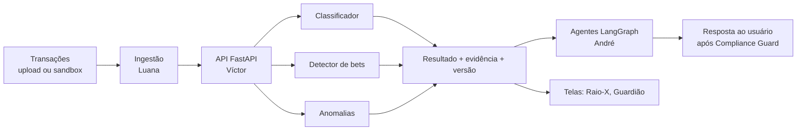

# Modelos auxiliares de ML: conceito, treino e integração

Guia da frente da Mariana (épico #97, branch `dev/mariana`). Explica o que cada modelo faz, por que ele existe, como ele funciona, como treinar e como plugar no sistema, e como usar um agente de IA de programação para acelerar o trabalho sem perder o controle da qualidade.

Os trechos de código são **esqueletos de partida**, não código já existente no repositório. Os nomes de pastas são sugestões, exceto `services/ml/classificador` (citado na #58) e `services/ml/sintetico` (citado na #51).

## 1. Visão geral

Três modelos pequenos e especializados alimentam o resto do produto. Eles não conversam com o usuário: recebem transações e devolvem **resultados estruturados com evidência**. Quem conversa é o sistema multiagente (frente do André), que usa esses resultados como ferramentas.

| Modelo | Responde a | Requisito | Meta (escopo `06`) | Issues |
|---|---|---|---|---|
| Classificador de transações | "Em que categoria está este gasto?" | RF02 | F1 macro ≥ 0,85; recall do Mínimo Existencial ≥ 0,90 | #58, #68 |
| Detector de apostas | "Isto é aposta? Quanto o usuário perdeu de fato?" | RF04 | Recall ≥ 0,95; precision ≥ 0,90 | #59, #69 |
| Detector de anomalias e golpes | "Isto foge do comportamento normal desta pessoa?" | RF11 | Recall ≥ 0,80; FPR ≤ 5% | #78 |

Fechamento: #83 serve e monitora os três; #92 consolida a análise final.



### Princípios que valem para os três

1. **Modelo clássico antes de LLM.** São tarefas tabulares e de texto curto, onde LightGBM e regras são mais baratos, rápidos, reproduzíveis e auditáveis. O LLM só entra nos casos incertos (#68, passo 4).
2. **Sempre devolver a evidência.** "Por que isto é aposta?" e "por que este alerta?" são critérios de aceite (#69 e #78), e é a evidência que o agente transforma em linguagem natural.
3. **Nunca calcular com LLM.** Perda líquida, totais e saldos são funções Python determinísticas (RNF03). O modelo classifica; a conta é código.
4. **Sem dados reais.** Todo treino usa a base sintética (#51), Sparkov, PaySim e ULB. Antes de qualquer texto ir para um LLM externo, o PII é mascarado (RNF01).
5. **Métrica como contrato.** Cada modelo tem um script de avaliação único, que gera `metrics.json`, e a CI compara esse arquivo com os limites do escopo.

## 2. Classificador de transações (RF02)

### Conceito

Dada uma transação (descrição, MCC, valor, horário, forma de pagamento), devolve a categoria e a confiança. Separa o **Mínimo Existencial** (moradia, alimentação, saúde...) do resto, porque a plataforma nunca pode sugerir cortar o essencial.

### Como funciona

- **Features de texto:** TF-IDF por *n-gramas de caracteres* sobre `description_masked`. Funciona bem com descrições sujas (`ATACADAO SUPERMERCADO`, `PAG*LOJA 123`) porque não depende de palavras inteiras.
- **Features numéricas e categóricas:** MCC (one-hot), valor absoluto, sinal (entrada ou saída), hora, dia do mês, forma de pagamento.
- **Modelo:** LightGBM multiclasse. O baseline de regras e regex (#58) existe para provar que o LightGBM melhora de verdade.
- **Confiança:** probabilidade calibrada. Abaixo de um limiar (por exemplo 0,70), a transação vai para o LLM com o PII mascarado, e a resposta do usuário ("reclassificar em 1 toque", RF10) volta como rótulo novo.

### Esqueleto

```python
from lightgbm import LGBMClassifier
from sklearn.calibration import CalibratedClassifierCV
from sklearn.compose import ColumnTransformer
from sklearn.feature_extraction.text import TfidfVectorizer
from sklearn.pipeline import Pipeline
from sklearn.preprocessing import OneHotEncoder

features = ColumnTransformer([
    ("texto", TfidfVectorizer(analyzer="char_wb", ngram_range=(2, 5), min_df=2), "description_masked"),
    ("mcc", OneHotEncoder(handle_unknown="ignore"), ["mcc", "payment_method"]),
    ("num", "passthrough", ["amount_abs", "is_outflow", "hour", "day_of_month"]),
])
base = Pipeline([
    ("features", features),
    ("modelo", LGBMClassifier(n_estimators=400, learning_rate=0.05,
                              class_weight="balanced", random_state=42)),
])
modelo = CalibratedClassifierCV(base, method="sigmoid", cv=3)  # sigmoid: poucos dados
```

No macOS, o LightGBM precisa do OpenMP (`brew install libomp`), senão a importação falha com `libomp.dylib` não encontrado.

### Avaliação

- **F1 macro** (`f1_score(average="macro")`): trata todas as categorias com o mesmo peso, então não deixa a classe grande esconder uma classe pequena e importante.
- **Recall do Mínimo Existencial:** de todas as transações realmente essenciais, quantas o modelo manteve como essenciais. É o erro mais caro, porque um gasto de aluguel tratado como lazer gera um conselho nocivo.
- **Matriz de confusão por persona**, para achar viés (por exemplo, insumo de MEI confundido com compras por impulso).
- Protocolo do escopo: *5-fold stratified CV*. Para o teste final, separe **por pessoa e por tempo** (#51, passo 4), senão o modelo "vê" o futuro.

## 3. Detector de apostas (RF04)

### Conceito

Marca cada transação como aposta ou não, **mostrando a evidência**, e depois calcula a perda líquida real e a concentração de horários (madrugada de 23h às 3h, pós-repasse de até 120 min, escalada). É a base do Guardião de apostas.

### Como funciona

A maior parte é **regra determinística + busca aproximada**, não ML pesado. Isso é intencional: a meta de recall de 0,95 exige previsibilidade, e a SPA/MF publica a lista oficial.

1. **MCC 7995:** forte indício, mas insuficiente. Intermediadores de pagamento escondem o MCC.
2. **CNPJ ou domínio** na lista de operadoras autorizadas (#59), com consulta por CNPJ e por nome.
3. **Busca aproximada** de nomes e marcas com RapidFuzz (`PAGBET*APOSTA`, `BETX 123`...).
4. **Classificador de apoio** só para o que as regras não resolvem (intermediador e descrição ambígua), treinado nas transações da persona `diego_24` e nas variações geradas na #51.
5. **Operadora fora da lista** vira o marcador "não autorizada".

```python
from rapidfuzz import fuzz, process, utils

def detectar_aposta(tx, marcas, cnpjs):
    evidencias = []
    if tx.mcc == "7995":
        evidencias.append({"regra": "mcc_7995"})
    if tx.cnpj and tx.cnpj in cnpjs:
        evidencias.append({"regra": "cnpj_spa", "cnpj": tx.cnpj})
    achado = process.extractOne(tx.descricao_norm, marcas,
                                scorer=fuzz.token_set_ratio,
                                processor=utils.default_process,  # ignora caixa e pontuação
                                score_cutoff=90)
    if achado:
        evidencias.append({"regra": "nome_aproximado", "marca": achado[0], "score": achado[1]})
    return {"is_bet": bool(evidencias), "evidencia": evidencias}
```

```python
# Perda líquida: função pura, sem modelo e sem LLM (RNF03)
def perda_liquida(txs_bet):
    return -sum(t.valor for t in txs_bet)  # saídas negativas, prêmios positivos
```

O RapidFuzz diferencia maiúsculas de minúsculas e não normaliza sozinho: sem o `processor`, `PAG*BETX APOSTA` não casa com `betx`. Normalize também os acentos antes de comparar.

### Avaliação

Recall ≥ 0,95 e precision ≥ 0,90. A prioridade é o **falso negativo** (aposta que passou despercebida), então a análise de erros (#69, passo 5) começa por eles. Teste em CI com casos fabricados: Pix fracionados, aposta logo depois do repasse, horário de madrugada.

## 4. Detector de anomalias e golpes (RF11)

### Conceito

Detecta transações atípicas **para aquela pessoa**: transferência noturna para destinatário novo, valor muito acima do padrão, boleto com beneficiário divergente. Alimenta o Guardião de golpes e os alertas de compra por impulso.

### Como funciona

`IsolationForest` é *não supervisionado*: ele isola pontos raros com cortes aleatórios, e quanto menos cortes são necessários para isolar um ponto, mais anômalo ele é. Não precisa de rótulo para treinar, só para **calibrar e medir**.

- **Features** (#78): hora, valor relativo à mediana da pessoa, recorrência do destinatário, destinatário novo, intervalo desde a última transação.
- **Treino:** só com comportamento normal do histórico.
- **Nota 0 a 1:** o `score_samples` do scikit-learn é negativo, e menor significa mais anômalo. Converte-se para a escala 0–1 pelo percentil em dados normais de validação. O limiar `anomaly_score ≥ 0,80` do escopo vira uma decisão calibrada.
- **FPR ≤ 5% por construção:** escolha o limiar como o percentil 95 do escore dos casos normais da validação e meça o recall em seguida.
- **Explicação legível:** o Isolation Forest não explica sozinho. Gere o motivo comparando cada feature com a linha de base da pessoa ("às 03h12, quando você quase nunca movimenta; destinatário nunca usado antes").

```python
import numpy as np
from sklearn.ensemble import IsolationForest

iso = IsolationForest(n_estimators=300, random_state=42).fit(X_normal_treino)
bruto = lambda X: -iso.score_samples(X)           # maior = mais anômalo
limiar = np.quantile(bruto(X_normal_val), 0.95)   # FPR ~ 5%
alerta = bruto(X_novo) >= limiar
```

### Cuidado com os benchmarks públicos

ULB tem colunas `V1`–`V28` anonimizadas por PCA, então as features de horário e destinatário **não existem** nele. PaySim tem tipo, valor, saldos e passo de tempo, mas não destinatário real. Use os dois para validar a **mecânica** (treino, limiar, FPR e recall) e use os dados sintéticos das personas (`antonio_67`, `mariana_28`) para a meta do produto. Registre essa diferença na análise final (#92).

## 5. Desenvolver, treinar e integrar: o mesmo caminho para os três

### 5.1 Estrutura sugerida

```text
services/ml/
  sintetico/        # gerador de dados (André, #51)
  classificador/    # baseline, treino, avaliação
  apostas/          # lista SPA/MF, detector, perda líquida
  anomalia/         # features, Isolation Forest, explicação
  comum/            # carregamento da base, métricas, contrato de resposta
```

### 5.2 Ciclo de cada modelo

1. **Dados:** carregar a base sintética com um comando (critério da #51) e separar treino, validação e teste por pessoa e por tempo, com semente fixa.
2. **Baseline:** o modelo mais simples possível, para ter uma linha de base registrada.
3. **Modelo:** treinar e comparar com o baseline **na validação**.
4. **Avaliar:** um script único gera `metrics.json` com as métricas do escopo, e o conjunto de teste só é tocado no fim.
5. **Empacotar:** salvar o artefato (`joblib`), o `metrics.json` e um cartão do modelo curto (dados usados, limites conhecidos), sob uma versão.
6. **Integrar:** expor o modelo atrás do contrato da seção 5.3 e subir na API.

### 5.3 Contrato de integração

Todo modelo responde no mesmo formato, o que permite à API e aos agentes tratá-los de maneira uniforme:

```python
from pydantic import BaseModel

class Resultado(BaseModel):
    transacao_id: str
    modelo: str            # "classificador" | "apostas" | "anomalia"
    versao: str            # exigido pela #83 em toda resposta
    saida: dict            # categoria / is_bet / anomaly_score
    confianca: float | None
    evidencia: list[dict]  # regras acionadas ou motivo do alerta
```

Na arquitetura hexagonal da API (#62), o domínio define a **porta** (`ClassificadorDeTransacoes`, `DetectorDeApostas`, `DetectorDeAnomalias`) e o código de `services/ml` é o **adaptador**. Assim o modelo pode ser trocado sem mexer no domínio, e a Mariana e o Víctor trabalham em paralelo contra o mesmo contrato.

### 5.4 Qualidade automática (#83)

- Um `thresholds.yaml` com os limites do escopo, e um teste que lê o `metrics.json` e **reprova a CI** se qualquer métrica cair.
- Registrar a distribuição das previsões (por exemplo, proporção por categoria) para notar *drift*, e a latência (RNF06: p95 ≤ 8 s no texto).
- Os artefatos grandes não vão para o Git comum. Combinem com o André onde guardá-los antes de começar.

## 6. Como os modelos entram no sistema de agentes

O supervisor LangGraph (frente do André) chama os modelos **como ferramentas**, via API:

| Ferramenta do agente | Chama | Uso na conversa |
|---|---|---|
| `classificar_transacoes` | Classificador | "Para onde foi meu dinheiro este mês?" (Raio-X) |
| `detectar_apostas` | Detector de apostas | "Quanto perdi de verdade nas bets?" (Guardião) |
| `detectar_anomalias` | Isolation Forest | "Essa transferência é suspeita?" (Guardião de golpes) |

Regras de integração:

- O agente **recebe o resultado estruturado e o redige**, sem refazer a classificação nem a conta. Os números vêm da saída do modelo, e a evidência permite citar o motivo.
- A resposta final passa pelo **Compliance Guard** (frente do André), como qualquer outra.
- O LLM entra no classificador **apenas** para os casos de baixa confiança e **com PII mascarado**.
- A correção feita pelo usuário (RF10) é gravada como rótulo novo, o que dá o material para um retreino futuro.

## 7. Desenvolver com um agente de IA de programação

Um agente (Claude Code, Copilot, Cursor etc.) acelera muito este trabalho **se** a tarefa estiver definida de forma que o agente consiga verificar o próprio resultado. A regra é: **o script de avaliação é a especificação executável**.

### 7.1 O que delegar e o que decidir

| Delegue ao agente | Decida você |
|---|---|
| Montar o esqueleto de pipeline, a CLI de treino e o script de avaliação | Qual métrica importa e qual limite aceitar |
| Escrever testes (casos de borda de bets, CNPJ com máscara, descrições sujas) | Quais categorias existem e o que é "essencial" |
| Experimentar features e hiperparâmetros **na validação** | Quando o modelo é bom o bastante para virar versão |
| Gerar a explicação do alerta e os testes do contrato | Revisão final do que vai para um PR |
| Refatorar e documentar | Qualquer decisão que envolva dado pessoal |

### 7.2 Fluxo recomendado

1. **Dê a issue como especificação.** Cole o contexto, o passo a passo e o critério de aceite da issue, e peça um plano antes do código.
2. **Peça o teste primeiro.** O critério de aceite ("recall ≥ 0,95") vira um teste que falha. Só então o agente implementa.
3. **Ciclos curtos com métrica.** "Rode `avaliar` na validação, proponha uma mudança de feature, rode de novo, compare." Cada ciclo registra a linha em um log de experimentos (data, mudança, métrica).
4. **Trave o conjunto de teste.** Diga explicitamente ao agente que **não pode** ler nem ajustar o teste. Se ele otimizar contra o teste, a métrica final é falsa.
5. **Revise o diff.** Leia o código que o agente escreveu antes do PR, principalmente funções de métrica e vazamento de dados (por exemplo, uma feature criada com informação do futuro).
6. **Abra o PR para `develop`**, cite a issue e peça revisão de alguém do grupo.

### 7.3 Modelo de pedido

```text
Contexto: issue #69 (detector de apostas). Leia a issue, docs/escopo/06-metricas-e-validacoes.md
e docs/evidencias/datasets/README.md.
Objetivo: implementar services/ml/apostas conforme o contrato Resultado.
Restrições: sem dados reais; semente fixa; não leia nem ajuste a partição de teste;
perda líquida em função Python pura; toda detecção devolve a evidência.
Primeiro: proponha o plano e escreva os testes que falham (Pix fracionado,
aposta pós-repasse em até 120 min, madrugada 23h-03h).
Depois: implemente, rode o script de avaliação na validação e mostre o
metrics.json antes e depois.
```

### 7.4 Armadilhas comuns

- **Métrica inflada por dado sintético.** Se o gerador (#51) usa as mesmas regras que o modelo aprende, o resultado parece ótimo e não vale nada. Cheque com Sparkov, com ruído nos rótulos e com personas que ficaram fora do treino.
- **Vazamento temporal ou entre pessoas.** O mesmo usuário no treino e no teste, ou meses futuros nas features. Separe por pessoa e por tempo.
- **Mexer no limiar até a meta bater.** Calibre na validação, congele e só então meça no teste.
- **Dados e segredos no prompt.** Não cole dados reais, chaves ou tokens em ferramentas de IA, e mantenha o PII mascarado.
- **Confiar no "está pronto" do agente.** Pronto é o `metrics.json` aprovado pela CI.

## 8. Cronograma

| Semana | Issue | Entrega |
|---|---|---|
| S3 | #58 | Exploração, categorias e baseline de regras |
| S3 | #59 | Lista da SPA/MF versionada e consultável |
| S4 | #68 | LightGBM do classificador, com relatório contra o baseline |
| S4 | #69 | Detector de apostas com evidência |
| S5 | #78 | Isolation Forest com motivo de cada alerta |
| S6 | #83 | Serviço, versionamento, CI com limites bloqueantes e monitoramento |
| S7 | #92 | Análise final, vieses por persona e limitações |

Dependência de entrada: **#51** (dados sintéticos, André) destrava a #58, a #69 e a #78. A #83 depende também da API (#62, Víctor).

## 9. Pontos em aberto

1. **Número de categorias.** O escopo e a #58 falam em 8 categorias, mas o CSV de exemplo usa 10 (`RENDA`, `MORADIA`, `ALIMENTACAO`, `DIVIDA_JUROS`, `APOSTAS_BETS`, `FRAUDE_SUSPEITA`, `INVESTIMENTO`, `TRANSPORTE`, `COMPRAS_IMPULSO`, `SAUDE`) e o RF02 cita ainda "Insumo MEI". Fechar a lista na #58 e alinhar com o gerador da #51.
2. **Definição de Mínimo Existencial** para a métrica de recall: quais categorias contam como essenciais.
3. **Onde guardar os artefatos** dos modelos.
4. **Como o limiar de confiança do classificador** (envio ao LLM) é escolhido: custo do LLM contra a taxa de erro aceitável.
