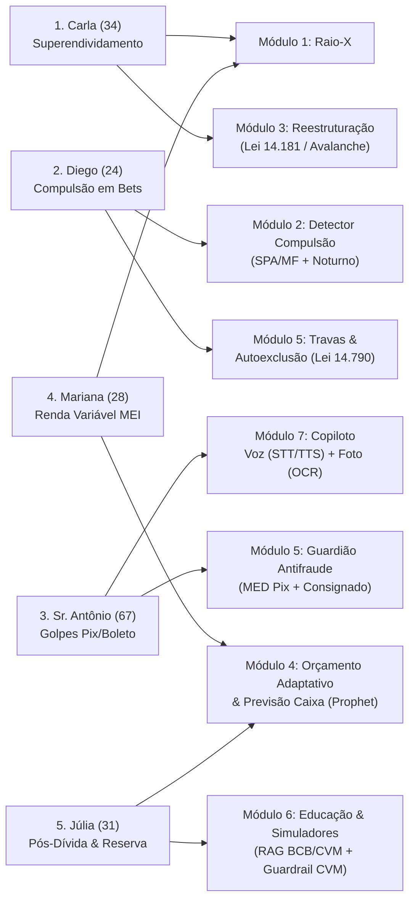

# 👥 Personas e Jornadas de Uso — PANDORA

Este diretório documenta em profundidade as **5 personas exclusivas** do projeto **PANDORA**. Cada persona foi construída com base nas notícias, levantamentos estatísticos, datasets e artigos científicos reunidos em [`docs/evidencias/`](../evidencias/README.md).

> [!NOTE]
> **Por que 5 personas exclusivas?**
> O problema financeiro no Brasil não é homogêneo: o superendividamento por custo de vida básico exige intervenção jurídica e cálculo de mínimo existencial; o vício em apostas (*bets*) exige detecção temporal e fricção comportamental; golpes contra idosos exigem interface por voz/imagem e protocolo de devolução; a desorganização de trabalhadores autônomos exige previsão de fluxo de caixa; e o pós-dívida exige educação financeira protegida por guardrails da CVM.

---

## 🧭 Índice de Navegação Rápida (Fichas Individuais)

| # | Persona | Arquétipo Central | Renda e Regime | Ficha Completa |
|---|---|---|---|---|
| **01** | **Carla Mendes (34 anos)** | Superendividamento Estrutural Familiar | R$ 2.850/mês (CLT · Fixa) | [📄 Ver ficha da Carla](01-carla-superendividamento.md) |
| **02** | **Diego Oliveira (24 anos)** | Compulsão em Apostas Online (*Bets*) | ~R$ 1.120/sem (App · Variável) | [📄 Ver ficha do Diego](02-diego-compulsao-bets.md) |
| **03** | **Sr. Antônio Ferreira (67 anos)** | Vulnerabilidade a Golpes e Consignado | R$ 2.412/mês (INSS · Fixa) | [📄 Ver ficha do Sr. Antônio](03-antonio-golpes-e-consignado.md) |
| **04** | **Mariana Costa (28 anos)** | Compras por Impulso (*BNPL*) e 4 Cartões | R$ 3.200–5.800/mês (MEI · Volátil) | [📄 Ver ficha da Mariana](04-mariana-impulso-e-cartoes.md) |
| **05** | **Júlia Santos (31 anos)** | Reconstrução Pós-Dívida e Reserva Segura | R$ 4.500/mês (CLT · Fixa) | [📄 Ver ficha da Júlia](05-julia-reconstrucao-e-reserva.md) |

---

## 📊 Comparativo Geral: Dores, Canais e Evidências

### 1. Perfil, Gatilho da Crise e Dor Principal

| Persona | Contexto Familiar e Profissional | Gatilho Principal da Crise | Dor Principal ("Voz do Usuário") |
|---|---|---|---|
| **1. Carla (34)** | Atendente de farmácia, mãe solo de 2 filhos (6 e 9 anos). | Paga o mínimo do cartão (rotativo a **435,9% a.a.**) + empréstimo pessoal para cobrir despesas básicas. | *"Se eu pagar o banco todo, falta dinheiro para o mercado das crianças."* |
| **2. Diego (24)** | Entregador de app (moto), solteiro, mora com os pais. | Aposta após receber o repasse semanal e entra em *chasing losses* de madrugada (23h–03h). | *"Perdi o dinheiro da parcela da moto tentando recuperar o que perdi ontem à noite."* |
| **3. Sr. Antônio (67)** | Aposentado pelo INSS, viúvo, mora sozinho no interior. | Engenharia social (falsa central + boleto falso de R$ 1.198) somada a 30% do benefício em consignado. | *"Tenho vergonha de contar pro meu filho que caí num golpe e medo de mexer no celular."* |
| **4. Mariana (28)** | Designer gráfica *freelancer* (MEI), divide aluguel. | Ansiedade de trabalho → compras noturnas parceladas em 4 cartões e pagamento de fatura com outro cartão. | *"Cada parcela parecia só R$ 50, mas juntas já comeram o dinheiro do mês que vem."* |
| **5. Júlia (31)** | Analista administrativa CLT, quitou dívidas há 3 meses. | Medo de voltar ao vermelho + bombardeio de *finfluencers* prometendo ganhos irreais. | *"Tenho medo de tirar da poupança e perder tudo, ou de cair em conversa de influenciador."* |

---

### 2. Mapeamento no Sistema: Como Cada Persona Usa o PANDORA

| Persona | Canal Primário de Entrada | Módulos e Agentes Acionados | Base Legal e Científica Aplicada |
|---|---|---|---|
| **1. Carla (34)** | Upload de PDFs de faturas + Chat em texto | **Raio-X** (`Analista de Dados`) + **Reestruturação** (`Estrategista de Dívidas`) | Lei 14.181/2021 (Mínimo Existencial), Lei 14.690/2023 (Teto Rotativo), CPC art. 833, Prawitz (2006) |
| **2. Diego (24)** | Open Finance (Sandbox) + Notificações proativas | **Detector de Compulsão** (`Coach Comportamental`) + **Proteção** (`Guardião`) | Estudo Especial BCB nº 119/2024, CID-11 `6C50`, Lei 14.790/2023 (*Bets*), Thaler & Sunstein (2008) |
| **3. Sr. Antônio (67)** | **Voz (STT/TTS)** + **Foto de Boleto / Print** | **Copiloto Multimodal** (`Agente Multimodal`) + **Antifraude** (`Guardião`) | Datafolha/FBSP (2025), Res. BCB 147/2021 (MED Pix), Lei 8.009/90 (Bem de Família) |
| **4. Mariana (28)** | Open Finance multi-banco (4 contas) + Dashboard | **Raio-X Multi-banco** + **Orçamento & Previsão** (`Planejador de Orçamento`) | CNC/Peic (85,3% cartão), Modelos `Isolation Forest` (impulso) e `Prophet/ETS` (fluxo 30/60/90d) |
| **5. Júlia (31)** | Chat em texto + Simuladores + Trilha RAG | **Orçamento** + **Educação** (`Educador RAG` + `Compliance Guard CVM`) | Serasa (42% reincidência), CFPB (2017), Lusardi & Mitchell (2014), Res. CVM 19, 20 e 30/2021 |

---

## 🔗 Diagrama de Cobertura do Sistema pelas 5 Personas

