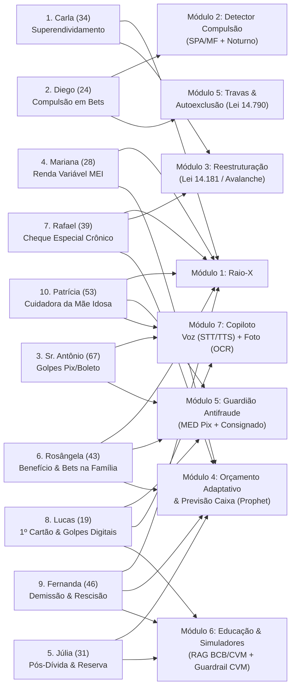

# 👥 Personas e Jornadas de Uso — PANDORA

Este diretório documenta em profundidade as **10 personas exclusivas** do projeto **PANDORA**. Cada persona foi construída com base nas notícias, levantamentos estatísticos, datasets e artigos científicos reunidos em [`docs/evidencias/`](../evidencias/README.md).

> [!NOTE]
> **Por que 10 personas exclusivas?**
> O problema financeiro no Brasil não é homogêneo: o superendividamento por custo de vida básico exige intervenção jurídica e cálculo de mínimo existencial; o vício em apostas (*bets*) exige detecção temporal e fricção comportamental; golpes contra idosos exigem interface por voz/imagem e protocolo de devolução; a desorganização de trabalhadores autônomos exige previsão de fluxo de caixa; e o pós-dívida exige educação financeira protegida por guardrails da CVM.
>
> As personas 06 a 10 ampliam a cobertura para situações que não cabem nas cinco primeiras: o dano das *bets* sobre quem **não aposta** (família no Bolsa Família), o cheque especial crônico de quem nunca atrasa uma parcela, o jovem que entra no crédito e nos golpes digitais ao mesmo tempo, o choque de renda por demissão e o cuidador que administra o dinheiro de uma pessoa idosa.

---

## 🧭 Índice de Navegação Rápida (Fichas Individuais)

| # | Persona | Arquétipo Central | Renda e Regime | Ficha Completa |
|---|---|---|---|---|
| **01** | **Carla Mendes (34 anos)** | Superendividamento Estrutural Familiar | R$ 2.850/mês (CLT · Fixa) | [📄 Ver ficha da Carla](01-carla-superendividamento.md) |
| **02** | **Diego Oliveira (24 anos)** | Compulsão em Apostas Online (*Bets*) | ~R$ 1.120/sem (App · Variável) | [📄 Ver ficha do Diego](02-diego-compulsao-bets.md) |
| **03** | **Sr. Antônio Ferreira (67 anos)** | Vulnerabilidade a Golpes e Consignado | R$ 2.412/mês (INSS · Fixa) | [📄 Ver ficha do Sr. Antônio](03-antonio-golpes-e-consignado.md) |
| **04** | **Mariana Costa (28 anos)** | Compras por Impulso (*BNPL*) e 4 Cartões | R$ 3.200–5.800/mês (MEI · Volátil) | [📄 Ver ficha da Mariana](04-mariana-impulso-e-cartoes.md) |
| **05** | **Júlia Santos (31 anos)** | Reconstrução Pós-Dívida e Reserva Segura | R$ 4.500/mês (CLT · Fixa) | [📄 Ver ficha da Júlia](05-julia-reconstrucao-e-reserva.md) |
| **06** | **Rosângela Souza (43 anos)** | Proteção do Benefício Social e *Bets* na Família | R$ 1.560/mês (Diárias + Bolsa Família) | [📄 Ver ficha da Rosângela](06-rosangela-beneficio-e-bets-na-familia.md) |
| **07** | **Rafael Martins (39 anos)** | Cheque Especial Crônico e Troca de Dívida | R$ 5.200/mês (Servidor · Fixa) | [📄 Ver ficha do Rafael](07-rafael-cheque-especial-cronico.md) |
| **08** | **Lucas Andrade (19 anos)** | Primeiro Cartão e Golpes em Compras Digitais | R$ 1.400/mês (Estágio · Fixa) | [📄 Ver ficha do Lucas](08-lucas-primeiro-cartao-e-golpes-digitais.md) |
| **09** | **Fernanda Rocha (46 anos)** | Choque de Renda por Demissão e Rescisão | ~R$ 2.500/mês (Seguro-desemprego · Temporária) | [📄 Ver ficha da Fernanda](09-fernanda-demissao-e-rescisao.md) |
| **10** | **Patrícia Nogueira (53 anos)** | Cuidadora: Finanças Delegadas da Mãe Idosa | R$ 3.900–4.800/mês (CLT + Plantões) | [📄 Ver ficha da Patrícia](10-patricia-cuidadora-e-financas-da-mae.md) |

---

## 📊 Comparativo Geral: Dores, Canais e Evidências

### 1. Perfil, Gatilho da Crise e Dor Principal

| Persona | Contexto Familiar e Profissional | Gatilho Principal da Crise | Dor Principal ("Voz do Usuário") |
|---|---|---|---|
| **1. Carla (34)** | Atendente de farmácia, mãe solo de 2 filhos (6 e 9 anos). | Paga o mínimo do cartão (rotativo a **435,9% a.a.**) + empréstimo pessoal para cobrir despesas básicas. | *"Se eu pagar o banco todo, falta dinheiro para o mercado das crianças."* |
| **2. Diego (24)** | Entregador de app (moto), solteiro, mora com os pais. | Aposta após receber o repasse semanal e entra em *chasing losses* de madrugada (23h–03h). | *"Perdi o dinheiro da parcela da moto tentando recuperar o que perdi ontem à noite."* |
| **3. Sr. Antônio (67)** | Aposentado pelo INSS, viúvo, mora sozinho no interior. | Engenharia social (falsa central + boleto falso de R$ 1.198) somada a 30% do benefício em consignado. | *"Tenho vergonha de contar pro meu filho que caí num golpe e medo de mexer no celular."* |
| **4. Mariana (28)** | Designer gráfica *freelancer* (MEI), divide aluguel. | Ansiedade de trabalho → compras noturnas parceladas em 4 cartões e pagamento de fatura com outro cartão. | *"Cada parcela parecia só R$ 50, mas juntas já comeram o dinheiro do mês que vem."* |
| **5. Júlia (31)** | Analista administrativa CLT, quitou dívidas há 3 meses. | Medo de voltar ao vermelho + bombardeio de *finfluencers* prometendo ganhos irreais. | *"Tenho medo de tirar da poupança e perder tudo, ou de cair em conversa de influenciador."* |
| **6. Rosângela (43)** | Diarista informal, separada, 3 filhos (8, 14 e 19 anos), beneficiária do Bolsa Família. | Filho de 19 anos aposta com a senha do app dela (R$ 1.100 em 60 dias) + empréstimo com agiota a 20% a.m. | *"O dinheiro do Bolsa Família sumia da conta e eu achava que era tarifa do banco."* |
| **7. Rafael (39)** | Professor da rede estadual, casado, 1 filha (4 anos). | Cheque especial 24 de 30 dias por mês (7,9% a.m.) + empréstimo pessoal contratado para "zerar" o cheque especial. | *"Eu ensino juros compostos e vivo no cheque especial."* |
| **8. Lucas (19)** | Estudante de ADS e estagiário, mora com os pais. | Primeiro cartão (fatura de R$ 1.050 com limite de R$ 1.200) + golpe de loja falsa no Instagram (R$ 389 via Pix). | *"Paguei no Pix, a loja sumiu e a fatura chegou maior que meu estágio."* |
| **9. Fernanda (46)** | Ex-supervisora administrativa, divorciada, filho universitário. | Demissão após 12 anos; FGTS bloqueado pelo saque-aniversário e pressão para "investir" a rescisão. | *"Todo mundo tem uma ideia do que eu devia fazer com o dinheiro. Eu só tenho medo de ele acabar."* |
| **10. Patrícia (53)** | Técnica de enfermagem, mora com a mãe (81, Alzheimer inicial) e a filha (17). | Descontos não autorizados no benefício da mãe + custos de cuidado no próprio cartão (parcelado a 8% a.m.). | *"Descobri um desconto no benefício da minha mãe que ninguém pediu, e meu cartão está pagando os remédios."* |

---

### 2. Mapeamento no Sistema: Como Cada Persona Usa o PANDORA

| Persona | Canal Primário de Entrada | Módulos e Agentes Acionados | Base Legal e Científica Aplicada |
|---|---|---|---|
| **1. Carla (34)** | Upload de PDFs de faturas + Chat em texto | **Raio-X** (`Analista de Dados`) + **Reestruturação** (`Estrategista de Dívidas`) | Lei 14.181/2021 (Mínimo Existencial), Lei 14.690/2023 (Teto Rotativo), CPC art. 833, Prawitz (2006) |
| **2. Diego (24)** | Open Finance (Sandbox) + Notificações proativas | **Detector de Compulsão** (`Coach Comportamental`) + **Proteção** (`Guardião`) | Estudo Especial BCB nº 119/2024, CID-11 `6C50`, Lei 14.790/2023 (*Bets*), Thaler & Sunstein (2008) |
| **3. Sr. Antônio (67)** | **Voz (STT/TTS)** + **Foto de Boleto / Print** | **Copiloto Multimodal** (`Agente Multimodal`) + **Antifraude** (`Guardião`) | Datafolha/FBSP (2025), Res. BCB 147/2021 (MED Pix), Lei 8.009/90 (Bem de Família) |
| **4. Mariana (28)** | Open Finance multi-banco (4 contas) + Dashboard | **Raio-X Multi-banco** + **Orçamento & Previsão** (`Planejador de Orçamento`) | CNC/Peic (85,3% cartão), Modelos `Isolation Forest` (impulso) e `Prophet/ETS` (fluxo 30/60/90d) |
| **5. Júlia (31)** | Chat em texto + Simuladores + Trilha RAG | **Orçamento** + **Educação** (`Educador RAG` + `Compliance Guard CVM`) | Serasa (42% reincidência), CFPB (2017), Lusardi & Mitchell (2014), Res. CVM 19, 20 e 30/2021 |
| **6. Rosângela (43)** | **Áudio** + Print do extrato (modo leve) | **Raio-X** + **Proteção do Benefício** (`Guardião`) + **Orçamento em Envelopes** (`Planejador`) | Estudo Especial BCB nº 119/2024 (Bolsa Família), Lei 14.790/2023, Lei 1.521/1951 (agiotagem), Lei 14.181/2021 |
| **7. Rafael (39)** | Open Finance (2 bancos) + Dashboard + Simuladores | **Raio-X** + **Reestruturação** (`Estrategista de Dívidas`) + **Previsão de Saldo** (`Planejador`) | Séries SGS `25463` e `25464`, Res. CMN 4.765/2019 (teto cheque especial), Res. CMN 4.292/2013 (portabilidade) |
| **8. Lucas (19)** | Chat + Compartilhar link/print (Instagram, WhatsApp) | **Antifraude** (`Guardião`) + **Copiloto Multimodal** + **Educação *Just-in-Time*** (`Educador`) | Datafolha/FBSP (2025, jovens e compras digitais), Res. BCB 147/2021 (MED), CDC art. 49, Lei 14.690/2023 |
| **9. Fernanda (46)** | Upload de documentos (TRCT, FGTS) + Chat + Simuladores | **Raio-X Documental** + **Previsão de Fôlego** (`Planejador`) + **Educação** (`Compliance Guard CVM`) | CFPB (2017, absorção de choque), Lei 12.506/2011, Leis 8.036/1990 e 13.932/2019 (FGTS), Lei 9.656/1998 art. 30 |
| **10. Patrícia (53)** | **Painel do Cuidador** (acesso delegado) + Voz para a mãe | **Raio-X do Benefício** + **Antifraude** (`Guardião`) + **Orçamento do Cuidado** (`Planejador`) | Datafolha/FBSP (idosos), Estatuto da Pessoa Idosa (Lei 10.741/2003), CC art. 1.783-A, LGPD (consentimento) |

---

## 🔗 Diagrama de Cobertura do Sistema pelas 10 Personas

